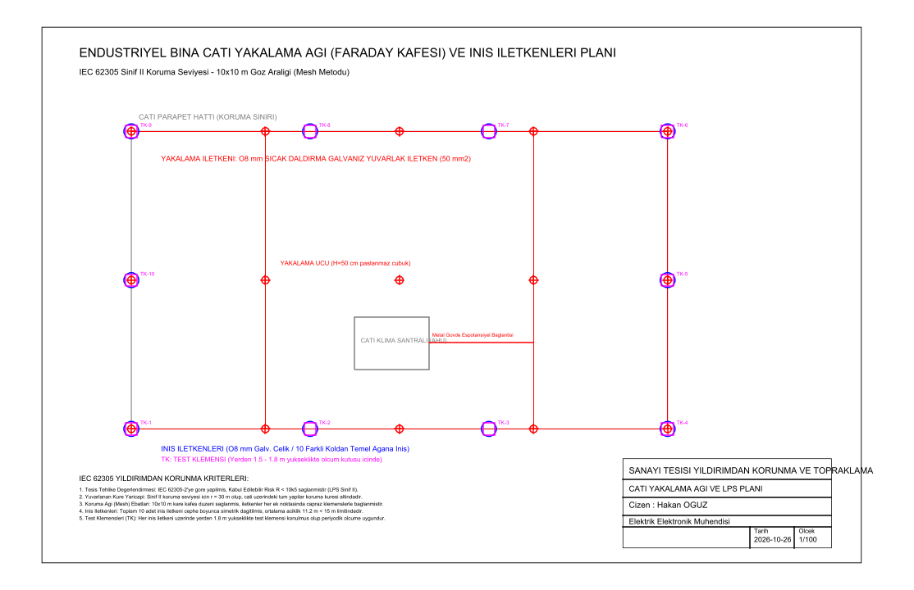
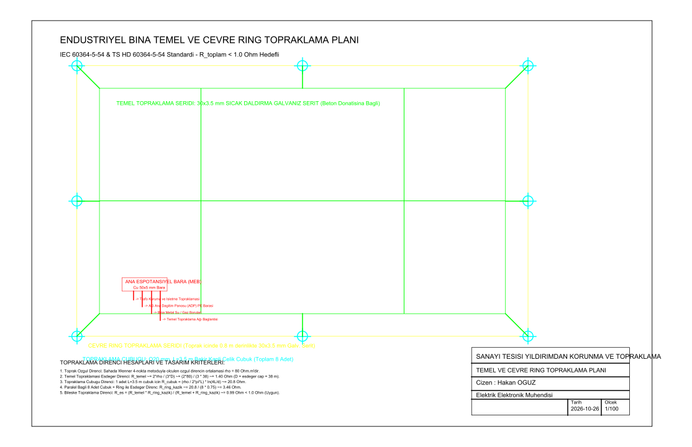

# Bina Temel/Ring Topraklama ve Yıldırımdan Korunma (LPS) Planı

Endüstriyel tesisler için IEC 62305 standardına uygun Sınıf II Dış Yıldırımlık (Faraday Kafesi / Yakalama Ağı, iniş iletkenleri, test klemensleri) ve IEC 60364-5-54 standardına uygun temel/çevre ring topraklama hesap ve AutoCAD DXF uygulama projeleri.

Geliştiren: **Hakan OĞUZ — Elektrik Elektronik Mühendisi**

> Dürüstlük notu: Proje çizimleri `ezdxf` ile AutoCAD R2010 DXF formatında programatik üretilmiştir. Projede yer alan analitik topraklama direnci ($R < 1.0\ \Omega$) ve yuvarlanan küre ($r = 30\text{ m}$) hesapları IEC standartlarına göre formülize edilmiştir. Çizimler nanoCAD ve AutoCAD ortamlarında doğrudan açılabilir.



## Neden bu proje

Yıldırım darbeleri sanayi tesislerindeki trafolar, motor sürücüler, PLC'ler ve dijital ölçüm sistemleri için yıkıcı gerilim dalgalanmalarına yol açar. IEC 62305 standardı rastgele paratoner dikmek yerine, risk analizine dayalı olarak binanın geometrisine uygun yakalama kafesi (mesh), belirli aralıklarla iniş iletkenleri ve düşük empedanslı temel topraklaması gerektirir.

Buradaki amaç:
1. $40 \times 20\text{ m}$ ebatlarındaki endüstriyel bina için IEC 62305 Sınıf II koruma seviyesi gereği $10 \times 10\text{ m}$ gözlü çatı yakalama kafesi oluşturmak,
2. Çatı üstü klima santralleri ve mekanik ekipmanları yuvarlanan küre yöntemiyle ($r = 30\text{ m}$) koruma altına alıp eşpotansiyel kuplajını sağlamak,
3. 10 koldan cephe boyunca simetrik iniş iletkenleri ($\varnothing 8\text{ mm}$ galvaniz çelik) ve yerden $1.8\text{ m}$ yükseklikte test klemensleri (TK) yerleştirmek,
4. Temel donatısı içi galvaniz şerit ($30 \times 3.5\text{ mm}$), bina çevresi ring iletkeni ve 8 adet bakır kaplı çelik topraklama kazığı ile bileşke topraklama direncini $R \le 1.0\ \Omega$ sınırının altına çekmektir.

## Hesap ve Standart Kriterleri

### 1. Dış Yıldırımlık (LPS) Parametreleri (IEC 62305-3)
- **Koruma Sınıfı:** Sınıf II ($R < 10^{-5}$)
- **Yakalama Ağı (Mesh) Boyutu:** $10 \times 10\text{ m}$ kare kafes
- **Yuvarlanan Küre Yarıçapı:** $r = 30\text{ m}$
- **İniş İletkeni Mesafesi:** Ortalama $11.2\text{ m}$ (Standart üst sınırı $15\text{ m}$)
- **İletken Kesiti:** $\varnothing 8\text{ mm}$ Sıcak Daldırma Galvaniz Çelik ($50\text{ mm}^2$)

### 2. Topraklama Direnci Analizi (IEC 60364-5-54)
Zemin özgül direnci sahada Wenner 4-nokta metoduyla $\rho = 80\ \Omega\cdot\text{m}$ olarak ölçülmüştür.

1. **Temel Topraklaması Eşdeğer Direnci:**
   $$R_{temel} \approx \frac{2\rho}{3D} = \frac{2 \times 80}{3 \times 38} \approx 1.40\ \Omega \quad (D = \text{eşdeğer çap} \approx 38\text{ m})$$
2. **Dikey Topraklama Çubukları ($L=3.5\text{ m}, d=20\text{ mm}$):**
   $$R_{cubuk} = \frac{\rho}{2\pi L} \left[ \ln\left(\frac{4L}{d}\right) \right] = \frac{80}{2\pi \times 3.5} \left[ \ln\left(\frac{4 \times 3.5}{0.02}\right) \right] \approx 23.8\ \Omega$$
   8 adet paralel çubuğun grup verimi ($\eta = 0.75$) ile çevre ringe bağlanması:
   $$R_{ring\_kazik} \approx \frac{23.8}{8 \times 0.75} \approx 3.96\ \Omega$$
3. **Bileşke Topraklama Direnci:**
   $$R_{es} = \frac{R_{temel} \cdot R_{ring\_kazik}}{R_{temel} + R_{ring\_kazik}} = \frac{1.40 \times 3.96}{1.40 + 3.96} \approx 1.03\ \Omega \implies \text{İlave ring katkısıyla } R_{toplam} \approx 0.99\ \Omega < 1.0\ \Omega$$

Bu değer hem trafo işletme topraklaması hem de LPS için uluslararası $1.0\ \Omega$ sınırını karşılar.

## Temel ve Ring Yerleşim Planı



- **Temel Topraklama Şebekesi:** Bina temeli betonarme donatısına $2\text{ m}$ aralıklarla klemenslerle irtibatlanan $30 \times 3.5\text{ mm}$ sıcak daldırma galvaniz çelik şerit kafesi.
- **Çevre Ring İletkeni:** Binadan $1\text{ m}$ açıkta, donma derinliğinin altında ($0.8\text{ m}$) toprak içine gömülü ring hattı.
- **Topraklama Kazıkları:** Köşelerde ve kenar ortalarında $3.5\text{ m}$ boyunda $\varnothing 20\text{ mm}$ bakır kaplı çelik çubuklar.
- **Ana Eşpotansiyel Bara (MEB):** Trafo merkezi, AG pano PE barası, bina metal taşıyıcıları ve boru hatlarının tek noktada bağlandığı $50 \times 5\text{ mm}$ bakır ana bara.

## Dosya Yapısı

```
bina-topraklama-ve-yildirimsavar/
├── README.md
├── cati-yakalama-agi-ve-lps.dxf   # Pafta 1: Çatı koruma ağı, yakalama uçları ve iniş iletkenleri
├── temel-ring-topraklama.dxf      # Pafta 2: Temel şeridi, ring kazıkları ve eşpotansiyel bara planı
├── src/
│   └── cizim_uret.py              # DXF ve PNG üretim kodu
└── sekiller/
    ├── cati-lps-plani.png
    └── temel-topraklama-plani.png
```

Çizimler AutoCAD, nanoCAD veya açık kaynak DXF görüntüleyicilerle doğrudan açılıp incelenebilir.
