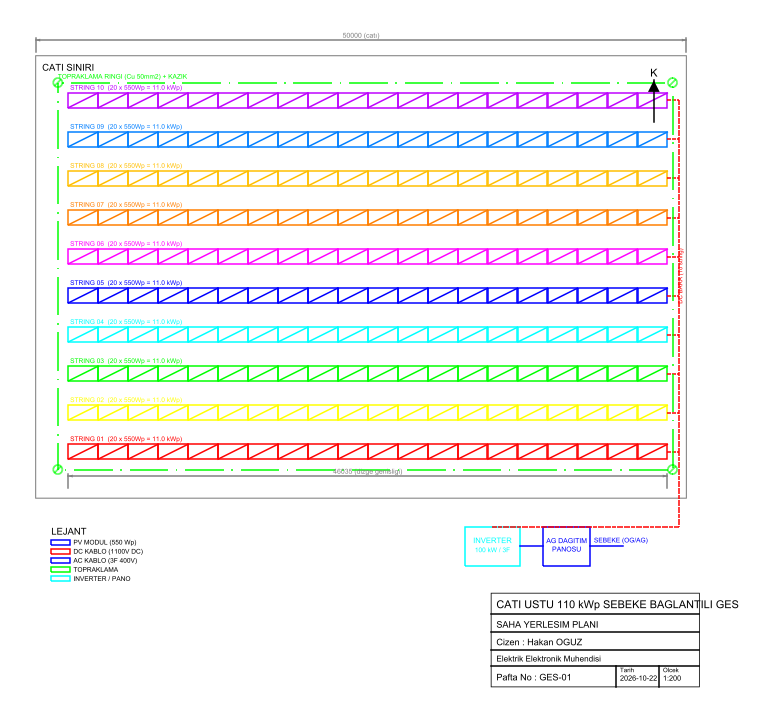
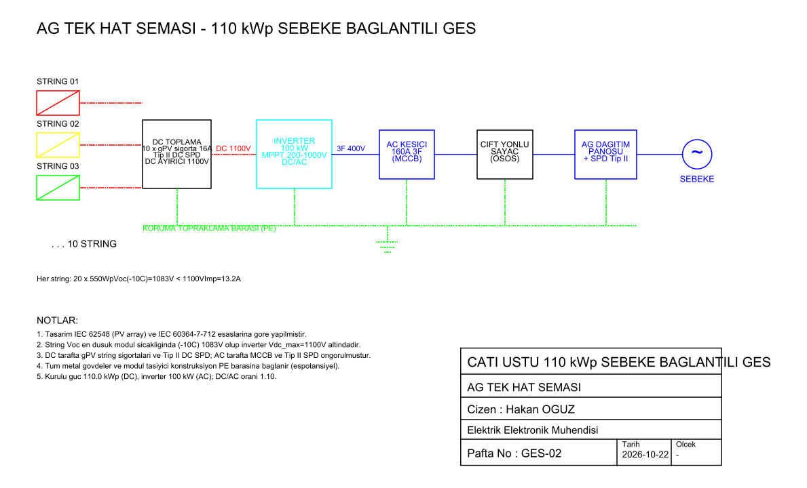

# Çatı Üstü 110 kWp Şebeke Bağlantılı GES — Saha Yerleşimi ve AG Tek Hat Şeması

Bir sanayi yapısının düz çatısına kurulacak **110,0 kWp** gücünde, şebeke bağlantılı
fotovoltaik (PV) santralinin saha yerleşim planı ve alçak gerilim (AG) tek hat şeması.
Çizimler `ezdxf` ile programatik olarak (`.dxf`) üretilir; nanoCAD / AutoCAD / LibreCAD'de açılır.

Çizen: **Hakan OĞUZ — Elektrik Elektronik Mühendisi**



## Amaç ve kapsam

Projede amaç, bir çatı GES'inin **elektriksel tasarımını** (dizge/string boyutlama, inverter
uyumu, koruma ve topraklama) hesaba dayalı biçimde ortaya koymak ve bunu uygulanabilir iki
paftaya dökmektir:

| Pafta | Dosya | İçerik |
|------|-------|--------|
| GES-01 | `ges-saha-yerlesimi.dxf` | Çatı sınırı, 10 string panel yerleşimi, DC bara, inverter + AG pano, topraklama ringi, ölçüler, lejant, antet |
| GES-02 | `ges-tek-hat-semasi.dxf` | String → DC toplama (sigorta/SPD/ayırıcı) → inverter → AC kesici → çift yönlü sayaç → AG pano → şebeke |

## Sistem bileşenleri ve kabuller

**PV modül (monokristal, 550 Wp)**

| Parametre | Değer |
|---|---|
| Nominal güç (STC) | 550 Wp |
| Açık devre gerilimi, V_oc | 49,5 V |
| MPP gerilimi, V_mp | 41,7 V |
| Kısa devre akımı, I_sc | 13,95 A |
| MPP akımı, I_mp | 13,19 A |
| V_oc sıcaklık katsayısı, β | −0,27 %/°C |
| Boyut | 2278 × 1134 mm |

**İnverter:** 100 kW string inverter, MPPT penceresi 200–1000 V, maksimum DC giriş gerilimi
**V_dc,max = 1100 V**, AC çıkış 3 faz 400 V.

**Dizi:** 10 string × 20 modül = **200 modül = 110,0 kWp**.

Tasarım sahası olarak Adana (enlem ≈ 37,0°) alınmıştır; uç sıcaklık kabulleri aşağıdaki
hesaplarda belirtilmiştir.

## Tasarım hesapları

### 1) String başına modül sayısı (gerilim uyumu)

Kritik durum, modüllerin **en soğuk** olduğu andır; V_oc sıcaklıkla ters orantılı arttığı için
string gerilimi en yüksek bu noktada olur. Tasarım minimum hücre sıcaklığı **T_min = −10 °C**:

```
V_oc(T) = V_oc,STC · [1 + β · (T − 25)]
V_oc(−10°C) = 49,5 · [1 + (−0,0027)·(−10 − 25)]
            = 49,5 · (1 + 0,0945) = 54,18 V/modül
```

İnverter giriş sınırı V_dc,max = 1100 V:

```
N_max = 1100 / 54,18 = 20,3  →  N = 20 modül/string
String V_oc(−10°C) = 20 · 54,18 = 1083,6 V  <  1100 V   ✓
```

### 2) MPPT penceresi (yüksek sıcaklıkta alt sınır)

En sıcak çalışmada (hücre ≈ 70 °C) MPP gerilimi düşer. V_mp sıcaklık katsayısı için
β_mp ≈ −0,34 %/°C alınırsa:

```
V_mp(70°C) = 41,7 · [1 + (−0,0034)·(70 − 25)] = 41,7 · 0,847 = 35,3 V/modül
String V_mp(70°C) = 20 · 35,3 = 706 V   >  MPPT alt sınırı 200 V   ✓
String V_mp(25°C) = 20 · 41,7 = 834 V   (MPPT penceresi 200–1000 V içinde)   ✓
```

String çalışma gerilimi tüm sıcaklık aralığında MPPT penceresinde kalır.

### 3) DC/AC oranı

```
P_dc = 200 · 550 = 110 000 Wp = 110,0 kWp
DC/AC = 110,0 / 100 = 1,10
```

1,05–1,25 aralığındaki tipik "inverter yükleme oranı" içinde; ılımlı DC fazlalığı sabah/akşam
ve kış üretimini artırırken öğle kırpılması (clipping) kaybı küçük kalır.

### 4) Sıralar arası mesafe (gölgelenmesiz pitch)

Modül yatay (landscape), panel eğimi β = 15°. Panelin eğim yönündeki boyu 1,134 m:

```
Panel yüksekliği        h = 1,134 · sin15° = 0,293 m
Taban izdüşümü          b = 1,134 · cos15° = 1,095 m
```

Kış gündönümü öğlen güneş yükseklik açısı (enlem 37°):

```
α = 90° − 37° − 23,45° = 29,55°
Gölge uzunluğu          d = h / tan(α) = 0,293 / 0,567 = 0,517 m
Minimum sıra pitch      p_min = b + d = 1,095 + 0,517 = 1,61 m
```

Projede **p = 3,0 m** seçilmiştir: gölgelenme sınırının belirgin üzerinde, ayrıca sıralar
arasında bakım/temizlik yürüyüş yolu bırakır.

### 5) AC tarafı akımı ve koruma

```
I_ac = P / (√3 · U · cosφ) = 100 000 / (1,732 · 400 · 0,98) ≈ 147 A
```

İnverter çıkışına **160 A 3F MCCB**, AG panosunda Tip II SPD öngörülmüştür. DC tarafta her
string için **gPV karakterli 16 A string sigortası** (I_sc·1,25 = 17,4 A'yı taşıyacak, modül
geri akım sınırını aşmayacak biçimde), **Tip II DC SPD** ve **1100 V DC yük ayırıcı** bulunur.

## Topraklama

Dizi çevresine bakır ring topraklama iletkeni (50 mm²) döşenir, köşelerde topraklama kazıkları
ile irtibatlandırılır. Modül çerçeveleri ve taşıyıcı konstrüksiyon koruma iletkeni (PE) ile
eşpotansiyel baraya bağlanır. Yaklaşım IEC 62305 (yıldırımdan korunma) ve IEC 60364-7-712
(PV tesisatları) ile uyumludur.

## DXF katman düzeni

| Katman | Renk | İçerik |
|---|---|---|
| CATI | gri | Çatı sınırı |
| PANELLER / STRING | string renkleri | PV modüller, string etiketleri |
| INVERTER | camgöbeği | İnverter gövdesi |
| DC_KABLO | kırmızı (kesikli) | DC bara ve string hatları |
| AC_KABLO | mavi | AC hatlar, pano, şebeke |
| TOPRAKLAMA | yeşil (noktalı) | Ring + kazıklar + PE bara |
| OLCU | gri | Ölçülendirme |
| YAZI / LEJANT / ANTET | — | Metin, lejant, başlık bloğu |

## Üretim / yeniden oluşturma

```bash
pip install ezdxf matplotlib
python src/ges_ciz.py
```

Script iki `.dxf` paftayı ve `sekiller/` altındaki iki PNG önizlemeyi üretir. Parametreler
(modül, string sayısı, pitch, çatı ölçüsü) `src/ges_ciz.py` başındaki sabitlerden değiştirilebilir.

## Çıktılar

- `ges-saha-yerlesimi.dxf` — GES-01 saha yerleşim planı (antetli)
- `ges-tek-hat-semasi.dxf` — GES-02 AG tek hat şeması (antetli)
- `sekiller/saha-yerlesimi.png`, `sekiller/tek-hat-semasi.png` — önizlemeler
- `makale/makale.pdf` — çıktıları özetleyen kısa akademik makale (İngilizce)



## Sınırlamalar

- Çizimler **ön tasarım/avan proje** düzeyindedir; uygulama projesi için çatı statiği, ayrıntılı
  kablo kesiti/gerilim düşümü hesabı ve yerel dağıtım şirketi (bağlantı anlaşması) gereksinimleri
  ayrıca ele alınmalıdır.
- Üretim (kWh) simülasyonu bu çalışmanın kapsamı dışındadır; odak elektriksel tasarım ve
  yerleşimdir. Sıcaklık katsayıları ve uç sıcaklıklar tipik kabul değerleridir.

---
Lisans: MIT — bkz. depo kökündeki `LICENSE`.
