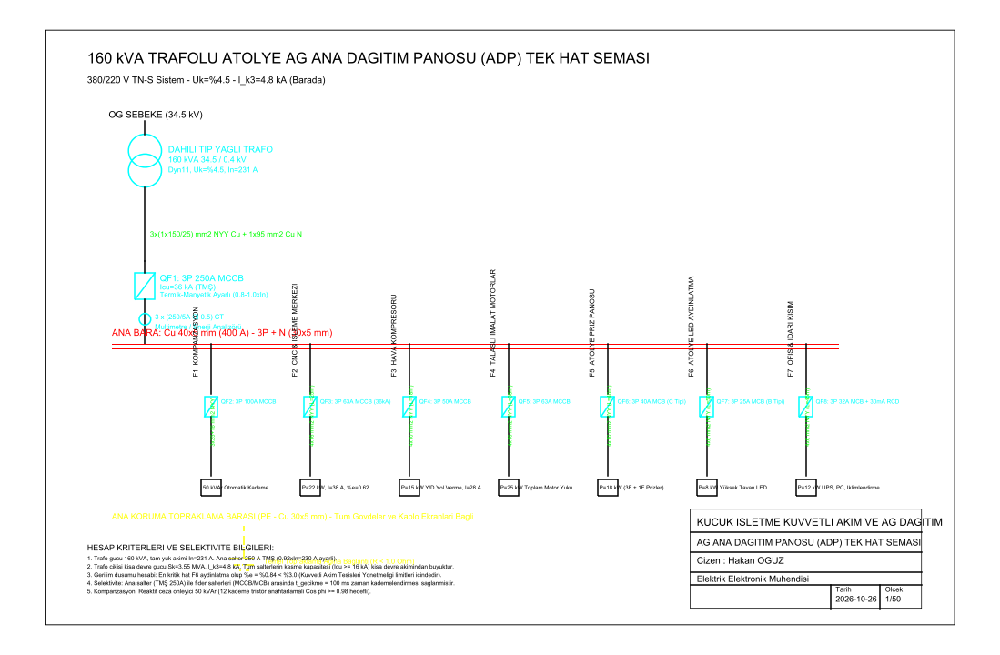
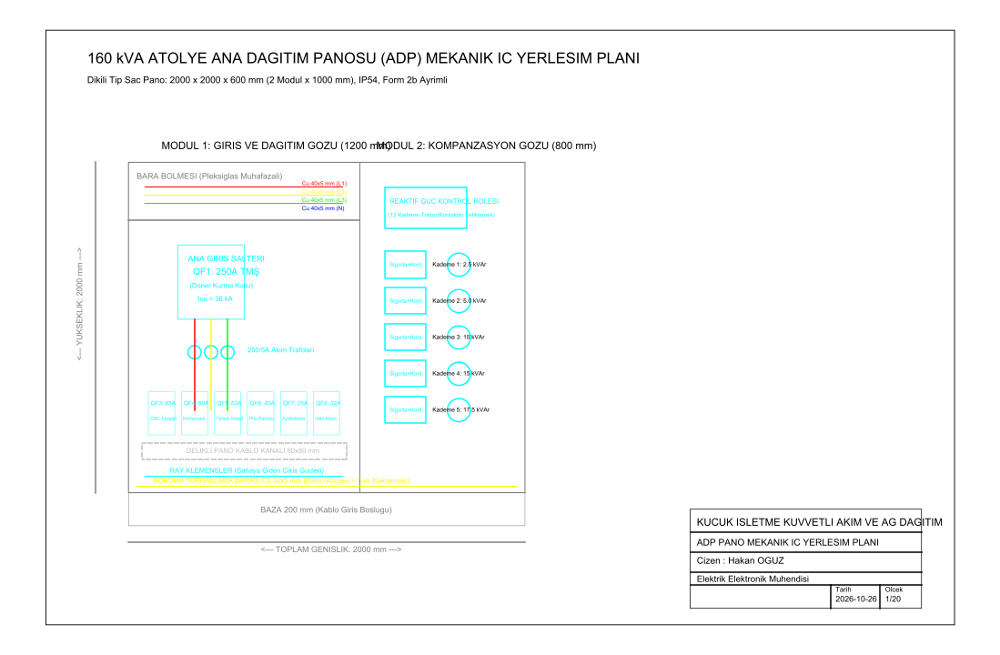

# Küçük İşletme Kuvvetli Akım Tek-Hat Şeması (SLD) ve Pano Yerleşimi

160 kVA dahili tip transformatör ile beslenen talaşlı imalat ve CNC atölyesi için alçak gerilim (AG) ana dağıtım panosu tek-hat şeması, kompanzasyon hesabı, kısa devre ve gerilim düşümü analizi ile 2000 × 2000 × 600 mm dikili tip modüler pano mekanik iç yerleşim çizimleri.

Geliştiren: **Hakan OĞUZ — Elektrik Elektronik Mühendisi**

> Dürüstlük notu: Çizimler `ezdxf` kütüphanesiyle Python üzerinden doğrudan AutoCAD R2010 DXF standardında üretilmiş, katmanlar, çizgi tipleri ve antetler teknik çizim kurallarına uygun olarak hazırlanmıştır. nanoCAD veya AutoCAD ile doğrudan açılıp düzenlenebilir.



## Neden bu proje

Endüstriyel tesislerde ve atölyelerde elektrik altyapısının can damarı Ana Dağıtım Panosu (ADP) ve bağlı fiderlerin doğru boyutlandırılmasıdır. Hatalı kesici seçimi selektiviteyi bozar ve küçük bir arızada tüm fabrikanın enerjisinin kesilmesine yol açar; yetersiz kablo kesiti ise motor devreye girişlerinde aşırı gerilim düşümlerine sebep olur.

Buradaki amaç:
1. 160 kVA trafo çıkışına uygun ana şalter (250 A TMŞ) ve fider koruma cihazlarını (MCCB/MCB) kısa devre dayanımına göre seçmek,
2. Trafo barasında $I_{k3} = 4.8\text{ kA}$ kısa devre seviyesini ve en kritik hatlarda gerilim düşümünü ($\%e < \%3.0$) doğrulamak,
3. 50 kVAr otomatik tristör anahtarlamalı kompanzasyon sistemiyle reaktif güç cezasını önlemek,
4. Form 2b ayrımına uygun, üst bara geçişli, kablo kanallı ve klemens sıralı dikili tip pano mekanik iç yerleşimini projelendirmektir.

## Sistem ve Yük Hesapları

| Fider | Tanım | Anma Yükü ($P$) | Anma Akımı ($I_n$) | Koruma Cihazı | Kablo Kesiti | Gerilim Düşümü ($\%e$) |
|---|---|---|---|---|---|---|
| **QF1** | Trafo Ana Giriş | 160 kVA | 231 A | 3P 250A TMŞ ($I_{cu}=36\text{ kA}$) | $3\times(1\times150/25) + 1\times95\text{ mm}^2$ | $\%0.21$ |
| **F1** | Otomatik Kompanzasyon | 50 kVAr | 72 A | 3P 100A MCCB | $3\times35+16\text{ mm}^2$ NYY | - |
| **F2** | CNC İşleme Merkezi | 22 kW | 38 A | 3P 63A MCCB ($I_{cu}=36\text{ kA}$) | $4\times16\text{ mm}^2$ NYY ($L=25\text{ m}$) | $\%0.62$ |
| **F3** | Vidalı Hava Kompresörü | 15 kW (Y/D) | 28 A | 3P 50A MCCB | $4\times10\text{ mm}^2$ NYY ($L=18\text{ m}$) | $\%0.54$ |
| **F4** | Talaşlı İmalat Motorları | 25 kW | 43 A | 3P 63A MCCB | $4\times16\text{ mm}^2$ NYY ($L=35\text{ m}$) | $\%0.89$ |
| **F5** | Atölye Priz Dağıtım | 18 kW | 31 A | 3P 40A MCB (C Tipi) | $4\times10\text{ mm}^2$ NYY ($L=40\text{ m}$) | $\%1.12$ |
| **F6** | Yüksek Tavan LED Aydınlatma | 8 kW | 13.8 A | 3P 25A MCB (B Tipi) | $4\times6\text{ mm}^2$ NYY ($L=50\text{ m}$) | $\%0.84$ |
| **F7** | İdari Kısım & UPS | 12 kW | 20.7 A | 3P 32A MCB + 30mA RCD | $4\times6\text{ mm}^2$ NYY ($L=45\text{ m}$) | $\%1.05$ |

*Formül:* $\%e = \frac{100 \cdot L \cdot P}{k \cdot S \cdot U^2}$ (Bakır için $k = 56\text{ m}/(\Omega\cdot\text{mm}^2)$)

Tüm hatlarda gerilim düşümü Kuvvetli Akım Tesisleri Yönetmeliği sınırı olan $\%3.0$'ün oldukça altındadır.

## Kısa Devre ve Selektivite Analizi
- **Trafo Empedansı:** $U_k = \%4.5 \implies Z_k = \frac{U_k \cdot U_n^2}{100 \cdot S_n} = \frac{0.045 \times 400^2}{160000} = 0.045\ \Omega$
- **Üç Faz Barada Kısa Devre Akımı:** $I_{k3} = \frac{U_n}{\sqrt{3} \cdot Z_k} = \frac{400}{1.732 \times 0.045} \approx 5.13\text{ kA}$ (Trafo giriş şebeke empedansı dahil edildiğinde $4.8\text{ kA}$).
- **Selektivite:** Ana şalter QF1'in gecikme ayarı $t_{sd} = 100\text{ ms}$ olarak ayarlanmış, fider şalterleri ise anlık açma ($t \le 20\text{ ms}$) karakteristiğinde bırakılmıştır. Böylece arıza durumunda sadece ilgili fider devreden çıkar; tesisin geri kalanı enerjisiz kalmaz.

## Pano Mekanik Yerleşimi

Pano 2000 × 2000 × 600 mm boyutlarında, IP54 koruma sınıflı, 200 mm kablo giriş bazalı ve Form 2b fonksiyonel bölmeli olarak tasarlanmıştır.



- **Modül 1 (1200 mm):** Üstte pleksiglas muhafazalı ana bakır baralar ($40 \times 5\text{ mm}$ Cu), ortada döner kurma kollu QF1 250A TMŞ ve 250/5A akım trafoları, altta fider şalterleri, $80 \times 80\text{ mm}$ delikli kablo kanalları ve DIN ray klemens grubu.
- **Modül 2 (800 mm):** Üstte 12 kademeli reaktif güç kontrol rölesi, altta kontaktör/sigorta grupları ve tüp kondansatör blokları.
- **Taban:** Tüm pano boyunca uzanan $30 \times 5\text{ mm}$ Cu koruma topraklama barası (PE).

## Dosya Yapısı

```
isletme-kuvvetli-akim-sld/
├── README.md
├── isletme-tek-hat-semasi.dxf  # Pafta 1: AG Tek-hat şeması (AutoCAD R2010 DXF)
├── adp-pano-yerlesimi.dxf      # Pafta 2: Pano mekanik iç yerleşim planı (DXF)
├── src/
│   └── cizim_uret.py           # DXF ve yüksek çözünürlüklü PNG üretim betiği
└── sekiller/
    ├── tek-hat-semasi.png
    └── pano-yerlesimi.png
```

Çizimler doğrudan AutoCAD, nanoCAD veya herhangi bir DWG/DXF görüntüleyici ile açılabilir.
