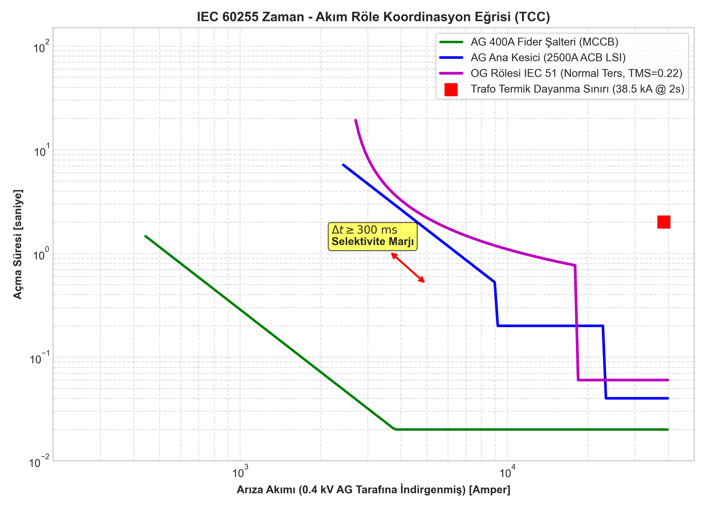
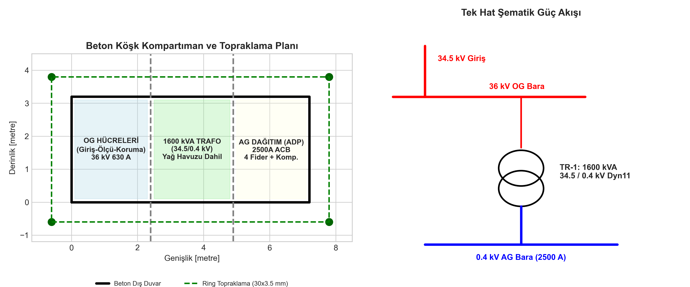

# 34,5 / 0,4 kV Kompakt Trafo Merkezi (Beton Köşk) ve Röle Koordinasyonu

Endüstriyel tesisler, yenilenebilir enerji santralleri ve ticari dağıtım şebekelerinde güvenilir ve kompakt orta gerilim (OG) dağıtımı sağlamak amacıyla monoblok beton köşk tipi trafo merkezleri yaygın olarak kullanılmaktadır. Bu projede, **1600 kVA 34,5 / 0,4 kV** kompakt trafo merkezinin OG tek hat şeması, IEC 60255 standartlarına uygun **zaman-akım röle koordinasyon (TCC) analizi** ve beton köşk mekanik yerleşim/topraklama paftaları hazırlanmıştır.

---

## 1. Sistem Tasarımı ve Ekipman Seçimleri

```
 34.5 kV Şebeke
       |
  +----+----+  Hücre 1: Hat Giriş-Çıkış (36 kV 630 A SF6 Yük Ayırıcısı + Topraklama)
  |         |
  +----+----+
       |
  +----+----+  Hücre 3: Ölçü Hücresi (34.5/V3 : 0.1/V3 kV OG Gerilim Trafoları)
  |         |
  +----+----+
       |
  +----+----+  Hücre 2: Trafo Koruma (36 kV 630 A Vakumlu Kesici + 50/51 - 50N/51N Röle)
  |         |           (Akım Trafosu: 50/5 A, Sınıf: 10P10)
  +----+----+
       |  (1x 3x1x95/16 mm² XLPE Cu)
  +----+----+
  |  TR-1   |  1600 kVA, 34.5 / 0.4 kV, Dyn11, Uk=%6.0, Hermetik Yağlı
  +----+----+
       |  (4x 3x1x240/120 mm² Cu NYY)
  +----+----+
  |   ADP   |  AG Ana Dağıtım Panosu (2500 A ACB + 4 Fider + 300 kVAr Kompanzasyon)
  +---------+
```

### 1.1. Nominal ve Kısa Devre Parametreleri
- **Nominal OG Akımı:** $I_{n,OG} = \frac{S_n}{\sqrt{3} \cdot U_n} = \frac{1600}{\sqrt{3} \cdot 34.5} = 26.78\text{ A}$
- **Nominal AG Akımı:** $I_{n,AG} = \frac{S_n}{\sqrt{3} \cdot U_{n,AG}} = \frac{1600}{\sqrt{3} \cdot 0.4} = 2309.4\text{ A}$
- **Transformatör Kısa Devre Akımı (AG tarafında):**
  $$I_{k3,AG} = \frac{I_{n,AG}}{u_k} = \frac{2309.4}{0.06} \approx 38.49\text{ kA}$$
- **Kısa Devre Akımı (OG tarafına indirgenmiş):**
  $$I_{k3,OG} = \frac{26.78}{0.06} \approx 446.3\text{ A}$$

---

## 2. IEC 60255 Koruma ve Selektivite Koordinasyonu

OG koruma rölesi ile AG ana kesici (ACB) ve fider kompakt şalterleri (MCCB) arasında tam selektivite sağlamak amacıyla zaman-akım karakteristikleri (TCC) modellenmiştir:

### 2.1. OG Aşırı Akım Rölesi (ANSI 51 - IEC Normal Ters / Standard Inverse)
Açma süresi denklemi:

$$t = \left( \frac{0.14}{\left(\frac{I}{I_s}\right)^{0.02} - 1} \right) \cdot TMS$$

- Akım Ayarı: $I_s = 1.3 \cdot I_{n,OG} = 1.3 \cdot 26.78\text{ A} = 35\text{ A}$ (AG tarafına indirgenmiş değeri $\approx 3000\text{ A}$).
- Zaman Çarpanı: $TMS = 0.22$.
- Ani Aşırı Akım (ANSI 50): $I_{>>} = 8 \cdot I_{n,OG} = 215\text{ A}$, Açma Süresi: $t_{inst} = 50\text{ ms}$.

### 2.2. AG Ana Kesici (2500 A ACB - LSI Karakteristik)
- Uzun Zaman Gecikmeli Termik Koruma ($L$): $I_r = 1.0 \cdot I_n = 2300\text{ A}$, $t_r = 12\text{ s} @ 6 I_r$.
- Kısa Zaman Gecikmeli Manyetik Koruma ($S$): $I_{sd} = 4 \cdot I_r = 9200\text{ A}$, $t_{sd} = 0.2\text{ s}$.
- Ani Koruma ($I$): $I_i = 10 \cdot I_r = 23000\text{ A}$, $t_i = 0.04\text{ s}$.

### 2.3. Selektivite Marjı
Arıza anında önce fiderin, fider açmazsa AG ana şalterin, en son aşamada OG kesicisinin açmasını garanti eden kademeleme süresi marjı:

$$\Delta t = t_{OG} - t_{AG} \ge 300\text{ ms}$$

TCC hesaplamaları `kompakt-trafo-tek-hat-ve-koruma.dwg` paftasında logaritmik eksenler üzerinde çizilmiştir.



---

## 3. Beton Köşk Yerleşimi ve Topraklama Sistemi

`kompakt-trafo-merkezi-yerlesimi.dwg` paftasında $7200\text{ mm} \times 3200\text{ mm}$ dış boyutlarında monoblok beton köşk tasarlanmıştır:
- **Üç Ayrık Kompartıman:** OG Hücre Odası ($2400\text{ mm}$), Trafo Odası ($2500\text{ mm}$ - sızdırmaz yağ toplama havuzlu), AG Pano Odası ($2100\text{ mm}$).
- **Topraklama Ringi:** Köşk dış çevresini $1\text{ m}$ mesafeden saran $30 \times 3.5\text{ mm}$ sıcak daldırma galvaniz şerit.
- **Dikey Elektrotlar:** Köşkün 4 köşesinde $20\text{ mm}$ çapında, $3.5\text{ m}$ boyunda som bakır kaplı çelik topraklama çubukları.
- Hedef Topraklama Direnci: $R_E \le 1.0\ \Omega$.



---

## 4. Üretilen CAD Dosyaları

| Dosya Adı | Açıklama |
| :--- | :--- |
| `kompakt-trafo-tek-hat-ve-koruma.dwg` | 34.5 kV Hücre tek hattı, trafo, AG çıkışları ve gömülü TCC koordinasyon eğrisi paftası |
| `kompakt-trafo-merkezi-yerlesimi.dwg` | Beton köşk mimari yerleşimi, havalandırma, kapılar, gerçek DIMENSION ölçüleri ve topraklama ringi |
