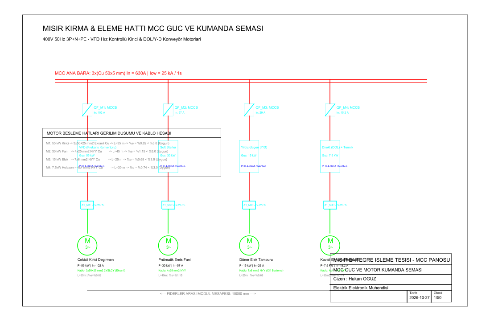
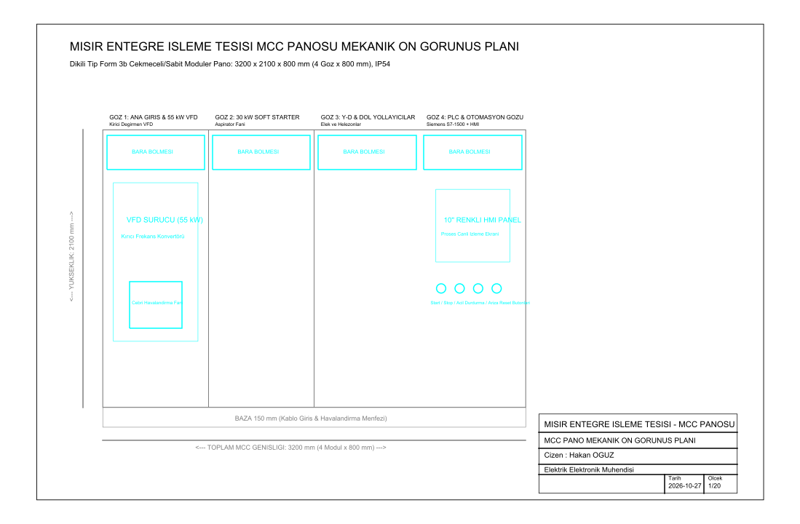

# Mısır İşleme Hattı MCC ve VFD Kumanda Panosu

Mısır entegre işleme tesislerindeki kırma, eleme, pnömatik taşıma ve elevatör motorları için motor kontrol merkezi (MCC) güç ve kumanda şeması, Form 3b 4 modüllü pano mekanik ön görünüşü ile kablo kesiti/gerilim düşümü parametrik mühendislik hesapları.

Geliştiren: **Hakan OĞUZ — Elektrik Elektronik Mühendisi**

> Dürüstlük notu: Proje çizimleri `ezdxf` ile hazırlanıp `nanoCAD` üzerinden gerçek **`.dwg`** formatına dönüştürülmüştür. DXF ara dosyaları kaldırılmış, doğrudan endüstriyel CAD yazılımlarıyla açılabilir DWG paftaları teslim edilmiştir.



## Neden bu proje

Mısır işleme ve nişasta fabrikalarında yüksek eylemsizlik momentine sahip çekiçli değirmenler, yüksek kalkış akımı çeken pnömatik emis fanları ve kovalı elevatörler bulunur. Çekiçli değirmenin frekans konvertörü (VFD) ile yumuşak hız kontrolü yapılırken, fanlarda soft starter, eleklerde ise klasik yıldız-üçgen yol verme tercih edilir. Hatalı kablo kesiti veya yetersiz motor koruma şalteri seçimi pano içi aşırı ısınmaya ve beklenmedik duruşlara (downtime) yol açar.

Buradaki amaç:
1. $55\text{ kW}$ VFD kontrollü kırıcı değirmen için ekranlı simetrik motor kablosu ($3\times50+25\text{ mm}^2$ 2YSLCY) seçmek ve EMC parazitlerini önlemek,
2. $30\text{ kW}$ emis fanı (Soft Starter), $15\text{ kW}$ elek tamburu (Y/D) ve $7.5\text{ kW}$ elevatör için anma akımı ve gerilim düşümü hesaplarını ($\%e < \%1.5$) doğrulamak,
3. 3200 × 2100 × 800 mm ebatlarında 4 gözlü, Form 3b tipinde, PLC (S7-1500) ve 10" dokunmatik HMI kontrollü MCC pano mekanik ön görünüşünü projelendirmektir.

## Motor Fiderleri ve Kablo Hesap Tablosu

| Kod | Motor Tanımı | Anma Gücü | Anma Akımı ($I_n$) | Yol Verme Yöntemi | Kablo Tipi ve Kesiti | Mesafe ($L$) | Gerilim Düşümü ($\%e$) |
|---|---|---|---|---|---|---|---|
| **M1** | Çekiçli Kırıcı Değirmen | 55 kW | 102 A | VFD (Frekans Konvertörü) | $3\times50+25\text{ mm}^2$ 2YSLCY (Ekranlı) | 35 m | $\%0.82 < \%3.0$ |
| **M2** | Pnömatik Emiş Fanı | 30 kW | 57 A | Soft Starter (Yumuşak Yol Verici) | $4\times25\text{ mm}^2$ NYY Cu | 45 m | $\%1.15 < \%3.0$ |
| **M3** | Döner Elek Tamburu | 15 kW | 29 A | Yıldız-Üçgen (Y/D) Kumandalı | $7\times6\text{ mm}^2$ NYY Cu (Çift Besleme) | 25 m | $\%0.68 < \%3.0$ |
| **M4** | Kovalı Elevatör Helezon | 7.5 kW | 15.2 A | Direkt (DOL) + Termik Röle | $4\times4\text{ mm}^2$ NYY Cu | 30 m | $\%0.74 < \%3.0$ |

## Pano Mekanik Ön Görünüşü



- **Modül 1 (800 mm):** Ana giriş şalteri ve 55 kW VFD sürücü bölmesi; cebri soğutma fanı ve filtre menfezleri.
- **Modül 2 (800 mm):** 30 kW Soft Starter ve bypass kontaktörü bölmesi.
- **Modül 3 (800 mm):** Yıldız-üçgen kontaktör grupları ve DOL motor çıkış modülleri.
- **Modül 4 (800 mm):** PLC otomasyon kabini, 24V DC SMPS güç kaynakları, 10" dokunmatik HMI panel ve operatör buton grubu.

## Dosya Yapısı

```
misir-isleme-mcc-vfd/
├── README.md
├── mcc-guc-kumanda-semasi.dwg      # Pafta 1: Güç, kumanda ve gerilim düşümü tablosu (.dwg)
├── mcc-pano-mekanik-yerlesimi.dwg  # Pafta 2: 4 Gözlü MCC mekanik pano görünüşü (.dwg)
├── src/
│   └── cizim_uret.py               # Çizim üretim betiği
└── sekiller/
    ├── mcc-guc-kumanda.png
    └── mcc-pano-yerlesimi.png
```
