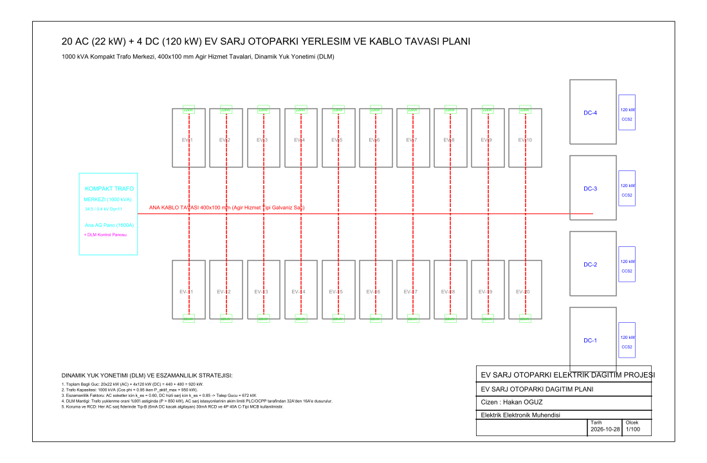
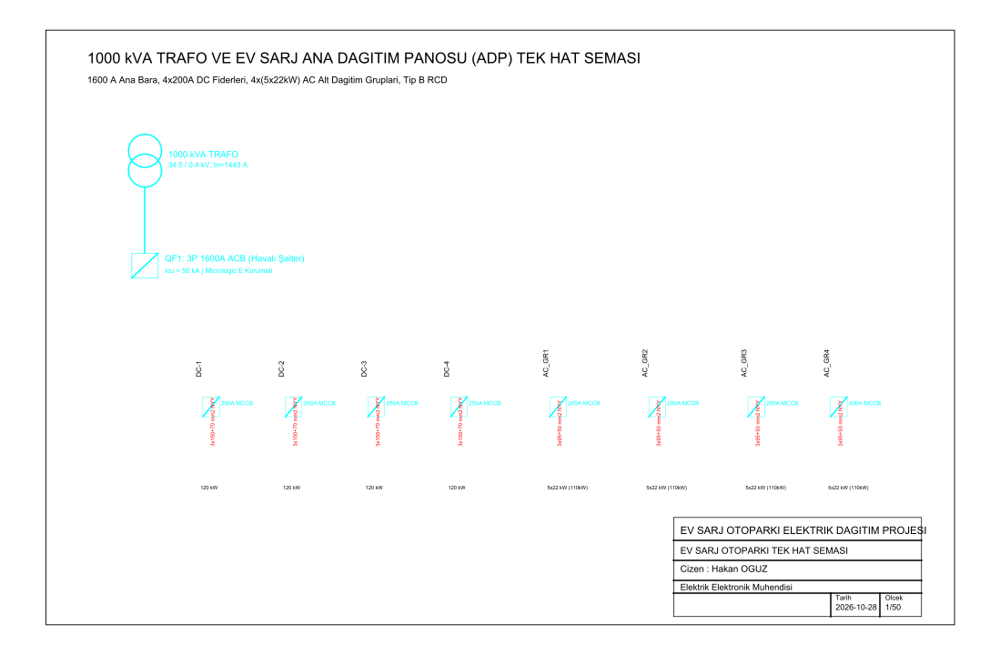

# 20 AC + 4 DC Şarj İstasyonlu Otopark Elektrik Dağıtım Projesi

1000 kVA trafo merkezli elektrikli araç (EV) otoparkı için 20 adet 22 kW AC Tip-2 soket ve 4 adet 120 kW DC CCS2 hızlı şarj istasyonunun kat yerleşim planı, 400x100 mm ağır hizmet kablo tavası güzergahı, Dinamik Yük Yönetimi (DLM / Modbus) altyapısı ve 1600 A ana dağıtım panosu tek hat şeması.

Geliştiren: **Hakan OĞUZ — Elektrik Elektronik Mühendisi**

> Dürüstlük notu: Çizimler `ezdxf` ile tasarlanmış ve `nanoCAD` COM motoru üzerinden gerçek **`.dwg`** dosyalarına dönüştürülmüştür. DXF ara dosyaları temizlenmiş, doğrudan profesyonel DWG olarak sunulmuştur.



## Neden bu proje

Elektrikli araç şarj parklarında en büyük zorluk trafo kapasitesinin aşılması ve şebekeye aşırı tepe yük (peak load) binmesidir. 20 AC ($440\text{ kW}$) ve 4 DC ($480\text{ kW}$) istasyonun toplam bağlı gücü $920\text{ kW}$'tır. Eşzamanlılık faktörü ($k_{es}$) uygulanmadığında trafo aşırı yüklenir. Dinamik Yük Yönetimi (DLM / OCPP Smart Charging), trafo yüklenme oranı $\%90$'ı aştığında AC istasyonların akım sınırını düşürerek trafo yatırımı maliyetini optimize eder.

Buradaki amaç:
1. $1000\text{ kVA}$ ($1443\text{ A}$) trafo merkezinden 1600 A ana baraya kadar güç dağıtımını projelendirmek,
2. 4 adet DC hızlı şarj cihazı ($3\times150+70\text{ mm}^2$ NYY) ve 4 grup AC dağıtım panosu ($3\times95+50\text{ mm}^2$ NYY) için fider seçimlerini yapmak,
3. Her AC şarj noktasında IEC 61851 standardı gereği 6 mA DC kaçak akım algılayan Tip-B 30 mA RCD ve C-tipi MCB korumasını şematize etmek,
4. Otopark zemininde araç dönüş yarıçaplarına uygun park cepleri ($2500 \times 5000\text{ mm}$ AC, $3500 \times 6000\text{ mm}$ DC) ve tava yollarını çizmektir.

## Güç ve Eşzamanlılık Tablosu

| İstasyon Grubu | Adet | Birim Güç | Toplam Bağlı Güç | Eşzamanlılık ($k_{es}$) | Talep Gücü ($P_{talep}$) |
|---|---|---|---|---|---|
| **AC Şarj Soketleri** | 20 | 22 kW | 440 kW | 0.60 | 264 kW |
| **DC Hızlı Şarj (CCS2)** | 4 | 120 kW | 480 kW | 0.85 | 408 kW |
| **Toplam / Talep** | **24** | - | **920 kW** | - | **672 kW (Trafo Payı: %70.7)** |

## Tek Hat Şeması



- **Giriş:** 1000 kVA trafo çıkışında 3P 1600A ACB (Havalı Kesici), $I_{cu} = 50\text{ kA}$.
- **DC Fiderleri:** 4 adet bağımsız 250A MCCB korumalı $120\text{ kW}$ DC fideri.
- **AC Dağıtım Grupları:** 4 adet 200A MCCB korumalı alt dağıtım panosu; her pano 5 adet 22 kW AC şarj istasyonunu besler.

## Dosya Yapısı

```
sarj-otoparki-dagitim/
├── README.md
├── sarj-otoparki-yerlesimi.dwg  # Pafta 1: Otopark yerleşim ve kablo tavası planı (.dwg)
├── sarj-otoparki-tek-hat.dwg    # Pafta 2: 1000 kVA trafo ve ADP tek hat şeması (.dwg)
├── src/
│   └── cizim_uret.py            # Çizim üretim betiği
└── sekiller/
    ├── sarj-otoparki-yerlesimi.png
    └── sarj-otoparki-tek-hat.png
```
