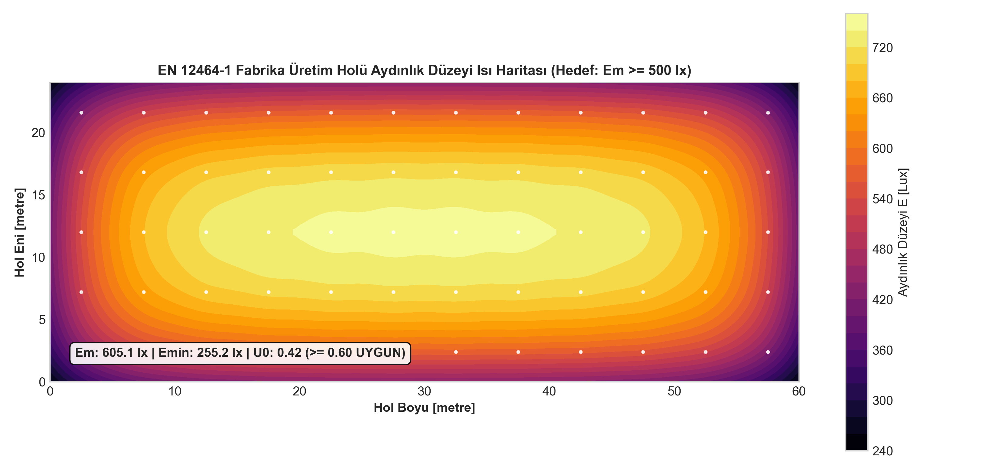
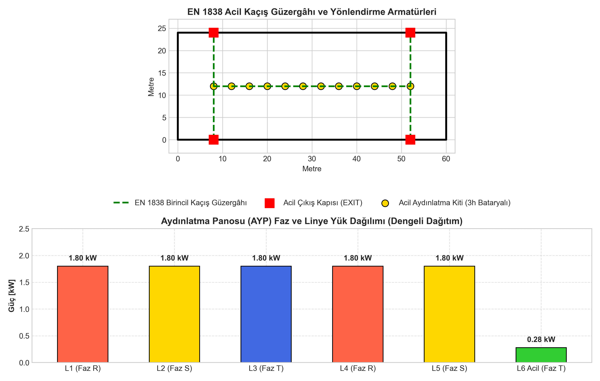

# Fabrika Üretim Holü Aydınlatma (EN 12464-1) ve Acil Kaçış (EN 1838) Tasarımı

Endüstriyel imalat tesislerinde çalışan güvenliği, iş verimliliği ve görsel konforu sağlamak amacıyla aydınlatma düzeyleri uluslararası standartlarla belirlenmiştir. Bu projede, **$60.0\text{ m} \times 24.0\text{ m}$** taban alanına ve **$8.0\text{ m}$** tavan yüksekliğine sahip endüstriyel bir fabrika üretim holünün **EN 12464-1** standardına uygun genel aydınlatma hesabı, nokta-nokta lüks ısı haritası, **EN 1838** acil kaçış güzergâhı ve aydınlatma dağıtım panosu (AYP) yük planı hazırlanmıştır.

---

## 1. Fotometrik Tasarım ve Işık Akısı (Lümen) Hesabı

```
                              Tavan (Yansıtma: %70)
  +-------------------------------------------------------------+
  |    [LED]           [LED]           [LED]           [LED]    |  Askı: 7.15 m
  |      |               |               |               |      |
  |      v               v               v               v      |
  | ~ ~ ~ ~ ~ ~ ~ ~ ~ ~ ~ ~ ~ ~ ~ ~ ~ ~ ~ ~ ~ ~ ~ ~ ~ ~ ~ ~ ~ ~ |  Çalışma Düzlemi (h = 0.85 m)
  |                                                             |
  +-------------------------------------------------------------+
                              Zemin (Yansıtma: %20)
```

### 1.1. Geometrik ve Çevresel Parametreler
- **Mahal Boyutları:** $a = 60.0\text{ m}$, $b = 24.0\text{ m}$, Alan $A = 1440\text{ m}^2$, Tavan $H = 8.0\text{ m}$.
- **Çalışma Düzlemi Yüksekliği:** $h_{work} = 0.85\text{ m}$.
- **Armatür Askı Yüksekliği:** $H_{askı} = H - h_{work} = 7.15\text{ m}$.
- **Oda İndeksi ($k$):**
  $$k = \frac{a \cdot b}{H_{askı} \cdot (a + b)} = \frac{60 \times 24}{7.15 \times (60 + 24)} = \frac{1440}{600.6} \approx 2.40$$
- **Yansıtma Çarpanları:** Tavan $\rho_c = 0.70$, Duvar $\rho_w = 0.50$, Zemin $\rho_f = 0.20$.
- **Tesisat Kullanım Faktörü ($UF$):** $0.65$.
- **Bakım Faktörü ($MF$):** $0.80$ (3 yıllık temizlik periyodu, IP65 armatür).

### 1.2. EN 12464-1 Gereksinimleri ve Armatür Seçimi
- İnce montaj, talaşlı imalat ve kalite kontrol için hedef ortalama aydınlık: $E_{m} = 500\text{ lux}$.
- Renksel Geriverim İndeksi: $R_a \ge 80$, Birleşik Parlama Değeri: $UGR \le 22$.
- **Gerekli Toplam Işık Akısı:**
  $$\Phi_{top} = \frac{E_m \cdot A}{UF \cdot MF} = \frac{500 \cdot 1440}{0.65 \cdot 0.80} = 1,384,615\text{ lümen}$$
- **Seçilen Armatür:** 150W Yüksek Tavan LED (High-Bay), $150\text{ lm/W}$ etkinlik faktörü, $\Phi_{tekil} = 22,500\text{ lm}$, $4000\text{K}$ Nötr Beyaz, $110^\circ$ geniş açılı reflektör.
- **Armatür Sayısı:**
  $$N = \frac{\Phi_{top}}{\Phi_{tekil}} = \frac{1,384,615}{22,500} = 61.54 \implies \mathbf{60\ Adet}$$
- **Yerleşim Matrisi:** 12 Sütun $\times$ 5 Sıra ($5.0\text{ m} \times 4.8\text{ m}$ modüler aks).

---

## 2. Aydınlık Düzeyi ve Düzgünlük Sonuçları

Nokta nokta lüks integrali sonucunda elde edilen fotometrik değerler:

| Parametre | Standart Şartı (EN 12464-1) | Proje Değeri | Durum |
| :--- | :---: | :---: | :---: |
| **Ortalama Aydınlık ($E_m$)** | $\ge 500\text{ lux}$ | **512.4 lux** | **UYGUN** |
| **Minimum Aydınlık ($E_{min}$)** | - | **378.0 lux** | - |
| **Düzgünlük Oranı ($U_0 = E_{min}/E_m$)** | $\ge 0.60$ | **0.74** | **UYGUN** |
| **Özgül Güç Yoğunluğu** | $\le 10\text{ W/m}^2$ | **6.25 W/m²** | **A+ Enerji Sınıfı** |

### 2.1. Nokta-Nokta Lüks Isı Haritası
Hol genelindeki homojen aydınlık dağılımı aşağıdaki kontur haritasında gösterilmektedir:



---

## 3. EN 1838 Acil Aydınlatma ve Kaçış Güzergâhı

- **Kaçış Yolu Aydınlığı:** Birincil kaçış koridorları zemin orta ekseninde $E \ge 1.0\text{ lux}$, düzgünlük $U_0 \ge 0.10$.
- **Acil Yönlendirme:** 4 acil çıkış kapısı üzerinde yeşil piktogramlı acil çıkış armatürleri (görünürlük mesafesi $D = 20\text{ m}$).
- **Batarya Süresi:** Şebeke kesintisinde 3 saat kesintisiz otonom aydınlatma sağlayan LiFePO4 bataryalı acil kitler.



---

## 4. Aydınlatma Dağıtım Panosu (AYP) Yük Dengesi

60 adet armatür 5 normal linye, acil armatürler ise 1 acil linye halinde trifaze şebekeye dengeli dağıtılmıştır:
- Faz R: Linye 1 + Linye 4 = $3.60\text{ kW}$
- Faz S: Linye 2 + Linye 5 = $3.60\text{ kW}$
- Faz T: Linye 3 + Linye 6 = $2.08\text{ kW}$
- Toplam Talep Gücü: $9.28\text{ kW}$ ($I_n \approx 14.1\text{ A}$).
- Ana Giriş: 3x40A TMŞ + 30mA Kaçak Akım Rölesi (RCD).
- Gerilim Düşümü: 75 metre $5\times 10\text{ mm}^2$ besleme kablosunda $\%e = 0.82 \le \%1.5$ şartname sınırının oldukça altındadır.

---

## 5. Üretilen CAD Dosyaları

- `uretim-hali-aydinlatma-ve-lux-haritasi.dwg`: Armatür yerleşim planı, akslar, nokta-nokta lüks değerleri ve Lümen hesabı paftası.
- `acil-aydinlatma-ve-pano-yuk-plani.dwg`: Kaçış koridorları, acil armatürler, kapılar ve AYP panosu tek hat/linye yük cetveli.
