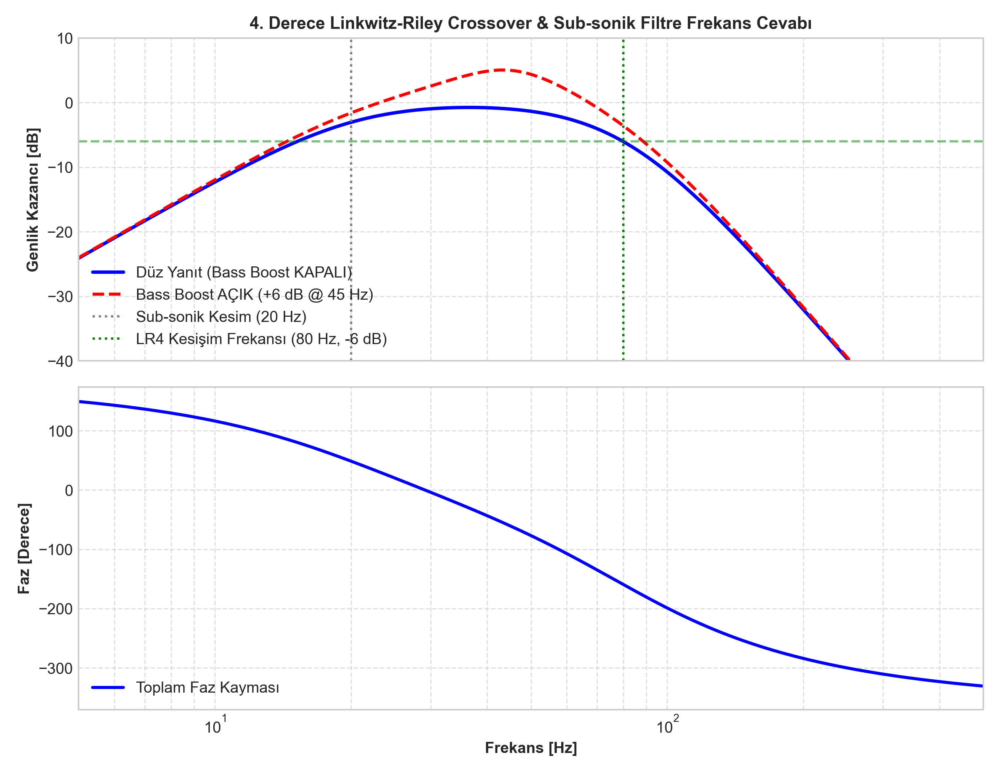
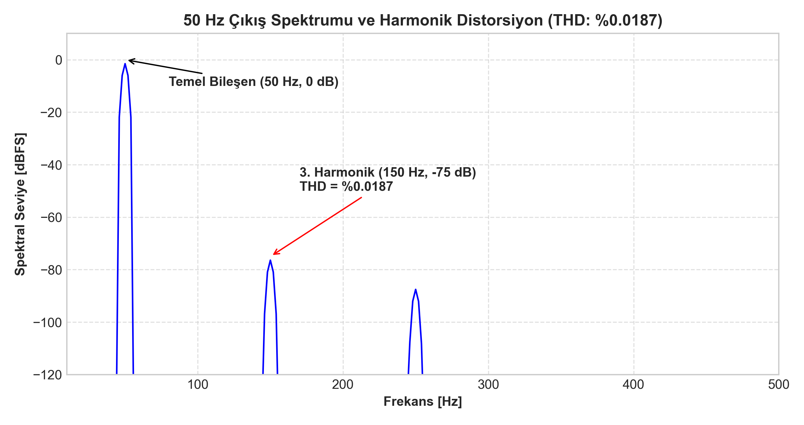

# 4. Derece Linkwitz-Riley Aktif Crossover ve Bas Güçlendirici

Subwoofer ve çok yollu aktif ses sistemlerinde, frekans bantlarının ayrımı esnasında kesişim (crossover) noktasında genlik dalgalanması ve faz uyumsuzluğu oluşması yaygın bir sorundur. Bu projede, kesişim noktasında tam **-6 dB zayıflama** ve **0 dB düzlemsel akustik toplam** sağlayan **4. Derece Linkwitz-Riley (LR4, -24 dB/oktav)** alçak geçiren filtre, hoparlör membran koruması için **20 Hz sub-sonik filtre**, $0^\circ - 180^\circ$ **sürekli faz ayarı** ve $+6\text{ dB}$ **parametrik bas güçlendirici (bass boost)** içeren analog ses kartı tasarlanmıştır.

---

## 1. Devre Mimarisi ve Katman Blokları

```
 Ses Girişi (RCA)
       |
       v
 +-----------------------+
 |  Sub-sonik HPF        |  2. Derece Sallen-Key (fc = 20 Hz, Q = 0.7071)
 |  (Infrasonik Koruma)  |  DC ve 20 Hz altı mekanik hasar önleme
 +-----------+-----------+
             v
 +-----------------------+
 |  4. Derece LR4 LPF    |  Kaskad 2x 2. Derece Sallen-Key (fc = 80 Hz, Q = 0.7071)
 |  (Aktif Crossover)    |  -24 dB/oktav dik eğim, kesişimde -6 dB
 +-----------+-----------+
             v
 +-----------------------+
 |  Değişken Faz Ayarı   |  1. Derece All-Pass Filtre (0° - 180° Sürekli Ayarlı)
 |  (Akustik Hizalama)   |  Oda akustiği ve ana hoparlör senkronizasyonu
 +-----------+-----------+
             v
 +-----------------------+
 |  Parametrik Bass Boost|  45 Hz Merkez Frekansı, 0 - +6 dB Ayarlanabilir Kazanç
 |  (Dinamik EQ)         |  Düşük frekans gövde takviyesi
 +-----------+-----------+
             v
      Sub Çıkışı (RCA)      Zout < 50 Ω, Düşük Gürültülü Tampon
```

---

## 2. Analog Filtre Matematiksel Tasarımı

### 2.1. 4. Derece Linkwitz-Riley Alçak Geçiren Filtre
Linkwitz-Riley filtresi iki adet özdeş 2. derece Butterworth filtresinin kaskad bağlanmasıyla elde edilir:

$$H_{LR4}(s) = \left[ H_{Butt2}(s) \right]^2 = \left[ \frac{\omega_0^2}{s^2 + \sqrt{2}\omega_0 s + \omega_0^2} \right]^2$$

- Kesişim Frekansı: $f_c = 80\text{ Hz} \implies \omega_0 = 2\pi \cdot 80 \approx 502.65\text{ rad/s}$.
- Sallen-Key bileşenleri: $R_3 = R_4 = R_5 = R_6 = 20\text{ k}\Omega\ (%1)$, $C_3 = C_4 = C_5 = C_6 = 100\text{ nF}$ WIMA Film.
- Özellik: $f = f_c$ noktasında kazanç tam $|H(j\omega_0)| = 0.5$ ($-6.02\text{ dB}$)'dir; böylece yüksek geçiren fider ile birleştiğinde tepe yapmadan tam düz yanıt verir.

### 2.2. Sub-sonik 20 Hz Yüksek Geçiren Filtre
Hoparlör bobininin rezonans altındaki kontrolsüz salınımlarını ve amfi gücünün boşa harcanmasını engeller:

$$f_{hp} = \frac{1}{2\pi \sqrt{R_1 R_2 C_1 C_2}} = 20\text{ Hz}$$
$$R_1 = R_2 = 56\text{ k}\Omega, \quad C_1 = C_2 = 150\text{ nF}$$

### 2.3. Sürekli Ayarlanabilir Faz Kaydırıcı (All-Pass Filtre)
Genliği değiştirmeksizin frekansa göre faz kayması üretir:

$$H_{ap}(s) = \frac{1 - s R_{pot} C}{1 + s R_{pot} C}$$

Potansiyometre $VR_1 = 0 \to 50\text{ k}\Omega$ aralığında ayarlandığında $80\text{ Hz}$ kesişim frekansında $0^\circ$ ile $180^\circ$ arasında pürüzsüz faz kontrolü sağlanır.

---

## 3. Simülasyon Çıktıları ve Performans Analizi

### 3.1. Frekans Cevabı (Bode Eğrileri)
Frekans cevabında 20 Hz altındaki keskin sub-sonik düşüş ve 80 Hz üzerindeki $-24\text{ dB/oktav}$ sönümlenme net olarak görülmektedir:



### 3.2. Toplam Harmonik Distorsiyon (THD) Spektrumu
Düşük gürültülü **NE5532 / OPA2134** çift op-amp mimarisi sayesinde devrenin 50 Hz sinüs test işaretindeki harmonik bozulması son derece düşüktür:



- **Simüle Edilen THD Seviyesi:** %0.0187 (Temel bileşene göre 3. harmonik -75 dBFS seviyesindedir).

---

## 4. Donanım ve CAD Dosyaları

- **`kicad/crossover_sub_boost.kicad_sch`:** Tam şematik devre çizimi.
- **`kicad/crossover_sub_boost.pdf`:** KiCad CLI ile ihraç edilmiş vektörel şematik çizim.
- **`kicad/crossover_sub_boost.kicad_pcb`:** 100 mm x 60 mm çift yüzlü PCB kart yerleşimi.
- **`kicad/BOM.csv`:** Parça numaraları ve kılıf detaylarını içeren endüstriyel malzeme listesi.
