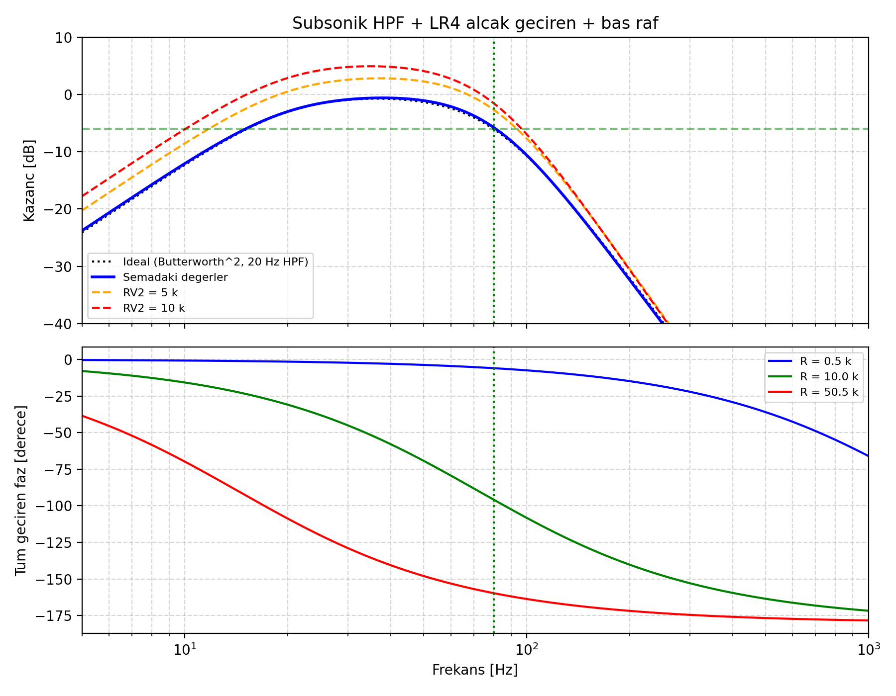
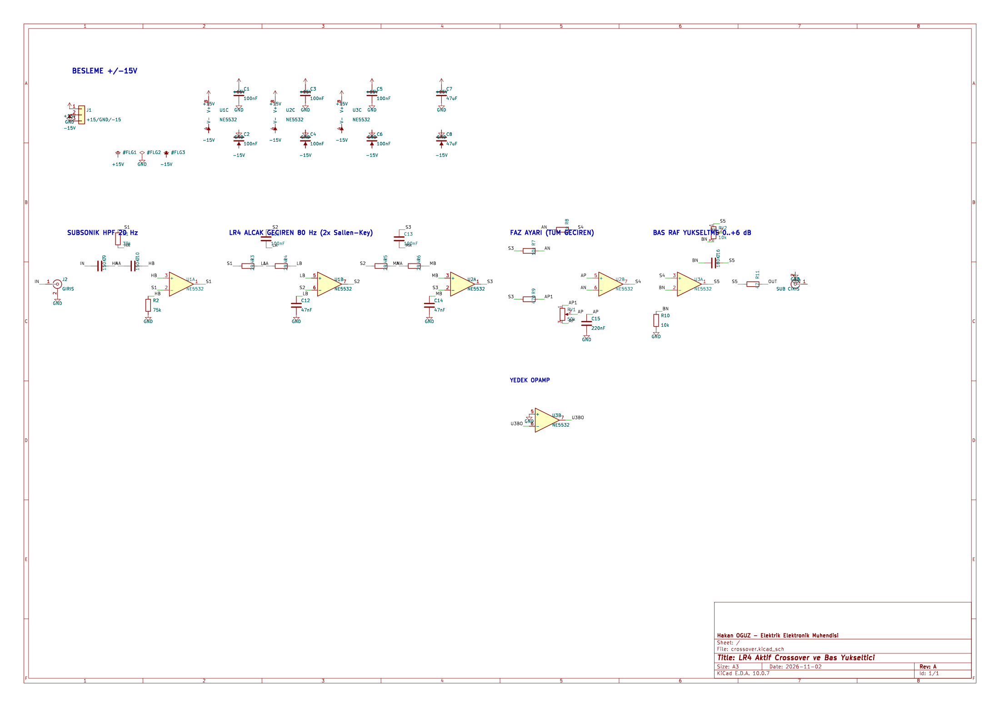

# Linkwitz-Riley Aktif Crossover ve Bas Yükseltici

Subwoofer hattı için analog ön kat: 20 Hz subsonik yüksek geçiren filtre, 80 Hz kesimli 4. derece
Linkwitz-Riley (LR4) alçak geçiren filtre, sürekli ayarlı faz döndürücü ve 0…+6 dB bas raf
yükseltici. Üç NE5532 (çift op-amp) ±15 V ile beslenir.

Geliştiren: **Hakan OĞUZ — Elektrik Elektronik Mühendisi**



## Sinyal yolu

```
RCA giriş -> HPF 20 Hz (U1A) -> LPF 80 Hz (U1B) -> LPF 80 Hz (U2A) -> faz (U2B) -> bas raf (U3A) -> 47 Ω -> RCA çıkış
```

LR4, iki özdeş 2. derece Butterworth katının art arda bağlanmasıdır:

$$H_{LR4}(s) = \left[\frac{\omega_0^2}{s^2 + \sqrt{2}\,\omega_0 s + \omega_0^2}\right]^2$$

Kesim frekansında kazanç −6 dB olur; yüksek geçiren yolla toplandığında genlik düz kalır.

## Bileşen seçimi

Birim kazançlı Sallen-Key katında eşit dirençle Q = 0.707 için kondansatör oranı 2:1 olmalı.
Eşit kondansatörlü yüksek geçirende ise toprak direnci geri besleme direncinin iki katıdır.

| Kat | Elemanlar | fc | Q |
|---|---|---|---|
| Subsonik HPF | C = 150 nF, R_f = 39 kΩ, R_g = 75 kΩ | 19.6 Hz | 0.693 |
| LPF (×2) | R = 29.4 kΩ, C_geri = 100 nF, C_toprak = 47 nF | 79.0 Hz | 0.729 |
| Faz | 10 kΩ / 10 kΩ, 470 Ω + RV1 50 kΩ, 220 nF | — | — |
| Bas raf | R_g = 10 kΩ, RV2 10 kΩ ‖ 180 nF | ~88 Hz köşe | — |

Değerler E24/E96 serisinden seçildiği için Q ideal 0.707'den biraz sapar.

## Analiz

`sim/filtre_analizi.py` kat transfer fonksiyonlarını şemadaki değerlerden kurar ve ideal
Butterworth² eğrisiyle karşılaştırır:

```bash
python sim/filtre_analizi.py
```

Çıktı:

```
HPF: fc = 19.6 Hz, Q = 0.693
LPF: fc = 79.0 Hz, Q = 0.729
LR4 -6 dB noktasi: 81.2 Hz
80 Hz kazanc: -5.75 dB
Faz ayari R = 0.47 k -> 80 Hz'de -6.0 derece
Faz ayari R = 25.00 k -> 80 Hz'de -140.2 derece
Faz ayari R = 50.47 k -> 80 Hz'de -159.7 derece
Bas raf RV2 = 0 k -> 30 Hz'de +0.00 dB
Bas raf RV2 = 5 k -> 30 Hz'de +3.45 dB
Bas raf RV2 = 10 k -> 30 Hz'de +5.67 dB
```

−6 dB noktası E-serisi değerler yüzünden 80 Hz yerine 81.2 Hz'e düşer. Faz döndürücü 80 Hz'de
yaklaşık 0° ile −160° arasında ayarlanır; tam 180° için C7 470 nF yapılabilir.

## Donanım (KiCad)

`donanim/crossover.kicad_sch`: üç NE5532, ±15 V klemens girişi, her entegrede 100 nF ayrıştırma
ve rail başına 47 µF toplu kondansatör. Kullanılmayan U3B gerilim izleyici olarak toprağa bağlı.
ERC: 0 ihlal. Şema baskısı `crossover.pdf`, malzeme listesi `crossover-bom.csv`.


