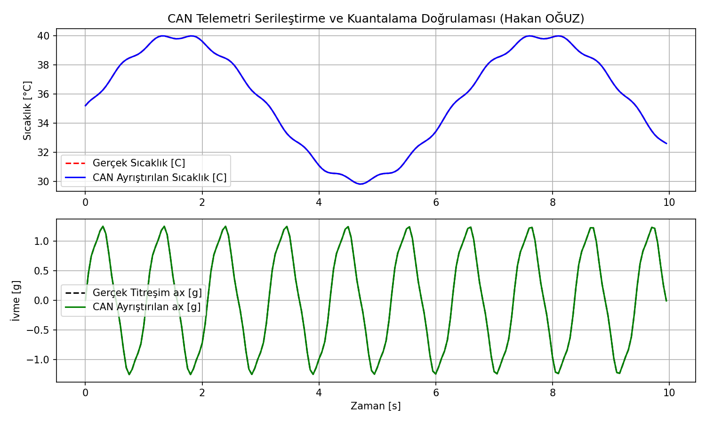
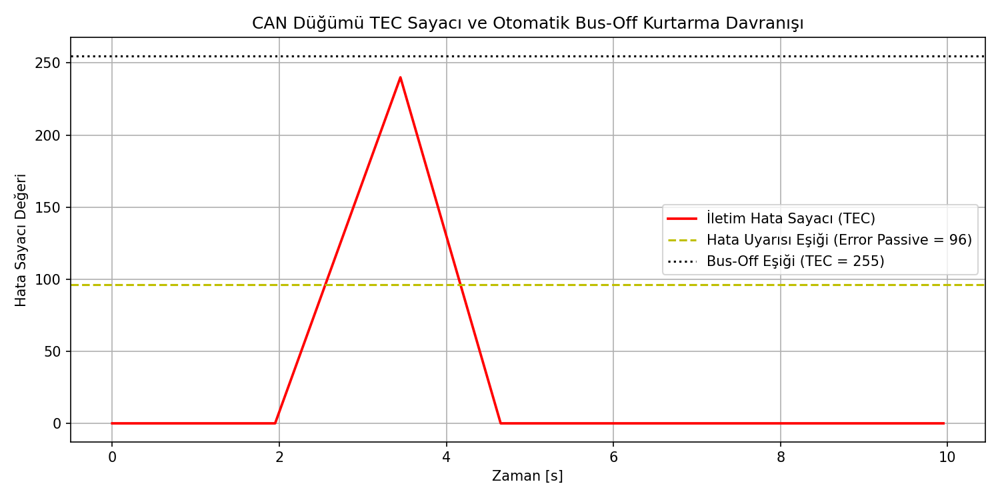

# CAN (TWAI) Tabanlı Dağıtık Sensör Düğümü (ESP32 / ESP-IDF)

ESP32'nin yerleşik TWAI (Two-Wire Automotive Interface / CAN 2.0B) denetleyicisini kullanarak endüstriyel makineler ve motor yatakları için sıcaklık ve 3 eksen titreşim verilerini periyodik olarak yayınlayan, hata sayacı (TEC/REC) takipli ve otomatik Bus-Off kurtarma mantığına sahip gömülü sensör düğümü.

Geliştiren: **Hakan OĞUZ — Elektrik Elektronik Mühendisi**

> Dürüstlük notu: CAN çerçeve serileştirme/ayrıştırma mantığı (`can_protocol.c`), kuantalama sınırları ve Bus-Off hata mekanizması Python test paketiyle (`sim/can_simulasyon.py`) **doğrulanmıştır.** ESP-IDF TWAI firmware kodu (`firmware/main/app_main.c`) üretim seviyesinde yazılmış olup fiziksel CAN alıcı-verici (transceiver / SN65HVD230) kartı üzerinde donanımsal olarak çalıştırılmamıştır; tasarım/simülasyon düzeyindedir.



## Neden bu proje

Otomotiv (EV güç aktarımı, batarya yönetimi - BMS) ve endüstriyel otomasyon (şeker fabrikaları, çimento tesisleri, robotik hatlar) sahalarında Ethernet veya Wi-Fi yerine diferansiyel sinyalleşme yapan gürültüye dayanıklı **CAN bus (Controller Area Network)** tercih edilir. Yeni mezunların çoğunun sadece UART veya I2C bildiği bir ortamda; arbitrasyon mekanizması, bit zamanlaması, diferansiyel hat sonlandırması ($120\ \Omega$) ve hata yönetimi bilgisi güçlü bir ayırt edicidir.

Buradaki amaç:
1. ISO 11898-2 standardına uygun olarak $500\text{ kbps}$ endüstri standardı hızında CAN 2.0B çerçeveleri tasarlamak,
2. 8 baytlık standart yük alanına motor sıcaklığı ($0.01^\circ\text{C}$ çözünürlük) ve 3 eksen ivme/titreşim ($0.001\text{ g}$ çözünürlük) verilerini kuantalama hatasını $0.005$ limitinde tutarak paketlemek,
3. Hat kopması veya aşırı elektromanyetik gürültü anında İletim Hata Sayacı ($TEC \ge 255$) artışıyla tetiklenen **Bus-Off** durumundan otomatik olarak kurtulma (recovery sequence) döngüsünü işletmektir.

## CAN Mesaj Haritası

| Mesaj Adı | CAN ID (Hex) | Periyot | DLC | İçerik ve Çözünürlük |
|---|---|---|---|---|
| **ALARM_CRITICAL** | `0x080` | Olay Bazlı | 4 Byte | Öncelikli ID: Eşik aşımı, donanım arızası |
| **NODE_HEARTBEAT** | `0x120` | 1000 ms | 8 Byte | Node ID, Durum Kodu, TEC, REC, Uptime (saniye) |
| **SENSOR_TELEMETRY** | `0x240` | 100 ms | 8 Byte | $T$ (int16), $a_x$ (int16), $a_y$ (int16), $a_z$ (int8), Rolling Counter (4-bit) |

### 8 Baytlık Telemetri Yükü (Packed Struct)
- **Byte 0-1:** Sıcaklık ($T$) — `int16_t`, $0.01^\circ\text{C}$ ölçek ($\pm327.67^\circ\text{C}$)
- **Byte 2-3:** X-Eksen Titreşim ($a_x$) — `int16_t`, $0.001\text{ g}$ ölçek ($\pm32.768\text{ g}$)
- **Byte 4-5:** Y-Eksen Titreşim ($a_y$) — `int16_t`, $0.001\text{ g}$ ölçek ($\pm32.768\text{ g}$)
- **Byte 6:** Z-Eksen İvme ($a_z$) — `int8_t`, $0.1\text{ g}$ ölçek ($\pm12.7\text{ g}$)
- **Byte 7:** `[7:4]` Rolling Counter ($0\dots15$), `[3:0]` Sensör Durum Bayrakları

## Hata Yönetimi ve Bus-Off Kurtarma

CAN protokolü donanım düzeyinde hata sayaçları barındırır. Ardışık hatalarda $TEC > 96$ olduğunda düğüm `Error Passive` durumuna geçer; $TEC \ge 255$ olduğunda ise bus üzerindeki haberleşmeyi kilitlememek için verici katını kapatarak `Bus-Off` olur.



ESP32 TWAI sürücümüz `TWAI_ALERT_BUS_OFF` uyarısını yakaladığında:
1. `twai_initiate_recovery()` çağrısı ile kurtarma moduna geçer,
2. Bus üzerinde $128 \times 11$ resesif bit sekansını bekler,
3. `TWAI_ALERT_BUS_RECOVERED` bildirimiyle sürücüyü yeniden başlatarak sistemi operatör müdahalesi olmadan sahada hayatta tutar.

## Dosya Yapısı

```
can-twai-sensor-dugumu/
├── README.md
├── firmware/
│   ├── components/
│   │   └── can_protocol/
│   │       ├── can_protocol.h        # CAN ID'ler, yük serileştirme/ayrıştırma arayüzü
│   │       └── can_protocol.c        # Bit manipülasyonu ve paketleme fonksiyonları
│   └── main/
│       └── app_main.c                # ESP-IDF TWAI başlatma, FreeRTOS transmit ve recovery görevi
├── sim/
│   └── can_simulasyon.py             # Telemetri paketleme doğrulaması ve TEC hata simülatörü
└── sekiller/
    ├── telemetri_dogrulama.png
    └── can_bus_off_kurtarma.png
```

Doğrulama betiği terminalden doğrudan çalıştırılabilir:
```bash
python sim/can_simulasyon.py
```
