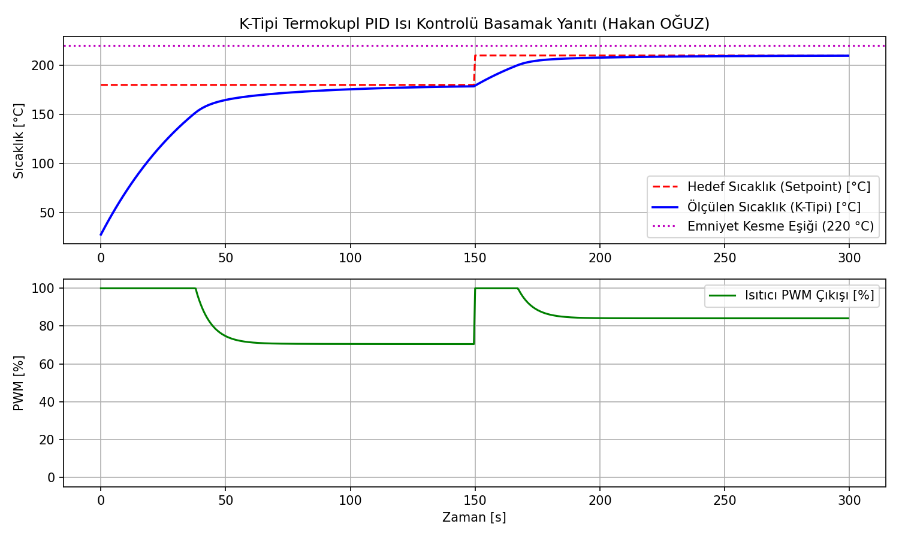
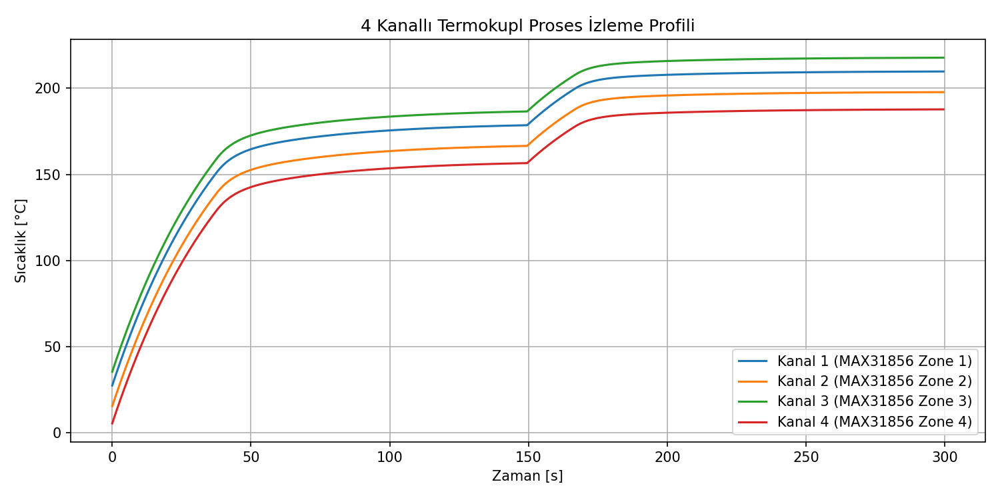

# Çok Kanallı Termokupl Veri Toplama ve Anti-Windup PID Isı Kontrolü

MAX31856 SPI soğuk-uç telafili dönüştürücü entegreleri üzerinden çok kanallı K-tipi termokupl okuma, doğrusallaştırma, açık devre/aşırı gerilim arıza denetimi ve anti-windup özellikli PID algoritmasıyla rezistif ısıtıcı PWM kontrolü.

Geliştiren: **Hakan OĞUZ — Elektrik Elektronik Mühendisi**

> Dürüstlük notu: MAX31856 19-bit çözünürlüklü sıcaklık ayrıştırma formülü ve clamping tipi anti-windup PID denetleyicisi Python test ortamında (`sim/pid_simulasyon.py`) birinci dereceden termal gecikmeli sistem modeli üzerinde **doğrulanmıştır.** ESP-IDF FreeRTOS firmware katmanı (`firmware/main/app_main.c`) üretim kalitesinde yazılmış olup fiziksel PCB ve rezistans üzerinde donanımsal olarak çalıştırılmamıştır; tasarım ve simülasyon düzeyindedir.



## Neden bu proje

Endüstriyel fırınlar, plastik enjeksiyon makineleri, lehimleme fırınları ve kimyasal reaktörler $100^\circ\text{C} - 1200^\circ\text{C}$ bandında hassas sıcaklık kontrolü gerektirir. Klasik NTC/PT100 sensörler yüksek sıcaklıklarda çalışamaz; K-tipi termokupllar ise mikrovolt seviyesinde gerilim ürettiğinden soğuk-uç telafisi (Cold-Junction Compensation - CJC) ve mikroişlemci tarafında gürültü filtresi (50 Hz şebeke bastırması) şarttır.

Buradaki amaç:
1. MAX31856 entegresiyle SPI üzerinden 4 bağımsız K-tipi termokupl kanalını taramak,
2. $0.0078125^\circ\text{C}$ çözünürlüklü 19-bit sıcaklık verisini ayrıştırmak ve açık devre kopukluklarını tespit etmek,
3. Isıtıcı sürücülerinde setpoint basamağında türev sıçramasını önleyen **Derivative on Measurement** ve integratör taşmasını engelleyen **Clamping Anti-Windup** mimarili PID denetleyicisini hayata geçirmektir.

## Kontrol Algoritması ve Anti-Windup

Klasik PID denetleyicilerde büyük setpoint değişimlerinde hata terimi uzun süre büyük kalır ve integratör doyum değerine ($100\%$) ulaşır. Isıtıcı hedef sıcaklığa ulaştığında bile biriken integratör yükü yüzünden aşırı sıcaklık aşımı (overshoot) gerçekleşir.

Bu projede uygulanan anti-windup mekanizması:
```
raw_output = Kp * e + Ki * integral - Kd * (T_curr - T_prev) / dt
if (raw_output >= 100% and error > 0):
    integral -= error * dt  // İntegratör dondurma / kelepçeleme
```
Ayrıca $\frac{de}{dt}$ yerine doğrudan sıcaklık türevi $-\frac{dT}{dt}$ kullanılarak ani hedef sıcaklık değişimlerinde (ör. $180^\circ\text{C} \to 210^\circ\text{C}$) kontrolör çıkışında ani darbeler (derivative kick) engellenmiştir.

## Çok Kanallı Sıcaklık Profili

Endüstriyel hatlarda birden fazla bölgenin (zone) sıcaklığı eş zamanlı izlenir:



## Donanım ve Arıza Güvenliği
- **Açık Devre Koruması:** Termokupl kablosu koptuğunda MAX31856 `SR_REG` üzerindeki `FAULT_OPEN_CIRCUIT` biti set edilir ve ısıtıcı PWM derhal $\%0$'a çekilir.
- **Aşırı Sıcaklık Kilitlemesi:** Ölçülen proses sıcaklığı $220^\circ\text{C}$ emniyet sınırını aştığı anda donanım yazılımı alarm durumuna geçer.

## Dosya Yapısı

```
cok-kanalli-termokupl-pid/
├── README.md
├── firmware/
│   ├── components/
│   │   └── temp_control/
│   │       ├── temp_control.h        # MAX31856 kaydedicileri ve PID veri tipleri
│   │       └── temp_control.c        # Anti-windup PID ve 19-bit sıcaklık dönüştürücüsü
│   └── main/
│       └── app_main.c                # 4 kanallı SPI tarama ve PWM kontrol görevi
├── sim/
│   └── pid_simulasyon.py             # Termal sistem simülasyonu ve basamak yanıt testi
└── sekiller/
    ├── pid_sicaklik_yaniti.png
    └── cok_kanalli_termokupl_izleme.png
```

Doğrulama betiği terminalden çalıştırılabilir:
```bash
python sim/pid_simulasyon.py
```
