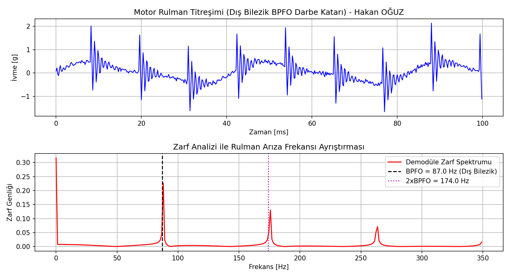
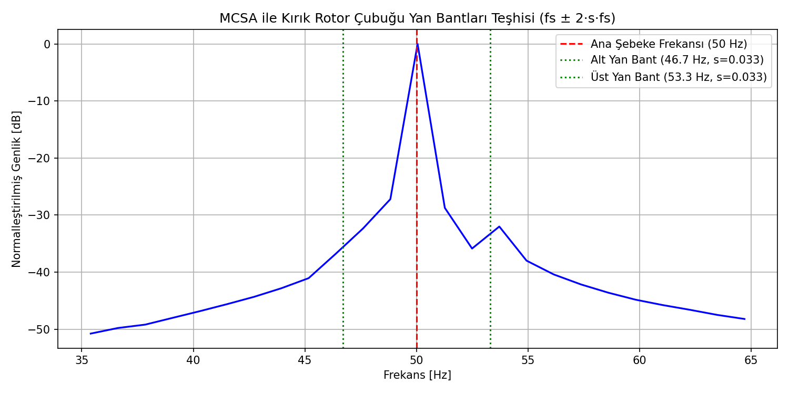

# ESP32 Kestirimci Bakım Düğümü: Rulman Titreşimi ve MCSA Analizi

Endüstriyel asenkron motorlar için ivmeölçer tabanlı mekanik titreşim analizi (zarf/envelope spektrumu), rulman arıza frekansları kestirimi (BPFO/BPFI), ISO 10816-3 titreşim şiddet bölgeleri sınıflandırması ve motor akım imzası (MCSA) ile kırık rotor çubuğu tespiti yapan gömülü kestirimci bakım firmware çekirdeği.

Geliştiren: **Hakan OĞUZ — Elektrik Elektronik Mühendisi**

> Dürüstlük notu: DSP teşhis algoritmaları (`dsp_diagnostics.c`), rulman geometrik frekans hesabı ve Hilbert zarf demodülasyonu Python simülasyon ortamında sentetik arızalı sinyallerle **doğrulanmıştır.** ESP-IDF FreeRTOS firmware katmanı üretim standartlarında yazılmış olup fiziksel motor yatağı üzerinde piezoelektrik ivmeölçer ile test edilmemiştir; tasarım ve simülasyon düzeyindedir.



## Neden bu proje

Fabrikalarda motor arızalarının $\%50$'den fazlası rulman aşınmalarından, $\%10$'u ise rotor çubuğu kırılmalarından kaynaklanır. Klasik bakım reaktif (arıza sonrası) veya periyodiktir (ömrü dolmadan parça değişimi). Kestirimci bakım (PdM) ise rulman yüzeyinde oluşan mikroskobik çatlakların yarattığı darbe frekanslarını (BPFO/BPFI) ve stator akımındaki modülasyon yan bantlarını erken aşamada yakalayarak plansız duruşları engeller.

Buradaki amaç:
1. 6208 tipi rulman geometrisi ($N_b = 9$ bilya, $d = 12\text{ mm}$, $D = 60\text{ mm}$) ve $1450\text{ d/d}$ şaft devri için dış bilezik arıza frekansını ($BPFO = 87.0\text{ Hz}$) analitik hesaplamak,
2. Yüksek frekanslı yapısal rezonans darbelerini demodüle eden **Zarf (Envelope) Spektrumu** algoritmasıyla gürültü altındaki rulman hatasını görünür kılmak,
3. ISO 10816-3 standardına göre titreşim hız RMS ($V_{rms}$) değerini hesaplayarak makineyi Zone A (İyi) ile Zone D (Tehlike) arasında sınıflandırmak,
4. Motor Akım İmzası Analizi (MCSA) ile stator akımında $f_s \pm 2sf_s$ ($46.7\text{ Hz}$ ve $53.3\text{ Hz}$) frekanslarındaki kırık rotor çubuğu yan bantlarını $-35\text{ dB}$ eşiğinde yakalamaktır.

## Rulman Frekans Formülleri ve Hesapları

Rulman temas açısı $\theta = 0^\circ$ ve şaft dönme frekansı $f_r = 1450 / 60 = 24.17\text{ Hz}$ olmak üzere:
$$BPFO = \frac{N_b}{2} f_r \left(1 - \frac{d}{D}\cos\theta\right) = \frac{9}{2} \times 24.17 \times (1 - 0.20) = 87.0\text{ Hz}$$
$$BPFI = \frac{N_b}{2} f_r \left(1 + \frac{d}{D}\cos\theta\right) = \frac{9}{2} \times 24.17 \times (1 + 0.20) = 130.5\text{ Hz}$$

## MCSA Kırık Rotor Çubuğu Teşhisi

Motor sincap kafes rotor çubuklarından biri kırıldığında, rotordaki asimetrik manyetik alan stator akımında şebeke frekansı ($50\text{ Hz}$) etrafında kayma ($s$) bağımlı yan bantlar oluşturur:



## Dosya Yapısı

```
esp32-kestirimci-bakim/
├── README.md
├── firmware/
│   ├── components/
│   │   └── dsp_diagnostics/
│   │       ├── dsp_diagnostics.h    # ISO bölgeleri, rulman yapıları ve fonksiyon prototipleri
│   │       └── dsp_diagnostics.c    # Trapezoid hız entegrasyonu ve bant enerjisi tarayıcı
│   └── main/
│       └── app_main.c               # FreeRTOS kestirimci bakım ve alarm üretim görevi
├── sim/
│   └── dogrula.py                   # Sentetik arıza katarı üretimi ve zarf/MCSA test paketi
└── sekiller/
    ├── rulman_titresim_zarf_analizi.png
    └── mcsa_kirik_cubuk_spektrum.png
```

Doğrulama betiği doğrudan çalıştırılabilir:
```bash
python sim/dogrula.py
```
