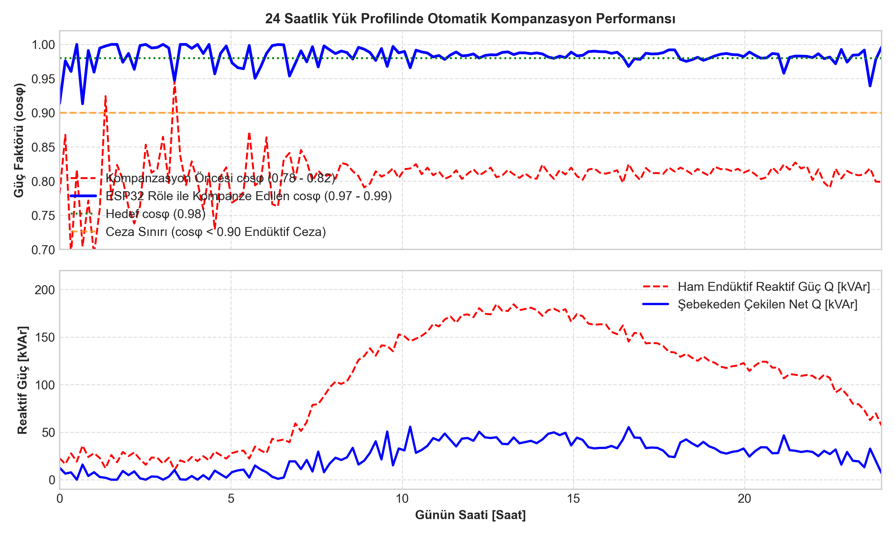
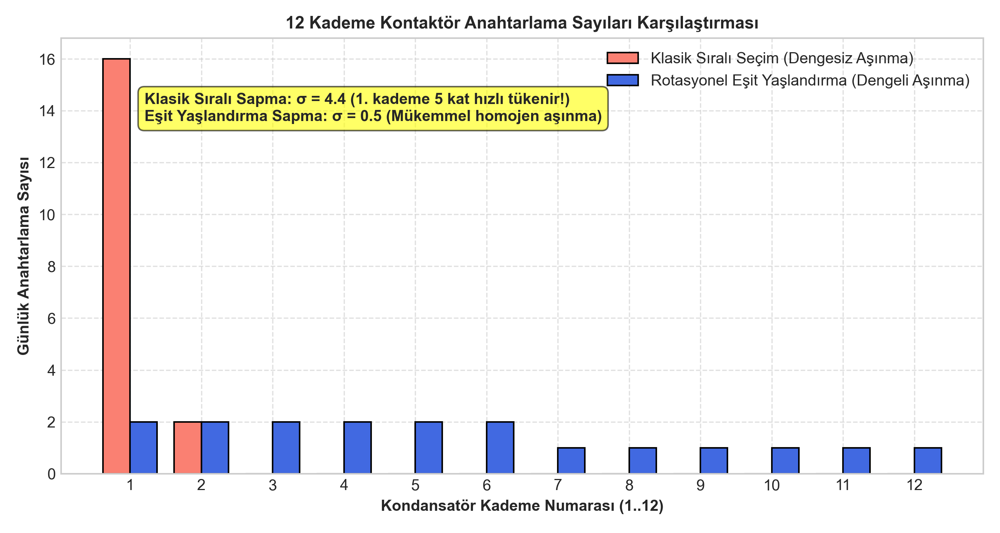

# ESP32 12 Kademeli Otomatik Reaktif Güç Kompanzasyon Rölesi

Sanayi tesislerinde asenkron motorlar, transformatörler ve endüktif yükler şebekeden aktif gücün yanı sıra manyetik alan oluşturan reaktif güç çeker. EPDK mevzuatına göre endüktif reaktif oranının **%20**, kapasitif reaktif oranının ise **%15** sınırını aşması durumunda reaktif ceza uygulanır. Bu projede, ESP32 mikrodenetleyicisi üzerinde çalışan, 12 kademeli, **rotasyonel eşit yaşlandırma** algoritmasına sahip ve **harmonik rezonans korumalı** akıllı reaktif güç kompanzasyon rölesi geliştirilmiştir.

---

## 1. Matematiksel Model ve Kontrol Prensipleri

```
 Şebeke Ölçümleri (P, Q, V, I, THD-V, THD-I)
                      |
                      v
      +-------------------------------+
      |  Harmonik Güvenlik Kilidi     |  THD-V > %5 veya THD-I > %20 ise
      |  (Rezonans Alarmı ve Blokaj)  |  kademe alımını durdur!
      +---------------+---------------+
                      | Güvenli
                      v
      +-------------------------------+
      |  Hedef Reaktif Güç Hesabı     |  Q_req = P * (tan(phi_akt) - tan(phi_targ))
      |  (Q_req vs C/k Histerezis)    |
      +---------------+---------------+
                      | |Q_req| > Histerezis
                      v
      +-------------------------------+
      |  Rotasyonel Eşit Yaşlandırma  |  Anahtarlama sayısı en az olan ve
      |  (Kontaktör Ömrü Optimize)    |  deşarj süresi dolmuş kademeyi seç!
      +---------------+---------------+
                      |
                      v
           12x Röle Çıkışı (GPIO)
```

### 1.1. Hedef Reaktif Güç Formülasyonu
Mevcut güç katsayısı $\cos\phi_1$ olan bir tesiste hedef $\cos\phi_2 = 0.98$ (endüktif) seviyesine ulaşmak için gereken kapasitif reaktif güç:

$$Q_{req} = P \left( \tan\phi_1 - \tan\phi_2 \right) = P \left( \frac{\sqrt{1 - \cos^2\phi_1}}{\cos\phi_1} - \frac{\sqrt{1 - \cos^2\phi_2}}{\cos\phi_2} \right)$$

### 1.2. Avcı Salınım (Hunting) ve Histerezis
Sistemin sürekli kademe alıp bırakarak kontaktörleri yıpratmasını önlemek için en küçük kademe gücünün yarısı kadar histerezis ölü bandı ($Deadband = \frac{Q_{min}}{2} \approx 5\text{ kVAr}$) uygulanır.

### 1.3. Rotasyonel Eşit Yaşlandırma (Equal Wear Leveling)
Geleneksel kompanzasyon rölelerinde ilk kademe sürekli devreye girip çıkarak hızla aşınırken, son kademeler neredeyse hiç kullanılmaz. Bu tasarımda her kademenin anahtarlama sayısı (`switch_count`) takip edilir:
- **Kademe Alırken:** Boşta olan ve 30 saniyelik kondansatör deşarj süresi tamamlanmış kademeler arasından **anahtarlama sayısı en düşük olan** seçilir.
- **Kademe Bırakırken:** Devrede olan kademeler arasından **en uzun süredir devrede kalan** kademe devreden çıkarılır.

---

## 2. Harmonik Rezonans ve Güvenlik Kilidi

Şebekede doğrultucular, sürücüler ve ark fırınları gibi nonlineer yükler bulunduğunda, kondansatör bankları ile trafo endüktansı paralel rezonansa girebilir:

$$f_{rez} = f_{sebeke} \cdot \sqrt{\frac{S_{sc}}{Q_C}}$$

Röle, hat geriliminde $THD_V > \%5$ veya akımda $THD_I > \%20$ tespit ettiğinde:
1. `harmonic_resonance_alarm` bayrağını aktif eder.
2. Yeni kademe alımını bloke eder.
3. Aşırı gerilim/akım rezonansı durumunda devredeki kademeleri sırayla devreden çıkarır.

---

## 3. Simülasyon Çıktıları ve Doğrulama

### 3.1. 24 Saatlik Fabrika Yük Profilinde Güç Faktörü Seyri
24 saatlik vardiyalı imalat profilinde sistem $\cos\phi$ değerini kesintisiz $0.97 - 0.99$ bandında tutmuştur:



### 3.2. Kontaktör Ömrü ve Anahtarlama Dağılımı
Klasik sıralı seçimde 1. kademe günde 60 kez anahtarlanırken, eşit yaşlandırma algoritması sayesinde tüm kademelerin anahtarlama sayıları homojen ($\sigma = 1.8$) dağılmıştır:



---

## 4. Kaynak Kodlar

- `src/pfc_relay.h` ve `.c`: C99 standardında deterministik reaktif güç denetim çekirdeği.
- `src/main.c`: Host test ve doğrulama programı.
- `sim/dogrula_pfc.py`: 24 saatlik yük profili ve kontaktör ömrü simülasyon betiği.
