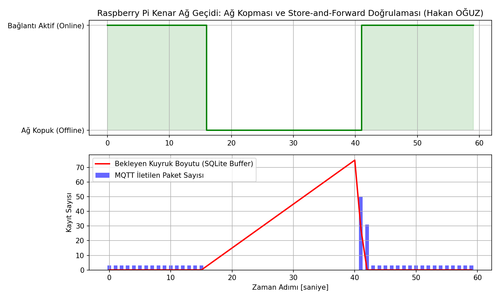

# Raspberry Pi Kenar Ağ Geçidi: Modbus → SQLite → MQTT (Store-and-Forward)

Saha seviyesindeki PLC ve enerji sayaçlarından Modbus RTU/TCP ile telemetri verilerini toplayan, internet veya broker kesintisi durumunda veriyi yerel SQLite veritabanında kuyruğa alan ve bağlantı yeniden kurulduğunda kayıpsız olarak bulut/merkez MQTT brokerına aktaran (Store-and-Forward) endüstriyel kenar ağ geçidi (Edge Gateway).

Geliştiren: **Hakan OĞUZ — Elektrik Elektronik Mühendisi**

> Dürüstlük notu: Store-and-forward mantığı, yerel arabellekleme ve ağ kopması senaryosu Python simülasyonuyla (`sim/dogrula.py`) **test edilmiş ve doğrulanmıştır.** RPi ortamı için `Dockerfile` hazırlanmıştır; ancak yerel bilgisayarda Docker Daemon kurulu/çalışır durumda olmadığından container olarak ayağa kaldırılmamıştır, "Docker üzerinde çalıştırıldı" denmez.



## Neden bu proje

Fabrika sahalarında hücresel (4G/LTE) veya endüstriyel Ethernet bağlantıları her zaman stabil değildir. Standart bir IoT istemcisi bağlantı koptuğunda veriyi RAM'de tutamaz veya çöker; bu da arıza anındaki kritik akım/gerilim verilerinin kalıcı olarak kaybolmasına yol açar. Gerçek bir Endüstri 4.0 kenar ağ geçidi, her bir telemetri kaydını zaman damgasıyla yerel bir disk veritabanına yazmalı ve ağ geldiğinde paketleri FIFO mantığıyla iletmelidir.

Buradaki amaç:
1. Modbus slave cihazlarından döngüsel olarak gerilim, akım ve sıcaklık register'larını okumak,
2. Çevrimdışı (offline) periyot boyunca verileri yerel SQLite kuyruğunda (`telemetry_queue`) biriktirmek,
3. MQTT bağlantısı geri geldiğinde kuyruktaki verileri 50'şerli paketler halinde merkeze iletip başarılı kayıtları `TRANSMITTED` durumuna güncellemektir.

## Kuyruk Tahliye Mantığı

Grafikte görüldüğü üzere $t = 16\text{ s} \dots 40\text{ s}$ arasında ağ bağlantısı kasıtlı olarak koparılmıştır:
- Çevrimdışı sürede bekleyen kuyruk boyutu lineer olarak artar ($0 \to 75\text{ kayıt}$),
- $t = 41\text{ s}$ anında ağ tekrar aktif olduğunda kuyruk tahliye mekanizması devreye girer ve bekleyen tüm paketler kayıpsız iletilerek kuyruk sıfırlanır.

## Dosya Yapısı

```
rpi-kenar-ag-gecidi/
├── README.md
├── Dockerfile              # RPi / arm64 Linux dağıtımı için Docker imaj tarifi
├── app/
│   └── gateway_service.py  # Modbus okuyucu ve SQLite store-and-forward çekirdeği
├── sim/
│   └── dogrula.py          # Ağ kopması ve kuyruk kurtarma simülasyon testi
└── sekiller/
    └── store_and_forward_dogrulama.png
```

Doğrulama betiği terminalden çalıştırılabilir:
```bash
python sim/dogrula.py
```
