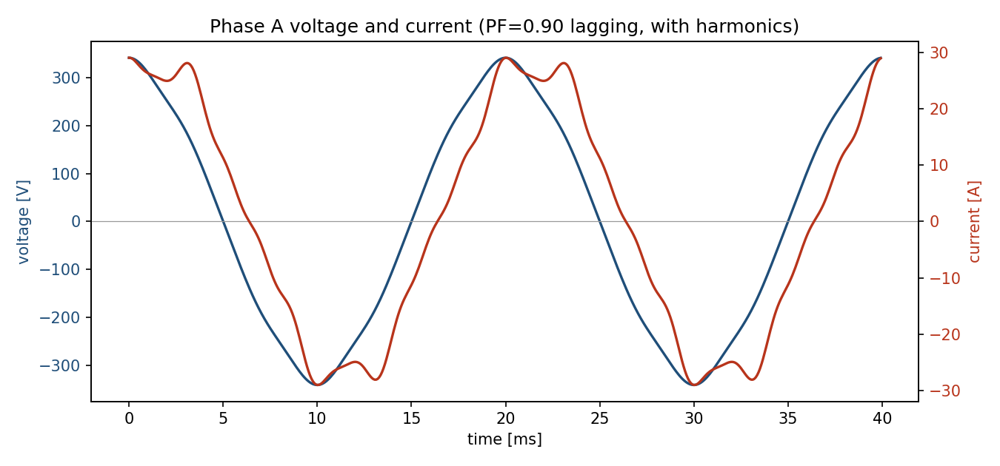
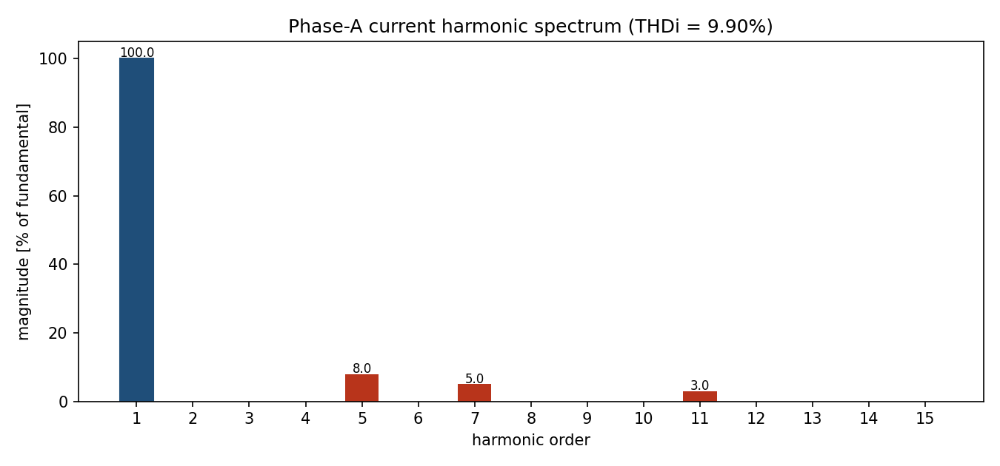
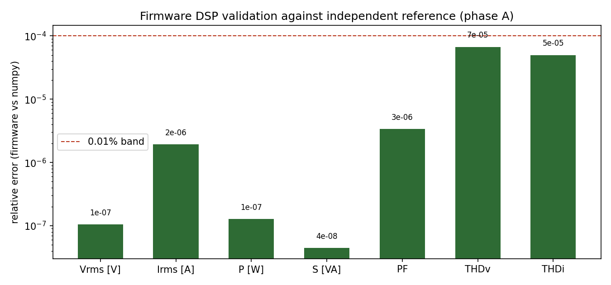

# Üç Fazlı Enerji Analizörü Düğümü (ESP32 / ESP-IDF)

ESP32 üzerinde çalışan, üç fazlı gerilim ve akım dalga biçimlerinden **gerçek RMS, aktif/görünür/
reaktif güç, güç faktörü ve toplam harmonik bozulumu (THD)** hesaplayan ve sonuçları **Modbus TCP**
ile yayınlayan bir enerji ölçüm düğümü. Sinyal işleme çekirdeği, taşınabilir C olarak yazılmış ve
aynı kaynak kod host tarafında (gcc) sentetik dalga biçimlerine karşı doğrulanmıştır.

Geliştiren: **Hakan OĞUZ — Elektrik Elektronik Mühendisi**

> Dürüstlük notu: DSP çekirdeği (`power_metrics.c`) host'ta bağımsız bir referansa karşı
> **doğrulanmıştır** (aşağıdaki sonuçlara bakın). ESP-IDF firmware'i **tasarım/geliştirme
> düzeyindedir; fiziksel karta yüklenip test edilmemiştir.** "Karta yükledim" denmez.



## Neden bu proje

Fabrikalarda ve binalarda enerji izleme, güç kalitesi (özellikle harmonikler) ve verimlilik için
üç fazlı ölçüm düğümleri yaygındır. Burada amaç, ticari bir enerji analizörünün çekirdek ölçüm
işlevini — örnekleme, RMS/güç hesabı ve THD kestirimi — sıfırdan, gömülü bir hedefte koşacak
biçimde ve **doğruluğu kanıtlanmış** olarak tasarlamaktır.

## Ölçüm teorisi

**Örnekleme penceresi.** Mains 50 Hz; çevrim başına 256 örnek, 10 çevrimlik pencere →
pencere başına **N = 2560 örnek**, kanal başına örnekleme hızı 12,8 kHz. Pencerenin tam sayıda
çevrim içermesi, her harmoniğin ayrık Fourier bininin tam üstüne düşmesini sağlar; böylece
pencereleme (windowing) gerekmez ve sızıntı (spectral leakage) oluşmaz.

**Gerçek RMS.** Dalga biçiminin tüm harmoniklerini kapsayacak biçimde örneklerden:

```
Vrms = sqrt( (1/N) Σ v[k]² )        Irms = sqrt( (1/N) Σ i[k]² )
```

**Güçler.**

```
P (aktif)     = (1/N) Σ v[k]·i[k]          [W]   (tüm ortak harmoniklerin katkısını içerir)
S (görünür)   = Vrms · Irms                 [VA]
Q (reaktif)   = sqrt( S² − P² )             [var] (gerçek RMS tanımıyla "non-active")
PF            = P / S
```

PF burada **gerçek güç faktörüdür**; harmonik bozulum PF'yi temel bileşen yer değiştirme güç
faktörünün (cos φ₁) altına çeker. Doğrulamada bu etki görülür (cos φ₁ = 0,900 iken PF = 0,897).

**THD (harmonik korelasyonu).** Her `h` harmoniği için genlik, dalga biçiminin o frekanstaki
sin/cos ile korelasyonundan bulunur:

```
A_h = (2/N) · sqrt( (Σ x[k]·cos(2π h k / spc))² + (Σ x[k]·sin(2π h k / spc))² )
THD = sqrt( Σ_{h=2..15} A_h² ) / A_1
```

Bu, harmonik başına tek bir DFT bini hesaplamaya eşdeğerdir (Goertzel mantığı) ve tüm FFT'den
çok daha hafiftir — gömülü hedef için uygundur.

## Mimari

```
  3F Gerilim ──[dirençli bölücü]──┐
  3F Akım   ──[akım trafosu + burden]──┐
                                       ├─► ESP32 ADC (sürekli/DMA, 6 kanal, 12.8 kHz/kanal)
                                       │
        power_metrics.c (RMS, P/S/Q, PF, THD)  ◄── ham sayımlar -> V/A ölçekleme (kalibrasyon)
                                       │
                         Modbus TCP giriş register'ları (port 502)
                                       │
                         SCADA / PLC / izleme yazılımı
```

Analog ön uç: gerilim için **dirençli bölücü** (orta-raya kaydırılmış, 11 dB zayıflatma ile
0–3,3 V'a oturtulmuş), akım için **akım trafosu (CT) + burden direnci**. ADC ham sayımları,
`app_main.c` içindeki `V_SCALE`/`I_SCALE` kalibrasyon katsayılarıyla gerçek birimlere çevrilir.

## Modbus TCP register haritası (giriş register'ları, uint16)

Her faz 8 register: `Vrms×10`, `Irms×100`, `P`, `S`, `Q`, `PF×1000`, `THDv×1000`, `THDi×1000`.

| Offset | İçerik | Offset | İçerik |
|---|---|---|---|
| 0–7   | Faz A bloğu | 16–23 | Faz C bloğu |
| 8–15  | Faz B bloğu | 24–27 | P_top, S_top, Q_top, PF_top×1000 |

## Firmware derleme (ESP-IDF)

```bash
cd firmware
idf.py set-target esp32
idf.py menuconfig          # Wi-Fi SSID/parola (Energy analyzer node configuration)
idf.py build flash monitor
```

`espressif/esp-modbus` bileşeni, bileşen yöneticisi tarafından `idf_component.yml`'den otomatik
çekilir.

## Host doğrulaması (DSP çekirdeği)

Gerçek firmware DSP kodu (`power_metrics.c`), host'ta derlenip bilinen harmonik içerikli sentetik
üç fazlı sinyallerle beslenir ve bağımsız bir numpy referansıyla karşılaştırılır:

```bash
cd sim
python gen_signals.py                                  # sinyal + referans + grafikler
gcc -O2 -std=c11 host_test.c \
    ../firmware/components/power_metrics/power_metrics.c \
    -I../firmware/components/power_metrics -lm -o host_test
./host_test samples.csv 256                            # firmware DSP'yi host'ta koşar
python compare.py                                      # karşılaştırma + doğrulama grafiği
```

**Test senaryosu:** 230 V faz-nötr gerilim (3., 5., 7. harmonikler), 20 A akım, temel PF 0,90
geri (5., 7., 11. akım harmonikleri). Sonuçlar:

| Büyüklük | Firmware (C) | Referans (numpy) | Analitik |
|---|---|---|---|
| Vrms (Faz A) | 230,109 V | 230,109 V | — |
| Irms (Faz A) | 20,098 A | 20,098 A | — |
| P (Faz A) | 4149,7 W | 4149,7 W | — |
| S (Faz A) | 4624,7 VA | 4624,7 VA | — |
| PF (Faz A) | 0,8973 | 0,8973 | <0,90 (bozulum) |
| THD_v | %3,082 | %3,082 | **%3,082** |
| THD_i | %9,899 | %9,899 | **%9,899** |
| P (3 faz) | 12 449 W | 12 449 W | — |

Firmware DSP ile referans arasındaki **maksimum bağıl hata 6,7×10⁻⁵** (float32/float64 farkı),
ve THD değerleri enjekte edilen harmonik içerikle **analitik olarak** birebir uyuşur.




## Dosya düzeni

```
firmware/
  main/app_main.c          ADC + Modbus + ölçüm görevi
  main/net_connect.c/.h    Wi-Fi istasyon getirme
  components/power_metrics/ taşınabilir DSP çekirdeği (host + ESP32 ortak)
sim/
  gen_signals.py           sentetik sinyal + numpy referans + grafikler
  host_test.c              gerçek C çekirdeğini host'ta koşan test
  compare.py               doğrulama raporu + grafik
makale/                    İngilizce akademik makale (.tex + .pdf)
```

## Sınırlamalar

- Firmware fiziksel donanımda çalıştırılmamıştır; ADC zamanlaması ve kalibrasyon katsayıları
  devreye alma (commissioning) sırasında ölçülmelidir.
- Reaktif güç, gerçek RMS "non-active" tanımıyla hesaplanır; temel bileşen bazlı Q (Budeanu/IEEE
  1459 ayrıştırması) ayrıca eklenebilir.
- Doğrulama, bilinen sentetik sinyallerle yapılmıştır; gerçek şebeke ölçümüyle saha doğrulaması
  kapsam dışıdır.

---
Lisans: MIT — bkz. depo kökündeki `LICENSE`.
