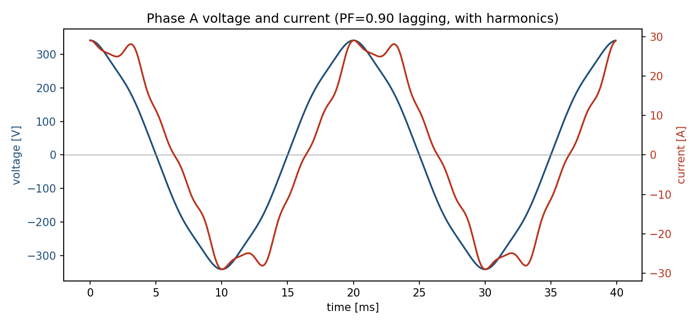
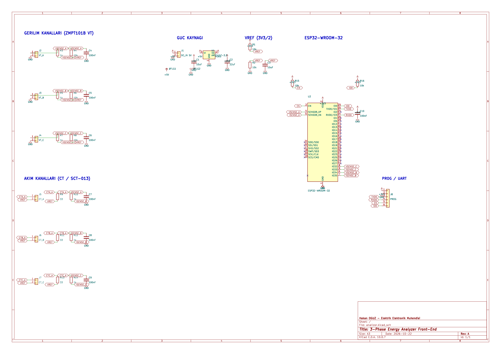
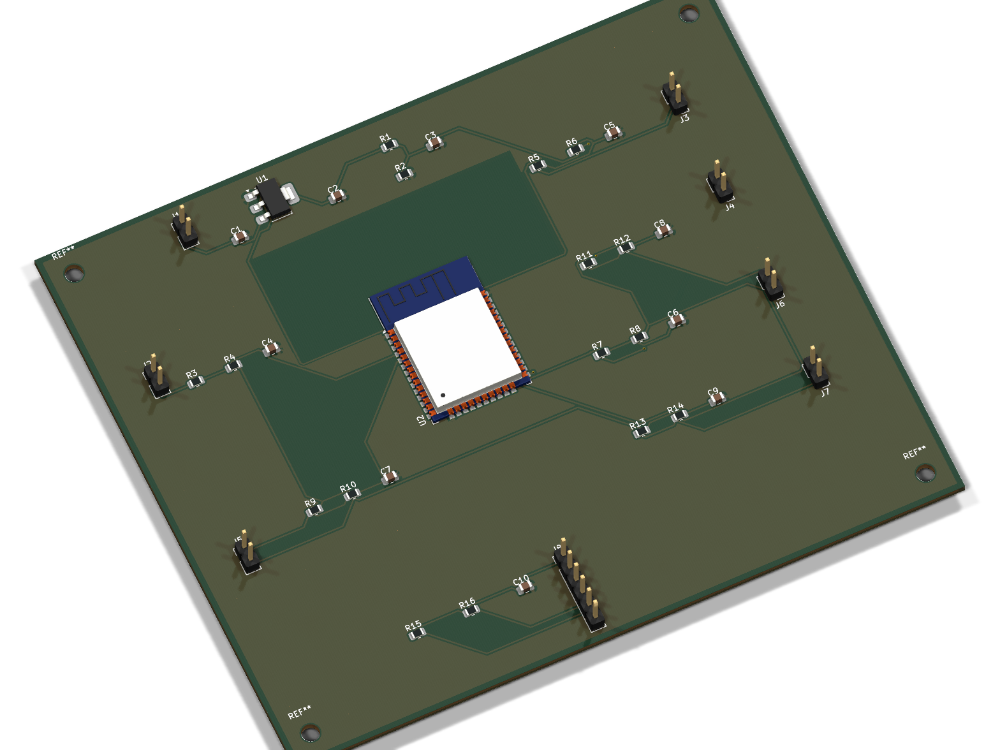
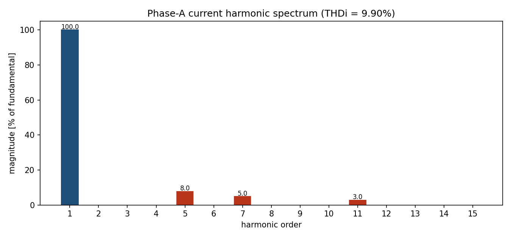
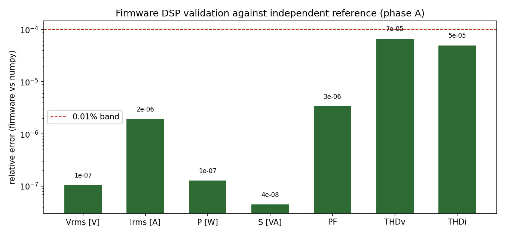

# Üç Fazlı Enerji Analizörü Düğümü (ESP32 / ESP-IDF)

Üç fazlı gerilim ve akım dalga biçimlerinden gerçek RMS, aktif/görünür/reaktif güç, güç faktörü
ve toplam harmonik bozulum (THD) hesaplayan, sonuçları Modbus TCP ile yayınlayan bir ölçüm düğümü.
Sinyal işleme çekirdeği taşınabilir C'dir; aynı kaynak host'ta (gcc) sentetik dalga biçimleriyle
koşturulup bağımsız bir numpy referansıyla karşılaştırılır.

Hakan OĞUZ — Elektrik Elektronik Mühendisi



## Ölçüm teorisi

50 Hz şebeke, çevrim başına 256 örnek, 10 çevrimlik pencere: N = 2560 örnek, kanal başına 12,8 kHz.
Pencere tam sayıda çevrim içerdiğinden her harmonik ayrık Fourier binine oturur, pencereleme
gerekmez ve sızıntı oluşmaz.

```
Vrms = sqrt( (1/N) Σ v[k]² )        Irms = sqrt( (1/N) Σ i[k]² )
P    = (1/N) Σ v[k]·i[k]   [W]       S = Vrms·Irms   [VA]
Q    = sqrt( S² − P² )     [var]     PF = P / S
```

PF gerçek güç faktörüdür; harmonik bozulum onu temel bileşen yer değiştirme faktörünün (cos φ₁)
altına çeker (cos φ₁ = 0,900 iken PF = 0,897). THD için her h harmoniğinin genliği, dalga biçiminin
o frekanstaki sin/cos ile korelasyonundan bulunur (harmonik başına tek DFT bini, Goertzel mantığı):

```
A_h = (2/N)·sqrt( (Σ x[k]·cos(2π h k / spc))² + (Σ x[k]·sin(2π h k / spc))² )
THD = sqrt( Σ_{h=2..15} A_h² ) / A_1
```

## Analog ön uç ve mimari

```
3F Gerilim → ZMPT101B VT ─┐
3F Akım    → CT (SCT-013) ─┤→ VREF=3V3/2 bias + RC anti-alias → ESP32 ADC (6 kanal, 12,8 kHz/kanal)
                           │
          power_metrics.c (RMS, P/S/Q, PF, THD) → Modbus TCP giriş register'ları (port 502) → SCADA/PLC
```

Gerilim için ZMPT101B gerilim trafosu, akım için akım trafosu (SCT-013). Her ikisi de orta-raya
(VREF = 3V3/2) biaslanıp RC anti-alias filtreden geçer. ADC ham sayımları `app_main.c` içindeki
`V_SCALE`/`I_SCALE` katsayılarıyla gerçek birimlere çevrilir.

## Devre şeması ve PCB (KiCad 10)

Ölçüm ön-ucunun şeması `donanim/analizor.kicad_sch`: 3 gerilim + 3 akım kanalı, VREF bias üreteci,
AMS1117-3.3 regülatör, ESP32-WROOM-32 ve UART/boot başlığı. ADC pin ataması firmware ile birebir
(VA=IO36, IA=IO39, VB=IO34, IB=IO35, VC=IO32, IC=IO33). ERC: 0 ihlal.

Şemadan türetilen 2 katmanlı kart `donanim/analizor.kicad_pcb`: işlevsel kümelenmiş yerleşim,
iki tarafta GND dökümü, 124×104 mm, köşelerde M3 montaj deliği, ESP32 anten keepout alanı bakırsız.
DRC: 0 ihlal. Üretim çıktıları `donanim/fabrikasyon/` (Gerber + Excellon drill), BOM
`donanim/analizor-bom.csv`, şema baskısı `donanim/analizor.pdf`.




## Modbus TCP register haritası (giriş register'ları, uint16)

Her faz 8 register: `Vrms×10`, `Irms×100`, `P`, `S`, `Q`, `PF×1000`, `THDv×1000`, `THDi×1000`.

| Offset | İçerik | Offset | İçerik |
|---|---|---|---|
| 0–7  | Faz A | 16–23 | Faz C |
| 8–15 | Faz B | 24–27 | P_top, S_top, Q_top, PF_top×1000 |

## Firmware derleme (ESP-IDF)

```bash
cd firmware
idf.py set-target esp32
idf.py menuconfig          # Wi-Fi SSID/parola
idf.py build flash monitor
```

`espressif/esp-modbus` bileşeni `idf_component.yml`'den otomatik çekilir.

## Host doğrulaması

DSP çekirdeği host'ta derlenip bilinen harmonik içerikli sentetik üç fazlı sinyallerle beslenir,
numpy referansıyla karşılaştırılır:

```bash
cd sim
python gen_signals.py
gcc -O2 -std=c11 host_test.c ../firmware/components/power_metrics/power_metrics.c \
    -I../firmware/components/power_metrics -lm -o host_test
./host_test samples.csv 256
python compare.py
```

Senaryo: 230 V faz-nötr (3., 5., 7. harmonikler), 20 A akım, temel PF 0,90 geri (5., 7., 11. akım
harmonikleri).

| Büyüklük | Firmware (C) | Referans (numpy) |
|---|---|---|
| Vrms (Faz A) | 230,109 V | 230,109 V |
| Irms (Faz A) | 20,098 A | 20,098 A |
| P (Faz A) | 4149,7 W | 4149,7 W |
| S (Faz A) | 4624,7 VA | 4624,7 VA |
| PF (Faz A) | 0,8973 | 0,8973 |
| THD_v | %3,082 | %3,082 |
| THD_i | %9,899 | %9,899 |
| P (3 faz) | 12 449 W | 12 449 W |

Firmware ile referans arasında maksimum bağıl hata 6,7×10⁻⁵ (float32/float64). THD değerleri enjekte
edilen harmonik içerikle birebir uyuşur.




## Dosya düzeni

```
donanim/      KiCad şeması + PCB + renderlar + fabrikasyon (Gerber/drill) + BOM
firmware/     ESP-IDF uygulaması (ADC + Modbus), power_metrics çekirdeği
sim/          sentetik sinyal üreteci, host testi, karşılaştırma
makale/       İngilizce makale (.tex + .pdf)
```

Lisans: MIT (bkz. depo kökü).
