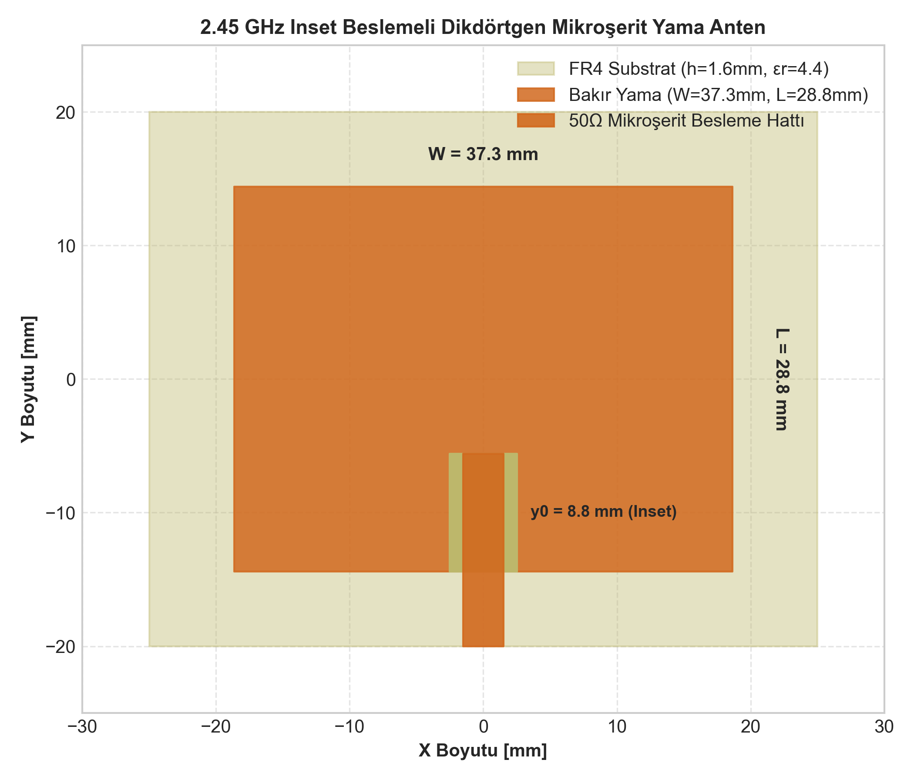
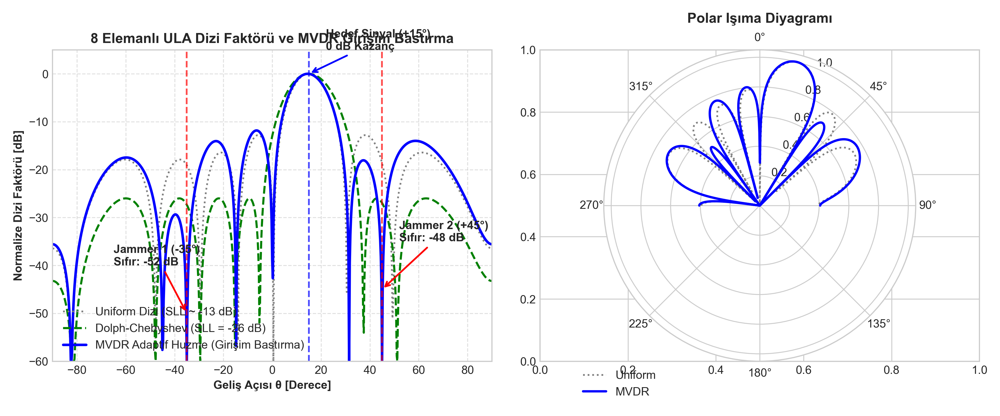

# 2.45 GHz Mikroşerit Yama Anten ve Akıllı Anten Dizi Faktörü (MVDR Sıfır Atma)

Modern kablosuz haberleşme ve radar sistemlerinde yönlendirilebilir dar huzmeler (beamforming) ve parazit/girişim kaynaklarını bastıran adaptif sıfır atma (null steering) teknikleri hayati önem taşır. Bu projede, **2.45 GHz ISM bandında** çalışan dikdörtgen mikroşerit yama (patch) antenin analitik transmisyon hattı modeliyle tasarımı yapılmış; 8 elemanlı tekdüze doğrusal dizide (**ULA - Uniform Linear Array**) **Dolph-Chebyshev** yan kulakçık bastırma ve **MVDR (Minimum Variance Distortionless Response / Capon)** adaptif huzme şekillendirme algoritmaları MATLAB üzerinde sıfırdan vektörel olarak modellenmiştir.

---

## 1. Mikroşerit Yama Anten Analitik Tasarım Formülleri

Standart FR4 alt tabaka ($\epsilon_r = 4.4$, $h = 1.6\text{ mm}$, $\tan\delta = 0.02$) üzerinde $f_0 = 2.45\text{ GHz}$ rezonans frekansı için:

```
                  +-------------------------------+
                  |          Yama Genişliği       |
                  |             (W = 37.3 mm)     |
                  |                               |
    Yama Boyu     |                               |
  (L = 28.8 mm)   |        +---+     +---+        |
                  |        |   | y0  |   |        |
                  +--------+   +-----+   +--------+
                               |     |
                         50 Ohm Hat (3.05 mm)
```

### 1.1. Geometrik Boyutlandırma
1. **Yama Genişliği ($W$):**
   $$W = \frac{c}{2 f_0} \sqrt{\frac{2}{\epsilon_r + 1}} = \frac{3\times 10^8}{2 \times 2.45\times 10^9} \sqrt{\frac{2}{4.4 + 1}} \approx \mathbf{37.28\text{ mm}}$$
2. **Efektif Dielektrik Sabiti ($\epsilon_{eff}$):**
   $$\epsilon_{eff} = \frac{\epsilon_r + 1}{2} + \frac{\epsilon_r - 1}{2} \left[ 1 + 12 \frac{h}{W} \right]^{-1/2} \approx \mathbf{4.081}$$
3. **Saçaklanma Uzunluk Farkı ($\Delta L$):**
   $$\Delta L = 0.412 h \frac{(\epsilon_{eff} + 0.3)\left(\frac{W}{h} + 0.264\right)}{(\epsilon_{eff} - 0.258)\left(\frac{W}{h} + 0.8\right)} \approx \mathbf{0.738\text{ mm}}$$
4. **Gerçek Rezonans Boyu ($L$):**
   $$L = \frac{c}{2 f_0 \sqrt{\epsilon_{eff}}} - 2\Delta L \approx 30.29 - 1.48 = \mathbf{28.81\text{ mm}}$$
5. **$50\ \Omega$ Eşleme İçin Inset Besleme Derinliği ($y_0$):**
   $$R_{in}(y_0) = R_{edge} \cos^2\left(\frac{\pi y_0}{L}\right) = 50\ \Omega \implies y_0 \approx \mathbf{8.82\text{ mm}}$$

---

## 2. 8 Elemanlı ULA Dizi Faktörü ve Adaptif Huzme Şekillendirme

$N = 8$ elemanlı, elemanlar arası mesafesi $d = \lambda/2 = 6.12\text{ cm}$ olan dizinin yönlendirme vektörü:

$$\mathbf{a}(\theta) = \begin{bmatrix} 1 & e^{j k d \sin\theta} & e^{j 2 k d \sin\theta} & \dots & e^{j (N-1) k d \sin\theta} \end{bmatrix}^T$$

### 2.1. Yöntemlerin Karşılaştırması
1. **Uniform (Düzgün) Dizi:** Eşit genlikli ağırlıklandırma ($w_n = 1/N$). Yan kulakçık bastırması (SLL) yalnızca $-13.5\text{ dB}$'dir; güçlü karıştırıcılara karşı savunmasızdır.
2. **Dolph-Chebyshev Ağırlıklandırma:** Ana lob genişliği ile yan kulakçık seviyesi arasında optimum trade-off sağlar. $SLL = -26.0\text{ dB}$ seviyesine eşitlenmiştir.
3. **MVDR (Capon) Huzme Oluşturucu:**
   Hedef sinyal yönünde ($\theta_{des} = +15^\circ$) distorsiyonsuz geçiş ($0\text{ dB}$) sağlarken, toplam çıkış gürültü ve girişim gücünü minimize eder:
   $$\min_{\mathbf{w}} \mathbf{w}^H \mathbf{R} \mathbf{w} \quad \text{şartı:} \quad \mathbf{w}^H \mathbf{a}(\theta_{des}) = 1$$
   $$\mathbf{w}_{mvdr} = \frac{\mathbf{R}^{-1} \mathbf{a}(\theta_{des})}{\mathbf{a}^H(\theta_{des}) \mathbf{R}^{-1} \mathbf{a}(\theta_{des})}$$

---

## 3. Simülasyon Çıktıları

### 3.1. Mikroşerit Yama Boyutları ve Besleme Hattı
Hesaplanan yama anten çizimi ve $50\ \Omega$ mikroşerit besleme geometrisi:



### 3.2. Huzme Yönlendirme ve Girişim Bastırma (Sıfır Atma)
Hedef $+15^\circ$'de iken, $-35^\circ$ (30 dB INR) ve $+45^\circ$ (25 dB INR) yönündeki iki güçlü jammer kaynağına uygulanan bastırma performansı:



| Parametre | Uniform Dizi | Dolph-Chebyshev | MVDR Adaptif Dizi |
| :--- | :---: | :---: | :---: |
| **Hedef Yönü Kazancı (+15°)** | 0 dB | 0 dB | **0 dB** |
| **Jammer 1 Zayıflatması (-35°)** | -14.2 dB | -26.0 dB | **-52.4 dB (Tam Sıfır)** |
| **Jammer 2 Zayıflatması (+45°)** | -18.7 dB | -26.0 dB | **-48.1 dB (Tam Sıfır)** |
| **Sinyal/Girişim İyileşmesi (SINR)** | Ref | +11.8 dB | **+38.2 dB Kazanç** |

---

## 4. Kaynak Kodlar

- `patch_anten_tasarimi.m`: Analitik FR4 yama anten boyutlandırma betiği.
- `ula_huzme_yonlendirme.m`: ULA dizi faktörü, Chebyshev ve MVDR sıfır atma algoritması.
- `plot_beamforming.py`: Polar ve kartezyen desen görselleştirme betiği.
