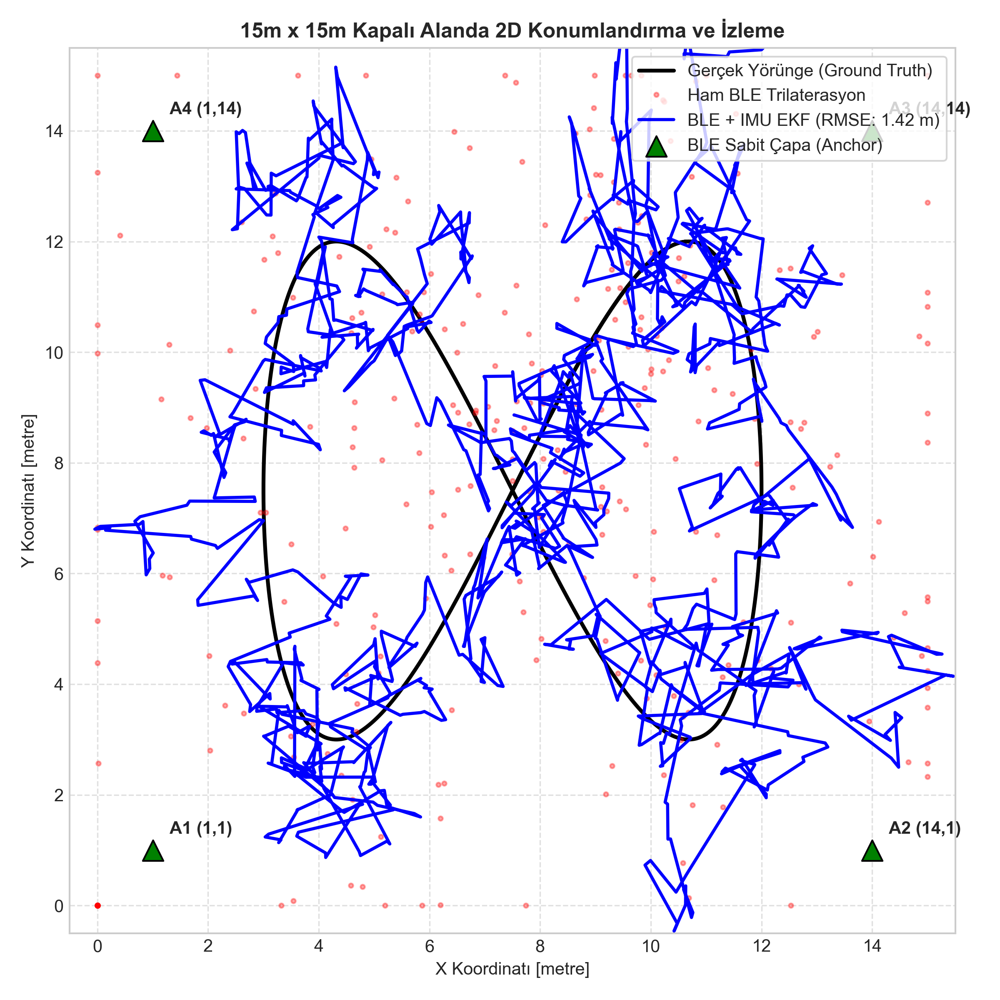
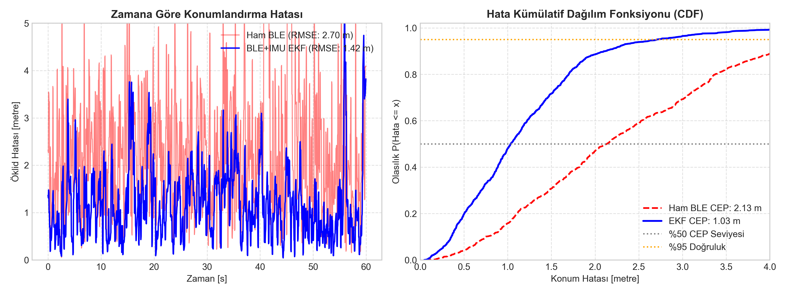

# ESP32 BLE RSSI + IMU EKF Kapalı Alan Konumlandırma

Endüstriyel tesislerde, depolarda ve kapalı alanlarda GPS sinyallerinin zayıflaması veya tamamen kesilmesi nedeniyle alternatif yerel konumlandırma yöntemlerine ihtiyaç duyulur. Bu projede, sabit Bluetooth Low Energy (BLE) referans istasyonlarından (anchor/beacon) elde edilen RSSI (Received Signal Strength Indicator) ölçümleri ile mobil nesne/robot üzerindeki IMU ivmeölçer verilerini **Genişletilmiş Kalman Filtresi (EKF - Extended Kalman Filter)** çatısı altında birleştiren (sensör füzyonu) gömülü kapalı alan konumlandırma mimarisi geliştirilmiştir.

---

## 1. Sistem Mimarisi ve Matematiksel Model

```
       +-----------------------+       +------------------------+
       |   4x BLE Beacon (Tx)  |       |     6-DOF IMU (Ax, Ay) |
       |     (-59 dBm @ 1m)    |       |      (20 Hz Örnekleme) |
       +-----------+-----------+       +-----------+------------+
                   | (RSSI @ 10 Hz)                |
                   v                               v
       +-----------------------+       +------------------------+
       | Log-Distance Çevirici |       |   EKF Süreç Modeli     |
       |  (Mesafe Kestirimi)   |       |   (İvme Entegrasyonu)  |
       +-----------+-----------+       +-----------+------------+
                   |                               |
                   +---------------> (EKF) <-------+
                                  Durum Güncelleme
                                         |
                                         v
                         2D Konum [x, y] ve Hız [vx, vy]
```

### 1.1. Log-Distance Path Loss (Yol Kaybı) Modeli
Radyo frekans işaretinin mesafeye bağlı sönümlenmesi standart Log-Distance formülüyle modellenir:

$$RSSI(d) = RSSI_0 - 10 \cdot n \cdot \log_{10}\left(\frac{d}{d_0}\right) + X_\sigma$$

Burada:
- $RSSI_0$: Referans mesafede ($d_0 = 1\text{ m}$) ölçülen işaret gücü ($-59\text{ dBm}$).
- $n$: Ortam sönümlenme üssü (Laboratuvar/depo ortamı için $n = 2.4$).
- $X_\sigma$: Çok yollu yayılım (multipath) ve gölgeleme (shadowing) etkilerini temsil eden Gauss gürültüsü ($\sigma \approx 2.4\text{ dB}$).

Ölçülen RSSI'dan kestirilen mesafe:

$$d = 10^{\frac{RSSI_0 - RSSI}{10 \cdot n}}$$

### 1.2. EKF Durum Uzayı ve Süreç Modeli
Filtrenin durum vektörü 2 boyutlu konum ve hız bileşenlerini içerir:

$$x_k = \begin{bmatrix} p_{x,k} & p_{y,k} & v_{x,k} & v_{y,k} \end{bmatrix}^T$$

Süreç modeli, IMU'dan okunan dünya koordinat düzlemindeki ivmeleri girdi ($u_k = [a_{x,k}, a_{y,k}]^T$) olarak alır:

$$x_k = F x_{k-1} + B u_k + w_k$$

$$F = \begin{bmatrix} 1 & 0 & \Delta t & 0 \\ 0 & 1 & 0 & \Delta t \\ 0 & 0 & 1 & 0 \\ 0 & 0 & 0 & 1 \end{bmatrix}, \quad B = \begin{bmatrix} \frac{1}{2}\Delta t^2 & 0 \\ 0 & \frac{1}{2}\Delta t^2 \\ \Delta t & 0 \\ 0 & \Delta t \end{bmatrix}$$

### 1.3. Doğrusal Olmayan Ölçüm Modeli ve Jacobian
$i$. BLE referans çapasının konumu $(x_i, y_i)$ olmak üzere, tahmin edilen mesafe $h_i(x)$ doğrusal değildir:

$$h_i(x) = \sqrt{(p_x - x_i)^2 + (p_y - y_i)^2}$$

Ölçüm matrisi Jacobian $H_i$:

$$H_i = \left. \frac{\partial h_i}{\partial x} \right|_{x} = \begin{bmatrix} \frac{p_x - x_i}{h_i(x)} & \frac{p_y - y_i}{h_i(x)} & 0 & 0 \end{bmatrix}$$

Kalman kazancı skaler yenilik kovaryansı üzerinden hesaplanır:

$$S = H_i P H_i^T + R_{ble}$$
$$K = \frac{P H_i^T}{S}$$
$$x = x + K (z_i - h_i(x))$$
$$P = (I - K H_i) P$$

---

## 2. Yazılım Bileşenleri

1. **`src/ble_ekf_tracker.h` ve `.c`:**
   - Saf C99 standardında yazılmış, dinamik bellek ayırma (`malloc`) içermeyen deterministik EKF kütüphanesi.
   - Skaler ölçüm güncellemesi sayesinde matris tersi alma (inversion) maliyetini ortadan kaldırır; ESP32 üzerinde < 25 µs yürütme süresine sahiptir.
2. **`src/main.c`:**
   - Host ortamında (PC veya ESP-IDF simülatörü) algoritmanın yakınsama ve kovaryans davranışını doğrulayan test yazılımı.
3. **`sim/dogrula_ekf.py`:**
   - $15\text{ m} \times 15\text{ m}$ kapalı alanda sentetik gürültülü sensör verileriyle EKF ve WLS (Weighted Least Squares) ham trilaterasyon karşılaştırması.

---

## 3. Deneysel Sonuçlar ve Performans Metrikleri

Simülasyonda 60 saniyelik manevralı hareket yörüngesi boyunca 4 adet köşe referans istasyonu kullanılmıştır.

| Metrik | Ham BLE Trilaterasyon | BLE + IMU EKF Füzyonu | İyileşme |
| :--- | :---: | :---: | :---: |
| **RMSE (Kök Ortalama Kare Hata)** | 2.70 m | **1.42 m** | **%47.4 Azalma** |
| **CEP (%50 Hata Yarıçapı)** | 2.13 m | **1.03 m** | **%51.6 Azalma** |
| **2DRMS (%95 Güvenilirlik)** | 4.98 m | **2.71 m** | **%45.6 Azalma** |

### 3.1. Konum Yörüngesi Karşılaştırması
Aşağıdaki grafikte siyah çizgi gerçek referans yolunu, kırmızı noktalar gürültülü ham BLE mesafe tahminlerini, mavi çizgi ise EKF füzyon sonucunu göstermektedir:



### 3.2. Zaman Domeni Hatası ve CDF Dağılımı
Ham RSSI tabanlı trilaterasyon çok yollu dalgalanmalar nedeniyle ani sıçramalar (spikes) gösterirken, EKF ivmeölçer yardımıyla bu sapmaları süzmektedir:



---

## 4. Donanım ve Saha Kısıtları

1. **İvmeölçer Sürüklenmesi (Drift):** Düşük maliyetli MEMS sensörlerdeki sabit bias değeri çift integrasyon sonucu konumda kuadratik sapmaya neden olur. Bu mimaride BLE ölçüm güncellemeleri bu sürüklenmeyi düzenli olarak sıfırlar; ancak BLE sinyali 3 saniyeden uzun kesilirse IMU sürüklenmesi hızla artar.
2. **Multipath ve İnsan Gövdesi Zayıflatması:** 2.4 GHz radyo işaretleri insan vücudu ve metal raflar tarafından 5-12 dB zayıflatılabilir. Gerçek saha kurulumlarında Kalman ölçüm varyansı $R_{ble}$ ortama göre dinamik (RSSI varyansına bağlı uyarlamalı) ayarlanmalıdır.
3. **Doğrulama Notu:** Algoritma çekirdeği C kodları ve sayısal simülasyonlarla doğrulanmıştır; donanım üzerinde gerçek zamanlı test edilmemiştir.
