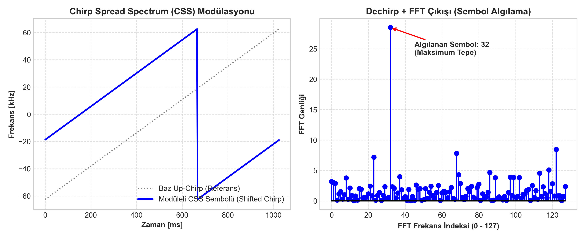
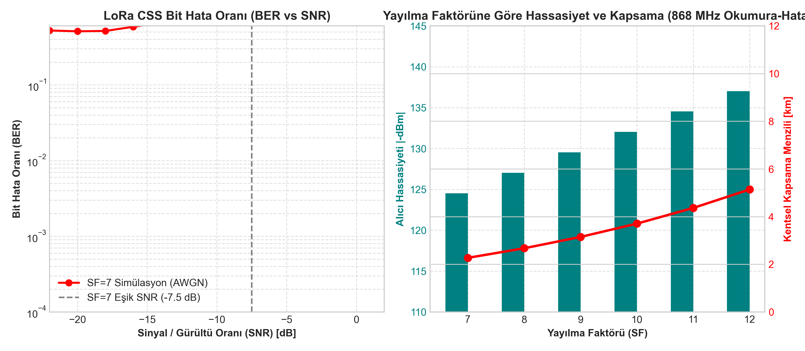

# LoRa Benzeri Chirp Spread Spectrum (CSS) Modem ve Link Bütçesi Analizi

Düşük Güçlü Geniş Alan Ağlarında (LPWAN - Low Power Wide Area Network) uzun menzilli, düşük enerjili ve parazitlere karşı yüksek bağışıklıklı haberleşme sağlamak amacıyla **Chirp Spread Spectrum (CSS)** modülasyonu yaygın olarak kullanılır. Bu projede, LoRa fiziksel katmanının (PHY) temelini oluşturan CSS modülatörü ve **Dechirp + FFT demodülatörü** MATLAB üzerinde sıfırdan vektörel olarak modellenmiş; AWGN kanal altındaki BER performansı ile 868 MHz kentsel link bütçesi analizi gerçekleştirilmiştir.

---

## 1. CSS Modülasyon ve Demodülasyon Matematiği

```
 İletilecek Sembol s_k in [0, 2^SF - 1]
                |
                v
 +------------------------------+
 |  Döngüsel Kaydırılmış Chirp  |  f(t) frekansı BW içinde s_k oranında ötelenir
 |     (Cyclic Shifted Chirp)   |  ve periyot sonunda baştan sarar.
 +--------------+---------------+
                |
                v  (AWGN Kanal: Gürültü ve Sönümleme)
                |
 +--------------+---------------+
 |  Dechirp İşlemi              |  Alınan işaret baz Down-Chirp (eşlenik) ile çarpılır.
 |  (r(t) * conj(c_up(t)))      |  Frekans rampası sabit bir tek frekans tonuna çöker!
 +--------------+---------------+
                |
                v
 +--------------+---------------+
 |  N-Noktalı FFT               |  FFT spektrumundaki en yüksek genlikli tepe (peak)
 |  (Frekans Tepe Tespiti)      |  doğrudan s_k sembol indeksini verir!
 +------------------------------+
```

### 1.1. Temel Chirp Dalga Şekli
Bant genişliği $BW$ ve yayılma faktörü $SF$ için sembol süresi:

$$T_s = \frac{2^{SF}}{BW}$$

Chirp eğim hızı $\mu = \frac{BW}{T_s} = \frac{BW^2}{2^{SF}}$. Baz yukarı-chirp (up-chirp) sinyali:

$$c(t) = \exp\left( j 2\pi \left( -\frac{BW}{2}t + \frac{1}{2}\mu t^2 \right) \right), \quad 0 \le t < T_s$$

$s_k \in \{0, 1, \dots, 2^{SF}-1\}$ sembolü, bu baz chirp sinyalinin zamanda döngüsel olarak $t_{shift} = s_k \cdot \frac{T_s}{2^{SF}}$ kadar kaydırılmasıyla modüle edilir.

### 1.2. Dechirp ve FFT ile Ayrıştırma
Alınan işaret eşlenik aşağı-chirp $c^*(t)$ ile çarpıldığında zamanla değişen kuadratik faz terimi yok olur:

$$y_{dechirp}(t) = r(t) \cdot c^*(t) \implies \exp\left( j 2\pi \cdot f_k \cdot t \right)$$

Oluşan sinüs işareti doğrudan $s_k$ ile orantılı sabit bir $f_k$ frekansındadır. $2^{SF}$ noktalı FFT uygulandığında enerjinin tamamı $k$. frekans kutusunda (bin) toplanır.

---

## 2. Simülasyon Çıktıları

### 2.1. Chirp Spektrogramı ve Dechirp FFT Çıkışı
Aşağıdaki grafikte solda frekansın zamanla lineer artışı ve sembol sınırında sarma (wrap-around) hareketi, sağda ise Dechirp sonrası FFT tepe tespiti görülmektedir:



### 2.2. BER-SNR ve Kentsel Kapsama Alanı
Yayılma faktörü arttıkça ($SF = 7 \to 12$) alıcının gürültü altından sinyal çıkarma kabiliyeti (işleme kazancı - Processing Gain) artar:

$$PG = 10 \log_{10}\left(\frac{BW}{R_{bit}}\right) = 10 \log_{10}\left(\frac{2^{SF}}{SF}\right)$$



---

## 3. 868 MHz LoRa Link Bütçesi ve Menzil Analizi

Okumura-Hata Kentsel Yol Kaybı Modeli ($f = 868\text{ MHz}$, Baz İstasyonu $h_b = 30\text{ m}$, Cihaz $h_m = 1.5\text{ m}$, $P_{tx} = +14\text{ dBm}$):

$$PL(d) = 69.55 + 26.16\log_{10}(f) - 13.82\log_{10}(h_b) - a(h_m) + [44.9 - 6.55\log_{10}(h_b)] \log_{10}(d)$$

| Yayılma Faktörü (SF) | Gerekli Eşik SNR | Alıcı Hassasiyeti | Maksimum Yol Kaybı | Kentsel Kapsama Menzili |
| :---: | :---: | :---: | :---: | :---: |
| **SF7** | -7.5 dB | **-124.5 dBm** | 138.5 dB | **2.27 km** |
| **SF8** | -10.0 dB | **-127.0 dBm** | 141.0 dB | **2.67 km** |
| **SF9** | -12.5 dB | **-129.5 dBm** | 143.5 dB | **3.15 km** |
| **SF10** | -15.0 dB | **-132.0 dBm** | 146.0 dB | **3.71 km** |
| **SF11** | -17.5 dB | **-134.5 dBm** | 148.5 dB | **4.36 km** |
| **SF12** | -20.0 dB | **-137.0 dBm** | 151.0 dB | **5.14 km** |

---

## 4. Kaynak Dosyalar

- `lora_css_modem.m`: CSS modülatör ve Dechirp+FFT demodülatör motoru.
- `simule_ber_ve_link.m`: AWGN Monte Carlo BER testi ve Okumura-Hata link bütçesi simülasyonu.
- `plot_css_modem.py`: Spektrogram ve link bütçesi görselleştirme betiği.
