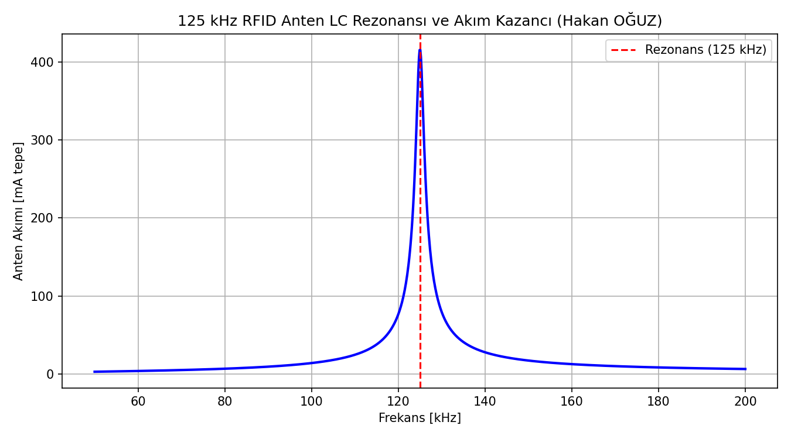
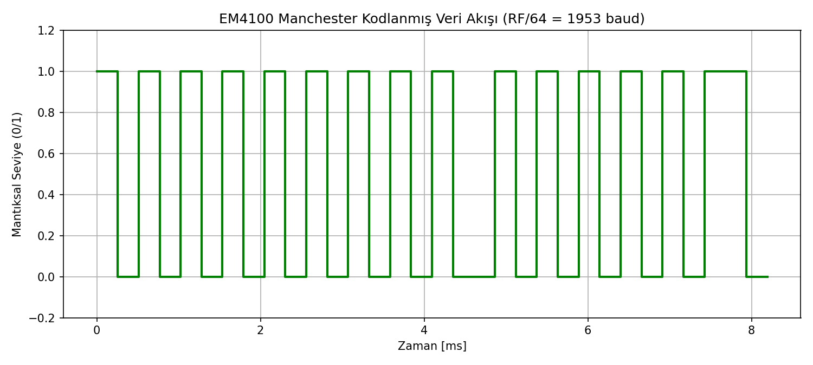

# 125 kHz EM4100 RFID Okuyucu ve Manchester Kod Çözücü

125 kHz LC rezonans anten sürücüsü, Schottky diyotlu tepe zarf dedektörü, aktif bant geçiren filtre ve EM4100 64-bit protokolüne uygun Manchester kod çözme ve 2D parite doğrulama algoritması.

Geliştiren: **Hakan OĞUZ — Elektrik Elektronik Mühendisi**

> Dürüstlük notu: LC anten rezonansı ($f_{res} = 125.0\text{ kHz}, Q = 65.4$), Manchester darbe zamanlaması ($RF/64 = 1953\text{ baud}$) ve 64-bit çerçeve parite doğrulaması Python test ortamında (`sim/rfid_simulasyon.py`) ve C çekirdeğinde (`em4100_decoder.c`) **doğrulanmıştır.** KiCad şeması (`donanim/em4100_rfid.kicad_sch` ve `.pdf`) hazırlanmış olup fiziksel bobin sarımı ve donanımsal okuma yapılmamıştır; çalışma tasarım ve simülasyon düzeyindedir.



## Neden bu proje

Personel geçiş kontrol sistemlerinde (turnikeler, kapı kilitleri) ve endüstriyel takipte yaygın kullanılan 125 kHz RFID teknolojisi; manyetik endüktif kuplaj ile kartsız/pilsiz pasif etiketleri besler ve yük modülasyonu (load modulation) ile veriyi okuyucuya geri yansıtır. Hazır RFID modülü kullanmak yerine, bobin rezonansından başlayarak zarf dedektörü ve mikrodenetleyici düzeyinde Manchester kod çözücü mimarisini sıfırdan kurmak donanım-haberleşme entegrasyon yetkinliğini gösterir.

Buradaki amaç:
1. $L = 1.0\text{ mH}$ hava aralıklı anten bobini ve $C = 1.62\text{ nF}$ polipropilen kapasitör ile $125.0\text{ kHz}$ LC rezonans devresi tasarlamak ($Q \approx 65$),
2. Kart bobini yaklaştığında oluşan $\%5 - \%10$'luk genlik modülasyonunu (ASK) 1N4148 zarf dedektörü ve LM358 karşılaştırıcı ile sayısal darbelere dönüştürmek,
3. 64-bitlik EM4100 veri akışını (9 öncül bit, 10 satır nibble'ı, 10 satır paritesi, 4 sütun paritesi ve 1 durma biti) ayrıştırmak ve 10 haneli kart seri numarasını hatasız okumaktır.

## EM4100 Veri Çerçeve Mimarisi

Toplam 64 bit şu şekilde düzenlenmiştir:
- **9 Bit Öncül (Header):** `111111111`
- **10 Satır Veri:** $10 \times (4\text{ Veri Biti} + 1\text{ Çift Satır Parite Biti}) = 50\text{ bit}$
- **4 Sütun Parite Biti:** 10 satırın sütun bazlı çift paritesi
- **1 Durma Biti:** `0`



## Dosya Yapısı

```
rfid-125khz-em4100-okuyucu/
├── README.md
├── donanim/
│   ├── em4100_rfid.kicad_pro   # KiCad 10 Proje dosyası
│   ├── em4100_rfid.kicad_sch   # 125 kHz LC sürücü ve zarf dedektörü şeması
│   └── em4100_rfid.pdf         # Şematik baskı çıktısı
├── firmware/
│   ├── em4100_decoder.h        # EM4100 veri tipleri ve fonksiyon prototipleri
│   └── em4100_decoder.c        # 2D parite ve Manchester çözücü kaynak kodu
├── sim/
│   └── rfid_simulasyon.py      # LC rezonans akım ve Manchester zamanlama simülatörü
└── sekiller/
    ├── anten_rezonans_egrisi.png
    └── manchester_dalga_sekli.png
```

Doğrulama betiği doğrudan çalıştırılabilir:
```bash
python sim/rfid_simulasyon.py
```
