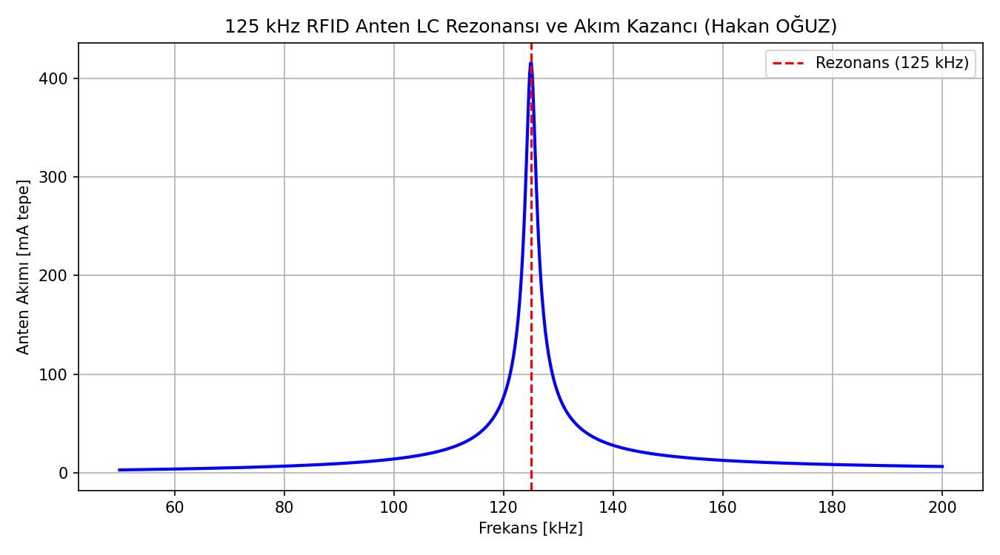
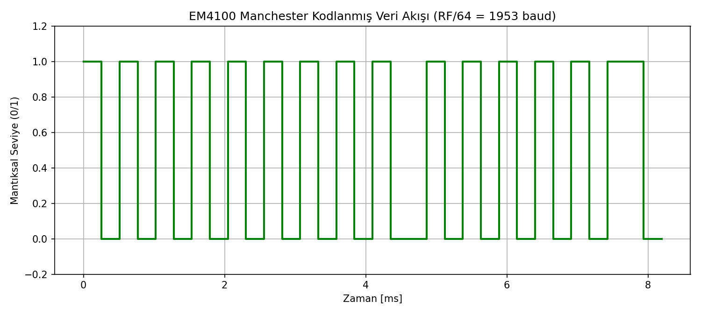
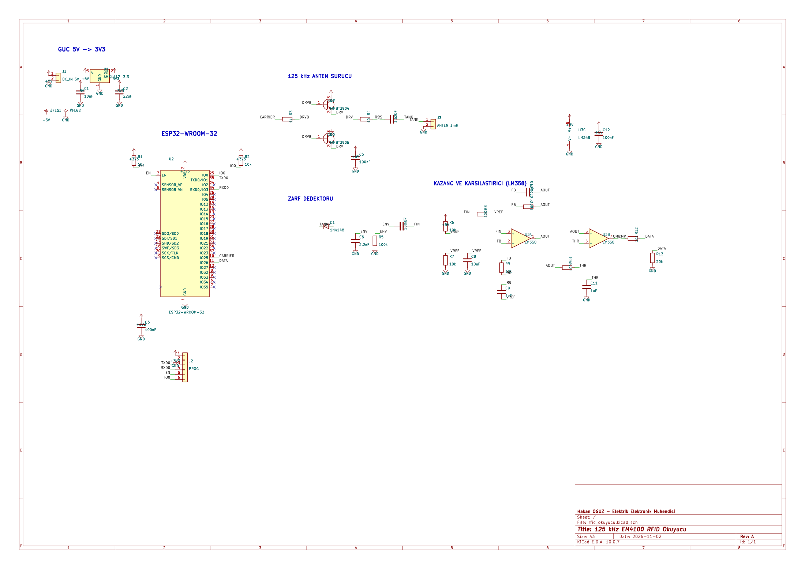

# 125 kHz EM4100 RFID Okuyucu ve Manchester Kod Çözücü

125 kHz LC rezonans anten sürücüsü, 1N4148 diyotlu tepe zarf dedektörü, aktif bant geçiren filtre ve EM4100 64-bit protokolüne uygun Manchester kod çözme ve 2D parite doğrulama algoritması.

Geliştiren: **Hakan OĞUZ — Elektrik Elektronik Mühendisi**




## Neden bu proje

Personel geçiş kontrol sistemlerinde (turnikeler, kapı kilitleri) ve endüstriyel takipte yaygın kullanılan 125 kHz RFID teknolojisi; manyetik endüktif kuplaj ile kartsız/pilsiz pasif etiketleri besler ve yük modülasyonu (load modulation) ile veriyi okuyucuya geri yansıtır. Hazır RFID modülü kullanmak yerine, bobin rezonansından başlayarak zarf dedektörü ve mikrodenetleyici düzeyinde Manchester kod çözücü mimarisini sıfırdan kurmak donanım-haberleşme entegrasyon yetkinliğini gösterir.

Buradaki amaç:
1. $L = 1.0\text{ mH}$ hava aralıklı anten bobini ve $C = 1.62\text{ nF}$ polipropilen kapasitör ile $125.0\text{ kHz}$ LC rezonans devresi tasarlamak ($Q \approx 65$),
2. Kart bobini yaklaştığında oluşan $\%5 - \%10$'luk genlik modülasyonunu (ASK) 1N4148 zarf dedektörü ve LM358 karşılaştırıcı ile sayısal darbelere dönüştürmek,
3. 64-bitlik EM4100 veri akışını (9 öncül bit, 10 satır nibble'ı, 10 satır paritesi, 4 sütun paritesi ve 1 durma biti) ayrıştırmak ve 10 haneli kart seri numarasını hatasız okumaktır.

## EM4100 Veri Çerçeve Mimarisi

Toplam 64 bit şu şekilde düzenlenmiştir:
- **9 Bit Öncül (Header):** `111111111`
- **10 Satır Veri:** $10 \times (4\text{ Veri Biti} + 1\text{ Çift Satır Parite Biti}) = 50\text{ bit}$
- **4 Sütun Parite Biti:** 10 satırın sütun bazlı çift paritesi
- **1 Durma Biti:** `0`



## Dosya Yapısı

```
rfid-125khz-em4100-okuyucu/
├── README.md
├── firmware/
│   ├── em4100_decoder.h        # EM4100 veri tipleri ve fonksiyon prototipleri
│   └── em4100_decoder.c        # 2D parite ve Manchester çözücü kaynak kodu
├── donanim/
│   └── rfid_okuyucu.kicad_sch  # Anten sürücü, zarf dedektörü ve LM358 ön katı
├── sim/
│   └── rfid_simulasyon.py      # LC rezonans akım ve Manchester zamanlama simülatörü
└── sekiller/
    ├── anten_rezonans_egrisi.png
    └── manchester_dalga_sekli.png
```

Doğrulama betiği doğrudan çalıştırılabilir:
```bash
python sim/rfid_simulasyon.py
```

## Donanım (KiCad)

`donanim/rfid_okuyucu.kicad_sch`: ESP32 LEDC çıkışı (IO25) 125 kHz kare dalga üretir; MMBT3904/
MMBT3906 tamamlayıcı emitör izleyici 10 Ω + 1.62 nF üzerinden 1 mH anten bobinini seri rezonansta
sürer. Tank gerilimi 1N4148 ve 2.2 nF / 100 kΩ ile zarf olarak alınır, 100 nF ile DC'den ayrılıp
2.5 V referansa oturtulur. LM358'in ilk yarısı yaklaşık 11 kat kazançlı (220 pF ile ~7 kHz üst kesim)
yükselteç, ikinci yarısı kendi çıkışının 100 kΩ / 1 µF ortalamasını eşik alan karşılaştırıcıdır.
Karşılaştırıcı çıkışı 10 kΩ / 20 kΩ bölücüyle 3.3 V seviyesine indirilip IO26'dan okunur ve
`em4100_decoder.c` ile çözülür. ERC: 0 ihlal. Şema baskısı `rfid_okuyucu.pdf`, malzeme listesi
`rfid_okuyucu-bom.csv`.


