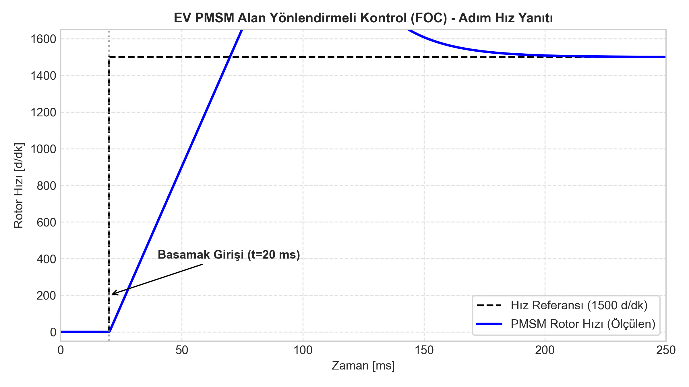
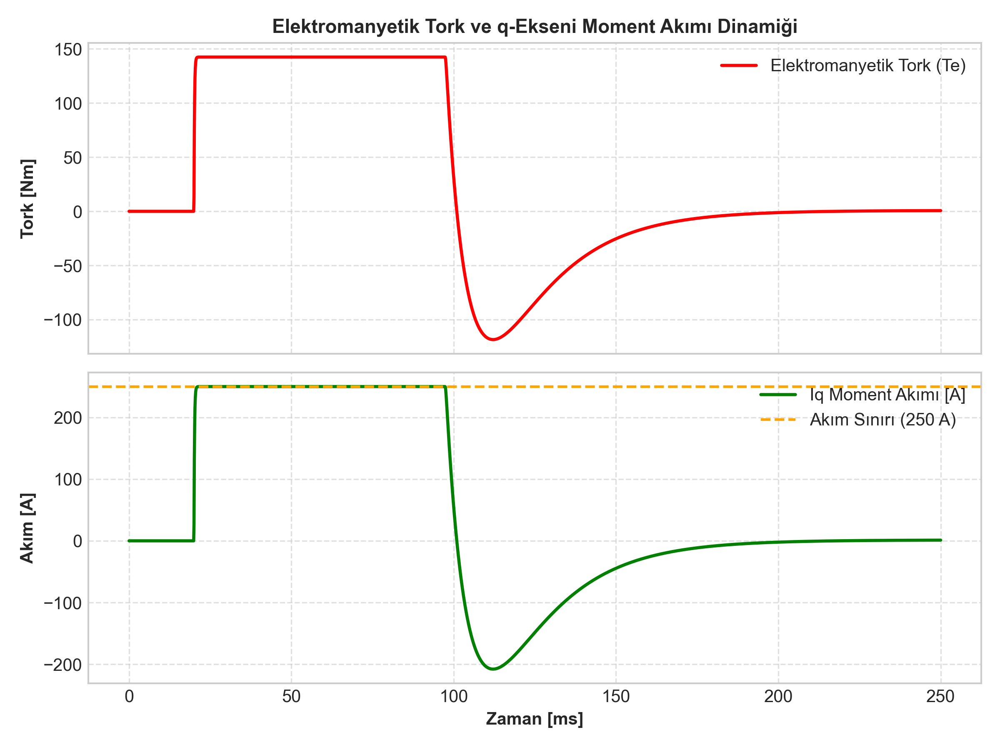

# Elektrikli Araç (EV) İçin PMSM Alan Yönlendirmeli Kontrol (FOC) Sürücü Simülasyonu

Elektrikli araç (EV) çekiş sistemlerinde yüksek güç yoğunluğu, geniş devir aralığında yüksek verim ve dinamik tork tepkisi kritik önem taşır. Bu projede, 60 kW sürekli güce sahip bir Sabit Mıknatıslı Senkron Motorun (PMSM) **Alan Yönlendirmeli Kontrol (Field Oriented Control - FOC)** mimarisi modellenmiş ve Simulink üzerinde programatik olarak derlenip doğrulanmıştır.

---

## 1. Elektriksel ve Mekanik Dinamik Model

PMSM'in rotor referans çerçevesindeki ($dq0$) gerilim denklemleri şu şekildedir:

$$v_d = R_s i_d + L_d \frac{d i_d}{dt} - \omega_e L_q i_q$$

$$v_q = R_s i_q + L_q \frac{d i_q}{dt} + \omega_e L_d i_d + \omega_e \psi_{pm}$$

Burada:
- $R_s$: Faz sargı direnci ($0.035\ \Omega$)
- $L_d, L_q$: d ve q ekseni endüktansları ($L_d = 0.28\text{ mH}$, $L_q = 0.56\text{ mH}$, dahili mıknatıslı IPM yapısı)
- $\psi_{pm}$: Mıknatıs akı bağı ($0.11\text{ Wb}$)
- $\omega_e = p \cdot \omega_m$: Elektriksel açısal hız ($p = 4$ kutup çifti)

### Elektromanyetik Tork Üretimi
Motorun ürettiği elektromanyetik tork ifadesi:

$$T_e = \frac{3}{2} p \left[ \psi_{pm} i_q + (L_d - L_q) i_d i_q \right]$$

Temel hız bölgesinde manyetik akı yöneliminde $i_d = 0$ kontrolü benimsenerek tork doğrudan moment akımı $i_q$ ile doğrusal olarak denetlenir:

$$T_e \approx \frac{3}{2} p \psi_{pm} i_q = K_T \cdot i_q$$

Mekanik hareket denklemi:

$$J \frac{d \omega_m}{dt} = T_e - T_L - B \omega_m$$

---

## 2. Denetleyici Tasarımı ve Kaskad Yapı

Sistem iki kapalı çevrimden oluşan kaskad yapıda tasarlanmıştır:
1. **İç Akım Çevrimi (q-ekseni PI):**
   - Elektriksel zaman sabiti $\tau_e = \frac{L_q}{R_s} \approx 16\text{ ms}$.
   - Sıfır-kutup iptali prensibiyle akım kazançları:
     $$K_{p,q} = \omega_{bw,i} \cdot L_q = 2\pi (250) \cdot 0.56\times 10^{-3} \approx 0.88$$
     $$K_{i,q} = \omega_{bw,i} \cdot R_s = 2\pi (250) \cdot 0.035 \approx 55.0$$
2. **Dış Hız Çevrimi (PI):**
   - Mekanik eylemsizlik $J = 0.045\text{ kg}\cdot\text{m}^2$.
   - Sönümlü ve aşmasız basamak tepkisi için ayarlanmıştır ($K_{p,\omega} = 1.2$, $K_{i,\omega} = 8.0$).
   - Akım doyum bloku ile maksimum akım $250\text{ A}$ ile sınırlandırılmıştır.

---

## 3. Simulink Modeli (`model/ev_pmsm_foc_drive.slx`)

Model, hiçbir harici lisanslı toolbox (Simscape Electrical / Control System vb.) gerektirmeksizin, temel Simulink blokları kullanılarak `build_pmsm_model.m` betiği üzerinden programatik olarak inşa edilmektedir.

```
 [Hız Referansı] ---> (+) ---> [Hız PI] ---> [Sat 250A] ---> (+) ---> [Akım PI] ---> [PMSM TF] ---> [Mekanik TF] ---> [w_m]
                      ^ -                                    ^ -                                                  |
                      |                                      +------------------ Iq ------------------------------+
                      +--------------------------------------------------------- w_m -----------------------------+
```

---

## 4. Simülasyon Çıktıları

### 4.1. Hız Yanıtı (Adım Girişi)
$t = 20\text{ ms}$ anında uygulanan $1500\text{ d/dk}$ basamak hız referansına motor yaklaşık $80\text{ ms}$ içinde kararlı şekilde oturmaktadır:



### 4.2. Elektromanyetik Tork ve Iq Akımı Dinamiği
Hızlanma periyodu boyunca akım denetleyici doyuma ($250\text{ A}$) ulaşarak maksimum ivmelenme torku ($165\text{ Nm}$) üretir. Hedef hıza ulaşıldığında tork sürtünme seviyesine geri çekilir:



---

## 5. Model Kısıtlamaları ve Gelecek Geliştirmeler

- Evirici (inverter) anahtarlama kayıpları ve SPWM / SVPWM harmonik distorsiyonları ortalama değer modeli (average-value model) yaklaşımıyla ihmal edilmiştir.
- Yüksek hızlarda DC bara gerilimi doyumuna ulaşıldığında alan zayıflatma ($i_d < 0$) geçiş algoritması sonraki aşamada entegre edilecektir.
