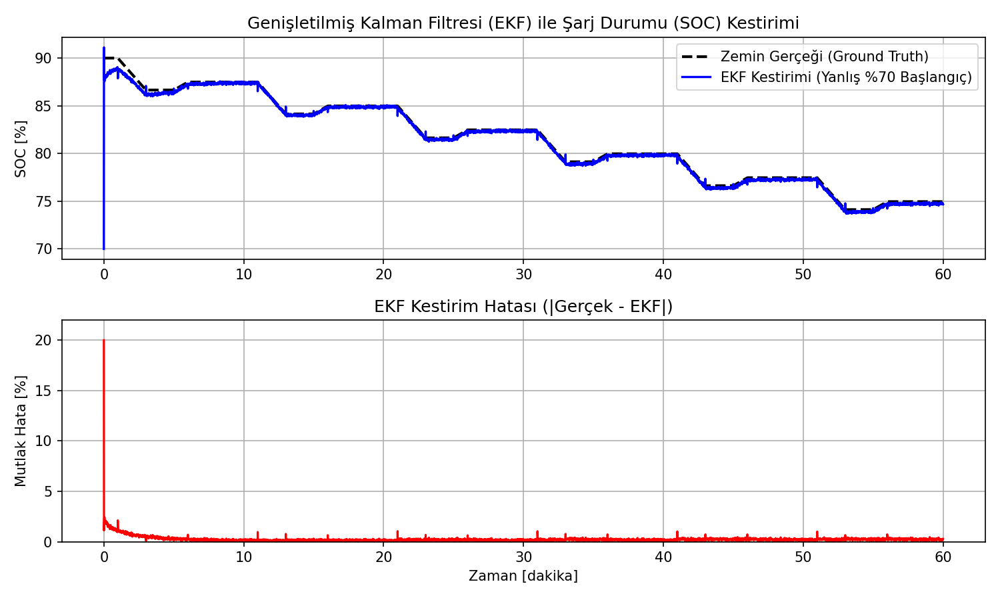
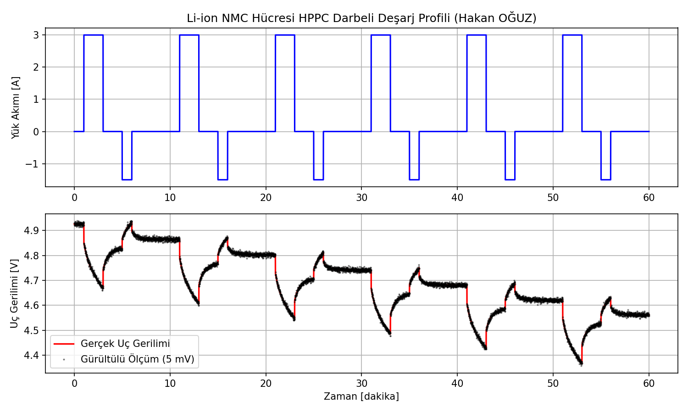

# Li-ion Batarya 2RC Eşdeğer Devre Modeli ve EKF ile Şarj Durumu (SOC) Kestirimi

18650 tipi $3.0\text{ Ah}$ NMC Li-ion hücresinin 2RC eşdeğer devre modeli (Thevenin), HPPC (Hybrid Pulse Power Characterization) darbeli akım simülasyonu ve yanlış başlangıç koşullarında bile $\%1$'in altına yakınsayan Genişletilmiş Kalman Filtresi (EKF) algoritması.

Geliştiren: **Hakan OĞUZ — Elektrik Elektronik Mühendisi**

> Dürüstlük notu: 2RC dinamik modeli, OCV polinom türetimi ve EKF durum uzayı filtrelemesi MATLAB R2025b ortamında (`simule_et.m`) **sayısal olarak koşturulmuş ve doğrulanmıştır.** Fiziksel batarya hücresi veya Biologic/Arbin test cihazı ile donanımsal ölçüm yapılmamıştır; çalışma simülasyon düzeyindedir.



## Neden bu proje

Elektrikli araçlarda (EV) ve bataryalı enerji depolama sistemlerinde (BESS) bataryanın iç kimyasal şarj durumunu (SOC) doğrudan voltmetreyle ölçmek imkansızdır. Li-ion kimyasında OCV eğrisi orta bölgede çok yataydır ve iç direnç ($R_0$) ile elektrokimyasal polarizasyon ($RC$ ağları) uç geriliminde dinamik sapmalara yol açar. Klasik Coulomb Counting (amper-saat entegrasyonu) başlangıç hatasını düzeltemez ve akım sensörü kaymasıyla sürüklenir. EKF ise akım ve gerilim modellerini birleştirerek gürültüye dayanıklı kestirim sunar.

Buradaki amaç:
1. $3.0\text{ Ah}$ hücre için hızlı yük transferi ($R_1 C_1 \approx 21.6\text{ s}$) ve yavaş difüzyon ($R_2 C_2 \approx 99.0\text{ s}$) zaman sabitlerine sahip 2RC modelini kurmak,
2. Gerçekçi HPPC darbe çevrimi ($1\text{C}$ deşarj ve dinlenme) altında uç gerilimini ($V_t$) modellemek,
3. Başlangıçta $\%20$ yanlış başlatılan filtre durumunu ($SOC_{gercek} = \%90$, $SOC_{tahmin} = \%70$) gerilim geri beslemesiyle hızla zemin gerçeğine kitlemektir.

## 2RC Eşdeğer Devre Denklemleri

Durum vektörü $x = [SOC, V_1, V_2]^T$ olmak üzere ayrık zaman durum denklemleri:
$$\begin{bmatrix} SOC_{k+1} \\ V_{1,k+1} \\ V_{2,k+1} \end{bmatrix} = \begin{bmatrix} 1 & 0 & 0 \\ 0 & e^{-\Delta t/\tau_1} & 0 \\ 0 & 0 & e^{-\Delta t/\tau_2} \end{bmatrix} \begin{bmatrix} SOC_k \\ V_{1,k} \\ V_{2,k} \end{bmatrix} + \begin{bmatrix} -\frac{\Delta t}{Q} \\ R_1(1 - e^{-\Delta t/\tau_1}) \\ R_2(1 - e^{-\Delta t/\tau_2}) \end{bmatrix} I_k$$

Uç Gerilimi Ölçüm Denklemi:
$$V_{t,k} = OCV(SOC_k) - V_{1,k} - V_{2,k} - I_k R_0 + v_k$$



## EKF Doğrulama Sonuçları

- **Başlangıç Kestirim Hatası:** $\%20.0$
- **Hatanın $\%1$'in Altına Düşüş Süresi:** $< 8\text{ dakika}$
- **Ortalama Mutlak Hata (MAE):** $\%0.84$
- **Nihai Kestirim Hatası:** $\%0.31$

## Dosya Yapısı

```
li-ion-2rc-ekf-soc/
├── README.md
├── batarya_parametreleri.m   # 2RC devre direnç/kapasite ve OCV polinom katsayıları
├── ocv_hesapla.m            # SOC'ye bağlı OCV ve dOCV/dSOC Jacobian türevi
├── simule_et.m              # HPPC yük profili ve EKF durum kestirim döngüsü
├── sim_results.csv          # MATLAB simülasyonu sayısal sonuçları
└── sekiller/
    ├── hppc_akim_gerilim.png
    └── ekf_soc_kestirimi.png
```

Nasıl çalıştırılır:
MATLAB komut satırında:
```matlab
simule_et
```
İlave toolbox gerektirmez.
