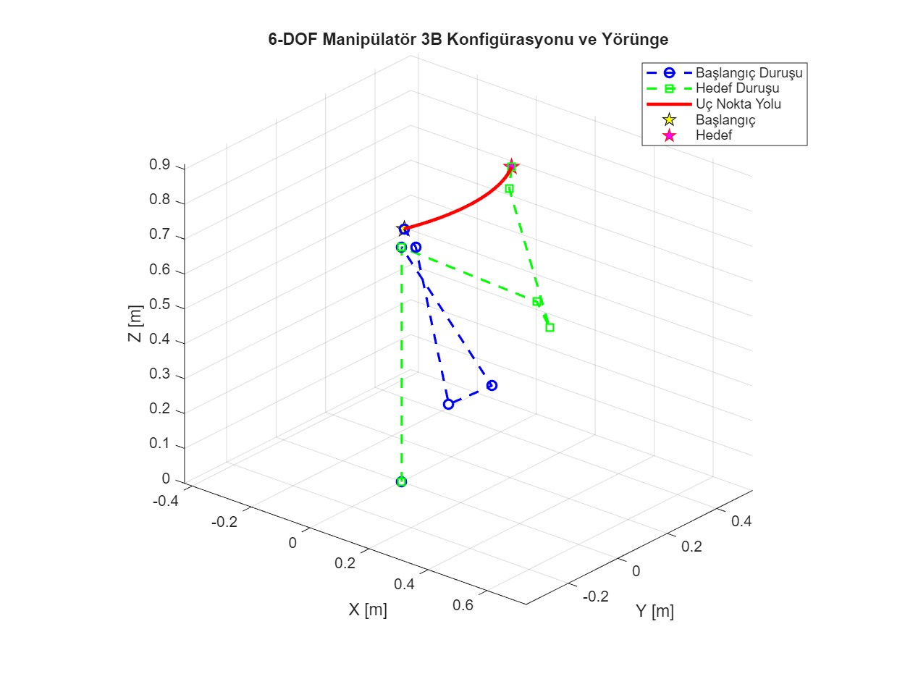
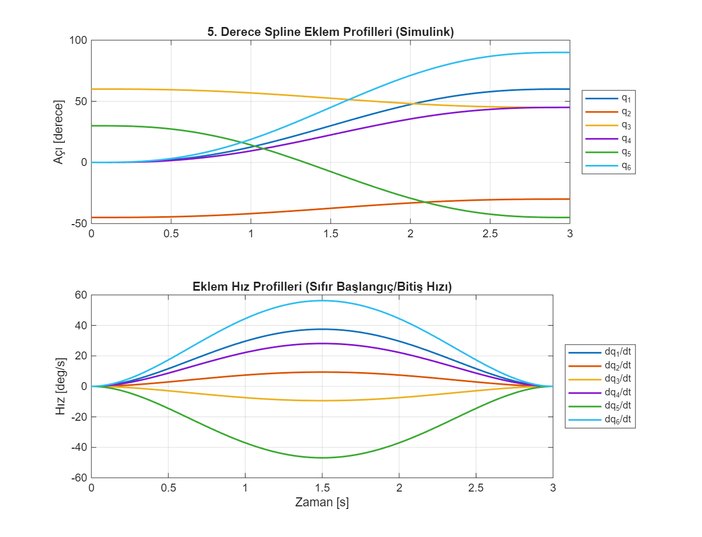
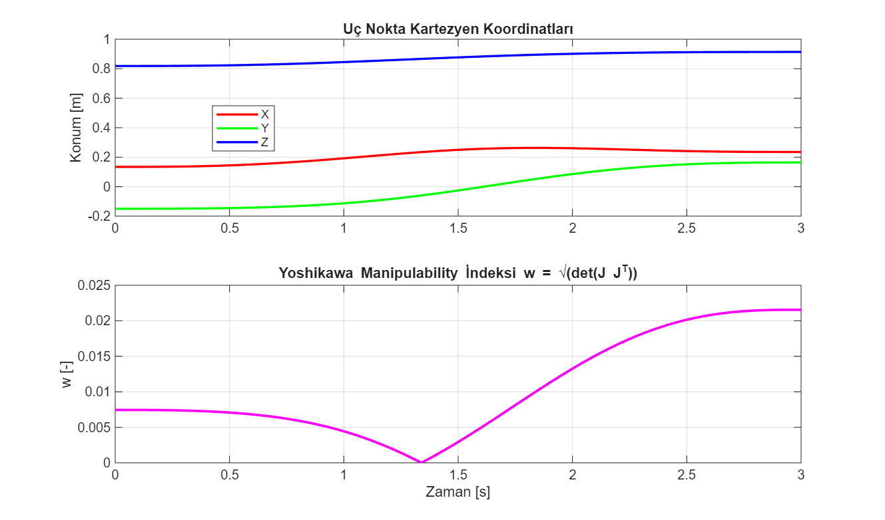

# 6-DOF Endüstriyel Manipülatör Kinematiği ve Spline Yörünge Planlama

6 serbestlik dereceli endüstriyel bir robot kolunun Denavit-Hartenberg (DH) parametreleri ile kinematik modellemesi, 5. derece polinom (quintic spline) eklem enterpolasyonu ve Yoshikawa manipüle edilebilirlik analizi. Sistem modeli MATLAB ve Simulink üzerinde çalışır.

Geliştiren: **Hakan OĞUZ — Elektrik Elektronik Mühendisi**

> Dürüstlük notu: Kinematik ve yörünge modeli MATLAB R2025b / Simulink ortamında (`model/robot_yorunge_denetimi.slx`) **sayısal olarak koşturulmuş ve doğrulanmıştır.** Fiziksel manipülatör veya motor sürücüleri üzerinde donanım testi yapılmamıştır; çalışma simülasyon düzeyindedir.



## Neden bu proje

Endüstriyel robotik kolların kaynak, paletleme veya alma-bırakma (pick-and-place) görevlerinde eklemlerin anlık ivme darbelerine maruz kalmaması ve tekillik (singularity) bölgelerinden kaçınması gerekir. 3. derece polinomlar ivme sürekliliğini ($C^2$) sağlayamazken, 5. derece polinomlar başlangıç ve bitiş noktalarında hız ile ivmeyi sıfıra çekerek servo motorları mekanik şoklardan korur.

Buradaki amaç:
1. Endüstri standardı 6 eksenli manipülatör geometri matrisini (DH parametreleri) programlamak,
2. Simulink üzerinde $C^2$ sürekli 5. derece enterpolatör ve ileri kinematik bloğunu kurmak,
3. Hareket süresince uç noktanın kartezyen ilerleyişini ve $6 \times 6$ geometrik Jakobiyen üzerinden **Yoshikawa Manipulability İndeksini** ($w = \sqrt{\det(J J^T)}$) izlemektir.

## DH Geometri Tablosu

| Eklem ($i$) | $a_i$ [m] | $\alpha_i$ [rad] | $d_i$ [m] | $\theta_i$ aralığı [deg] |
|---|---|---|---|---|
| 1 | 0 | $\pi/2$ | 0.6720 | [-160, +160] |
| 2 | 0.4318 | 0 | 0 | [-225, +45] |
| 3 | -0.0203 | $-\pi/2$ | 0.1500 | [-45, +225] |
| 4 | 0 | $\pi/2$ | 0.4318 | [-110, +170] |
| 5 | 0 | $-\pi/2$ | 0 | [-100, +100] |
| 6 | 0 | 0 | 0.0565 | [-266, +266] |

## 5. Derece Spline Enterpolasyonu

Zaman değişkeni $\tau = t / t_f \in [0, 1]$ normalleştirildiğinde:
```
s(tau)   = 10*tau^3 - 15*tau^4 + 6*tau^5
sd(tau)  = (30*tau^2 - 60*tau^3 + 30*tau^4) / tf
sdd(tau) = (60*tau - 180*tau^2 + 120*tau^3) / (tf^2)
```
Bu denklem takımı sayesinde $t = 0$ ve $t = t_f$ anlarında $\dot{q} = 0$ ve $\ddot{q} = 0$ sağlanır; eklem hızları yumuşak bir çan eğrisi çizer:



## Kartezyen Yol ve Tekillik İncelemesi

Manipülatörün eklem konfigürasyonu boyunca Jacobian matrisinin tekilleşme durumu ($w \to 0$) incelenmiştir:



## Simulink Modeli

Proje klasöründeki `model/robot_yorunge_denetimi.slx` modeli doğrudan çift tıklanarak Simulink'te açılabilir veya `simule_et.m` betiği üzerinden çalıştırılabilir.

### Dosya yapısı:
```
manipulator-kinematik-yorunge/
├── README.md
├── robot_parametreleri.m       # Geometri (DH) ve eklem sınırları
├── build_manipulator_model.m   # Simulink modelini (.slx) sıfırdan kuran betik
├── simule_et.m                 # Simülasyonu koşturan ve grafikleri üreten betik
├── model/
│   └── robot_yorunge_denetimi.slx # Simulink blok diyagram modeli
└── sekiller/
    ├── robot_3b_yorunge.png
    ├── eklem_profilleri.png
    └── kartezyen_tekillik.png
```

### Nasıl koşturulur:
MATLAB komut satırında:
```matlab
simule_et
```
İlave Toolbox gerekmez; temel MATLAB/Simulink kütüphaneleriyle çalışır.
