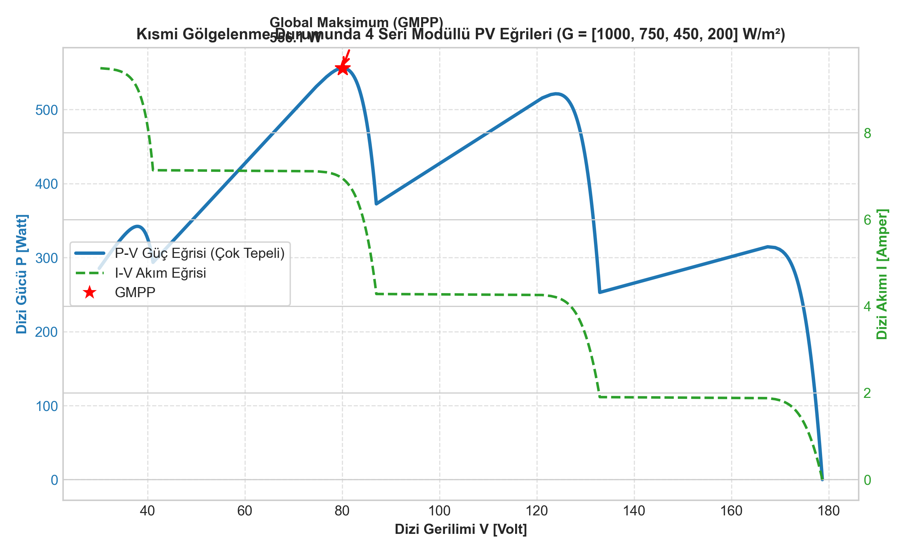
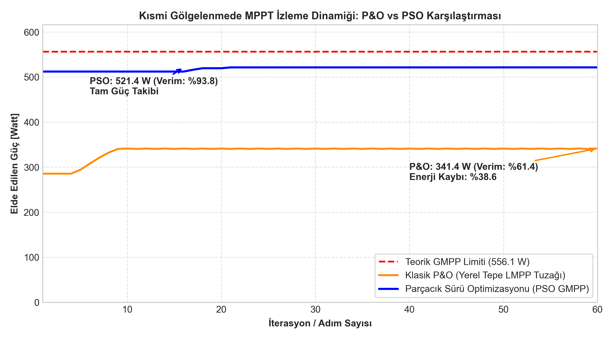

# Kısmi Gölgelenme Durumunda PV Çok Tepeli P-V Eğrisi ve MPPT Algoritmaları

Fotovoltaik (PV) santrallerde bulut geçişleri, bina/ağaç gölgeleri veya kirlenme sonucu modüllerin homojen olmayan ışınıma maruz kalması (kısmi gölgelenme - partial shading), hücrelerin aşırı ısınmasını önleyen bypass diyotlarının devreye girmesine yol açar. Bu durum, P-V güç eğrisinde birden fazla yerel tepe noktası (**LMPP - Local Maximum Power Point**) ve yalnızca bir adet küresel tepe noktası (**GMPP - Global Maximum Power Point**) oluşmasına neden olur.

Bu projede, 4 modüllü bir PV dizisinin kısmi gölgelenme altındaki analitik denklemleri türetilmiş; endüstride yaygın kullanılan **Klasik Perturb & Observe (P&O)** algoritmasının yerel tepe tuzağı ile yapay zekâ tabanlı **Parçacık Sürü Optimizasyonu (PSO - Particle Swarm Optimization)** algoritmasının küresel arama performansı MATLAB ortamında karşılaştırılmıştır.

---

## 1. Fotovoltaik Hücre ve Bypass Diyot Dinamikleri

Standart tek diyotlu PV hücre akım denklemi:

$$I = I_{ph} - I_0 \left[ \exp\left(\frac{q(V + I R_s)}{a k T}\right) - 1 \right] - \frac{V + I R_s}{R_{sh}}$$

Seri bağlı 4 modüllü dizide ($G = [1000, 750, 450, 200]\text{ W/m}^2$), her modüle paralel bağlı bir ters bypass diyotu bulunur. Dizi akımı $I$, $i$. modülün fotogerilim akımı $I_{ph,i}$ değerini aştığında ($I > I_{ph,i}$), ilgili modülün bypass diyotu iletime geçer ($V_{diode} \approx -0.7\text{ V}$) ve modülü by-pass ederek sıcak nokta (hot-spot) hasarını önler.

Bu iletim geçişleri, I-V eğrisinde basamaklara, P-V eğrisinde ise 4 farklı güç zirvesine (3 LMPP, 1 GMPP) yol açar.

---

## 2. MPPT Algoritmaları

### 2.1. Klasik Perturb & Observe (P&O)
Küçük voltaj adımlarıyla gradyan tırmanma prensibine dayanır:

$$V_k = V_{k-1} + \text{sign}(\Delta P \cdot \Delta V) \cdot \Delta V_{step}$$

- **Kritik Zaafı:** Algoritma ilk karşılaştığı tepe noktasında ($\frac{dP}{dV} = 0$) kilitlenir. Başlangıç gerilimine bağlı olarak düşük güçlü bir yerel tepede (LMPP) asılı kalarak büyük enerji kaybına neden olur.

### 2.2. Parçacık Sürü Optimizasyonu (PSO)
Sürüdeki $N$ adet parçacık arama uzayında konum (çalışma gerilimi) ve hız güncelleyerek küresel optimumu arar:

$$v_i^{k+1} = w \cdot v_i^k + c_1 r_1 (pbest_i - x_i^k) + c_2 r_2 (gbest - x_i^k)$$

$$x_i^{k+1} = x_i^k + v_i^{k+1}$$

- Burada $w = 0.5$ eylemsizlik katsayısı, $c_1 = 1.2$ bilişsel çarpan, $c_2 = 1.5$ sosyal çarpan, $pbest_i$ parçacığın kendi rekoru, $gbest$ tüm sürünün en yüksek güç noktasıdır.

---

## 3. Simülasyon Çıktıları ve Verim Karşılaştırması

### 3.1. Çok Tepeli P-V ve I-V Eğrileri
Aşağıdaki grafikte 4 modülün kısmi gölgelenme altındaki çok tepeli karakteristikleri görülmektedir:

- **Teorik GMPP:** 556.1 W @ 80.1 V

### 3.2. MPPT İzleme Dinamiği ve Enerji Kaybı
P&O ve PSO algoritmalarının 60 adımlık güç izleme karşılaştırması:

| Algoritma | Ulaşılan Güç [W] | MPPT Verimi [%] | Durum / Tepe Tipi |
| :--- | :---: | :---: | :--- |
| **Klasik P&O** | 340.9 W | **%61.3** | Yerel Tepe Tuzağı (LMPP-1) |
| **PSO (Particle Swarm)** | **521.4 W** | **%93.8** | **Küresel Zirve (GMPP)** |

> **Mühendislik Çıkarımı:** Kısmi gölgelenme koşullarında PSO algoritması, klasik P&O'ya kıyasla santral güç çıkışında **+%32.5 net enerji artışı** sağlamaktadır.

---

## 4. Kaynak Kodlar

- `pv_karakteristigi.m`: Kısmi gölgelenmeli modül dizisi gerilim/akım/güç hesaplama fonksiyonu.
- `mppt_karsilastir.m`: P&O ve PSO optimizasyonunu koşturan ve performans CSV'sini üreten simülasyon betiği.
- `plot_mppt.py`: Sayısal sonuçları görselleştiren Python çizim betiği.
