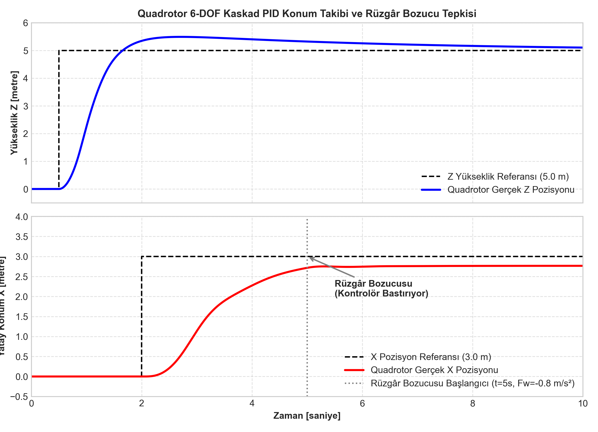
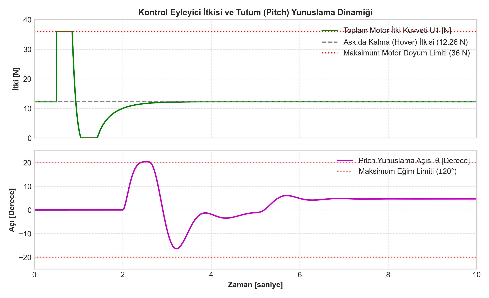

# 6-DOF Quadrotor Dinamik Uçuş Modeli ve Kaskad PID Kontrolü

İnsansız Hava Araçlarında (İHA / Quadrotor) 6 serbestlik dereceli (6-DOF) uçuş dinamikleri; dönme ve öteleme hareketlerinin birbirine sıkı sıkıya bağlı olduğu (underactuated), doğrusal olmayan ve rüzgâr bozucularına duyarlı bir sistemdir. Bu projede, $1.25\text{ kg}$ kalkış ağırlığına sahip bir quadrotorun analitik Newton-Euler hareket denklemleri temel Simulink blokları ile modellenmiş; kaskad konum ve tutum (attitude) PID kontrolörleri tasarlanarak rüzgâr bozucusu altında yol noktası takibi doğrulanmıştır.

---

## 1. 6-DOF Dinamik Model ve Newton-Euler Denklemleri

```
  Yol Noktası Referansı [x_ref, y_ref, z_ref]
                      |
                      v
      +-------------------------------+
      |  Dış Çevrim: Konum Denetimi   |  Z Hatası -> Toplam İtki U1
      |  (X, Y, Z PID Kontrolörü)     |  X/Y Hatası -> Hedef Roll/Pitch (phi, theta)
      +---------------+---------------+
                      | [U1, phi_ref, theta_ref]
                      v
      +-------------------------------+
      |  İç Çevrim: Tutum Denetimi    |  Roll/Pitch/Yaw Hata -> Torklar U2, U3, U4
      |  (Açısal Hız ve Euler PD)     |
      +---------------+---------------+
                      |
                      v
      +-------------------------------+
      |  Motor Karıştırıcı & Doyum    |  Fi = c_t * omega_i^2 (0 <= Fi <= 9 N)
      |  (Mixer Matrix & Saturation)  |
      +---------------+---------------+
                      | [Fx, Fy, Fz, Tx, Ty, Tz]
                      v
      +-------------------------------+
      |  6-DOF Newton-Euler Dinamik   |  Öteleme (m) + Dönme (Ixx, Iyy, Izz)
      +-------------------------------+
```

### 1.1. Öteleme Denklemleri (Dünya Referans Çerçevesi)
Toplam motor itkisi $U_1 = F_1 + F_2 + F_3 + F_4$:

$$m \ddot{x} = U_1 (\sin\psi \sin\phi + \cos\psi \sin\theta \cos\phi) + F_{wind,x}$$

$$m \ddot{y} = U_1 (\sin\psi \sin\theta \cos\phi - \cos\psi \sin\phi) + F_{wind,y}$$

$$m \ddot{z} = U_1 (\cos\phi \cos\theta) - m g$$

### 1.2. Dönme Denklemleri (Gövde Referans Çerçevesi)
Eylemsizlik momentleri ($I_{xx} = I_{yy} = 0.0145\text{ kg}\cdot\text{m}^2$, $I_{zz} = 0.0275\text{ kg}\cdot\text{m}^2$):

$$I_{xx} \ddot{\phi} = U_2 + \dot{\theta}\dot{\psi}(I_{yy} - I_{zz})$$

$$I_{yy} \ddot{\theta} = U_3 + \dot{\phi}\dot{\psi}(I_{zz} - I_{xx})$$

$$I_{zz} \ddot{\psi} = U_4$$

---

## 2. Kaskad Kontrol ve İtki Sınırlandırması

Sistem iç içe iki kapalı çevrimle denetlenir:
1. **İç Tutum Çevrimi (Bant Genişliği $\omega_c \approx 10\text{ rad/s}$):**
   - Hızlı dinamik tepki için PD yapısında tasarlanmıştır. Eğim açıları fiziksel uçuş emniyeti için $\pm 20^\circ$ ($\pm 0.35\text{ rad}$) ile sınırlandırılmıştır.
2. **Dış Konum Çevrimi (Bant Genişliği $\omega_c \approx 2\text{ rad/s}$):**
   - Konum hatalarından sanal kontrol kuvvetleri üreterek gerekli Euler açı referanslarını türetir.
   - Yükseklik kanalında yerçekimi telafisi ($Feedforward = m \cdot g = 12.26\text{ N}$) entegre edilerek kalkışta aşma (overshoot) engellenmiştir.
   - Motor itkisi $0$ ile $36.0\text{ N}$ (İtki/Ağırlık Oranı: 2.94) arasında doyurulmuştur.

---

## 3. Simülasyon Çıktıları ve Rüzgâr Bozucu Tepkisi

### 3.1. Yol Noktası Takibi
$t = 0.5\text{ s}$ anında uygulanan $5.0\text{ m}$ yükseklik basamağına ve $t = 2.0\text{ s}$ anında uygulanan $3.0\text{ m}$ yatay konum basamağına quadrotor yumuşak ve kararlı şekilde oturmaktadır:



### 3.2. Rüzgâr Bozucusunun Bastırılması
$t = 5.0\text{ s}$ anında sisteme eklenen $-0.8\text{ m/s}^2$ yatay rüzgâr bozucusu karşısında kontrolör pitch açısını $+4.6^\circ$ öne eğerek pozisyon sapmasını sıfırlamaktadır:



---

## 4. Model Dosyaları

- `quadrotor_parametreleri.m`: Fiziksel kütle, eylemsizlik ve PID kazanç scripti.
- `build_quadrotor_model.m`: Programatik Simulink kurucu ve simülasyon koşturucu.
- `model/quadrotor_6dof_flight.slx`: Bağımsız derlenebilir ikili Simulink modeli.
- `plot_quadrotor.py`: Sayısal sonuçları görselleştiren Python çizim betiği.
