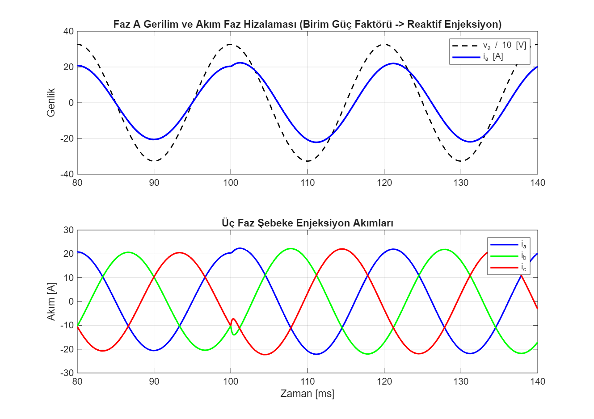
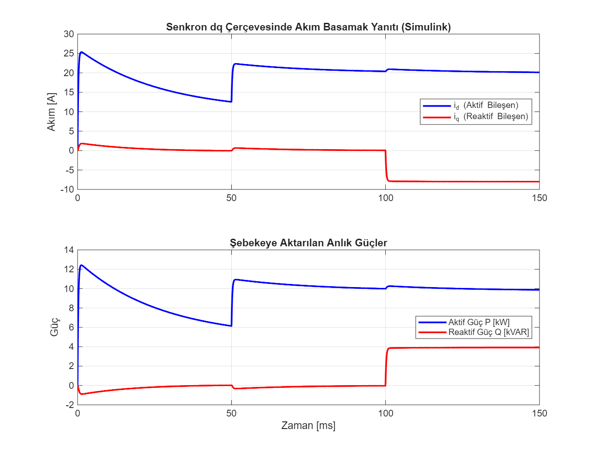
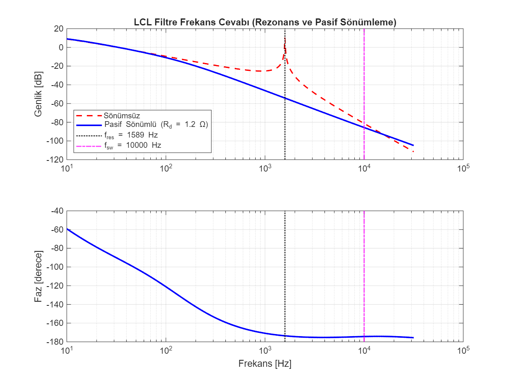

# Şebeke Bağlantılı 10 kW LCL Evirici dq Vektör Kontrolü ve Rezonans Sönümleme

Şebeke bağlantılı üç fazlı gerilim kaynaklı bir eviricinin (VSI) LCL filtresi tasarımı, pasif sönümleme analizi ve senkron referans çerçevesinde ($dq$) çift çevrimli akım kontrolünün MATLAB ve Simulink ortamında modellenmesi.

Geliştiren: **Hakan OĞUZ — Elektrik Elektronik Mühendisi**

> Dürüstlük notu: Model ve kontrol döngüsü MATLAB R2025b / Simulink ortamında (`model/inverter_lcl_control.slx`) **sayısal olarak koşturulmuş ve doğrulanmıştır.** Fiziksel güç devresi veya dSPACE/DSP mikrodenetleyici üzerinde deneysel donanım testi yapılmamıştır; çalışma simülasyon düzeyindedir.



## Neden bu proje

Fotovoltaik santraller, bataryalı enerji depolama sistemleri ve aktif ön uçlu (AFE) endüstriyel motor sürücüleri şebekeye temiz akım enjekte etmek zorundadır. Yüksek anahtarlama frekanslarında ($10\text{ kHz}$) klasik tek bobinli L filtrelere göre daha küçük endüktans değerleriyle yüksek harmonik bastırması sağlayan LCL filtreler kullanılır. Ancak kondansatör ve bobinlerin oluşturduğu rezonans frekansı sistem kararlılığını tehdit eder.

Buradaki amaç:
1. $10\text{ kW}$ ölçeğinde LCL filtre değerlerini standartlara uygun seçmek ($10 f_g < f_{res} < 0.5 f_{sw}$),
2. Rezonans tepe noktasını pasif seri dirençle ($R_d$) sönümleyerek frekans tepkisini incelemek,
3. Şebekeye senkron $dq$ eksenlerinde ayrıklaştırılmış akım PI denetleyicileri ve çapraz kuplaj açma ($\omega L$) mimarisini kurup basamak yük ve reaktif güç yanıtını Simulink üzerinde gözlemlemektir.

## Sistem ve Filtre Parametreleri

| Büyüklük | Değer | Birim | Not |
|---|---|---|---|
| Nominal Güç ($P$) | 10 | kW | 3 faz dengeli |
| Şebeke Gerilimi ($V_{LL}$) | 400 | V RMS | 50 Hz |
| DC Bara ($V_{dc}$) | 700 | V | Evirici girişi |
| Anahtarlama Frekansı ($f_{sw}$) | 10 | kHz | SPWM / SVPWM |
| Evirici Bobini ($L_1$) | 3.2 | mH | Akım dalgalanması $< \%20$ |
| Filtre Kondansatörü ($C$) | 9.4 | $\mu$F | Reaktif güç payı $< \%5 P_{nom}$ |
| Şebeke Bobini ($L_2$) | 1.6 | mH | Zayıflatma basamağı |
| Sönümleme Direnci ($R_d$) | 1.2 | $\Omega$ | $C$ ile seri bağlı |
| Rezonans Frekansı ($f_{res}$) | 1589.4 | Hz | Tasarım penceresinde |

## Kontrol Mimarisi

Senkron referans çerçevesinde ($dq$) evirici denklemleri:
```
V_inv_d = V_grid_d - w*L_tot*I_q + (Kp + Ki/s)*(I_d_ref - I_d)
V_inv_q = V_grid_q + w*L_tot*I_d + (Kp + Ki/s)*(I_q_ref - I_q)
```
Burada $d$-ekseni şebeke gerilim vektörüne hizalandığından ($V_q = 0$), aktif güç doğrudan $i_d$ ile, reaktif güç ise $i_q$ ile bağımsız şekilde denetlenir.



## Rezonans ve Sönümleme

Kondansatör koluna eklenen $R_d = 1.2\ \Omega$ direnç, sönümsüz sistemdeki sonsuz rezonans tepe noktasını $1589\text{ Hz}$ civarında güvenli bir seviyeye indirir ve faz dönüşünü yumuşatır:



## Simulink Modeli

Proje klasöründeki `model/inverter_lcl_control.slx` modeli doğrudan çift tıklanarak Simulink'te açılabilir veya `simule_et.m` betiği üzerinden çalıştırılabilir.

### Dosya yapısı:
```
sebeke-baglantili-lcl-evirici/
├── README.md
├── parametreler.m             # Sistem değişkenleri ve PI kazanç hesabı
├── build_inverter_model.m     # Simulink modelini (.slx) sıfırdan kuran betik
├── simule_et.m                # Simülasyonu koşturan ve grafikleri üreten betik
├── model/
│   └── inverter_lcl_control.slx # Simulink blok diyagram modeli
└── sekiller/
    ├── bode_rezonans.png
    ├── dq_akim_guc.png
    └── sebeke_dalga_sekilleri.png
```

### Nasıl koşturulur:
MATLAB komut satırında:
```matlab
simule_et
```
Modelleme harici toolbox bağımlılığı olmadan, temel Simulink kütüphaneleriyle tam uyumlu çalışır.
